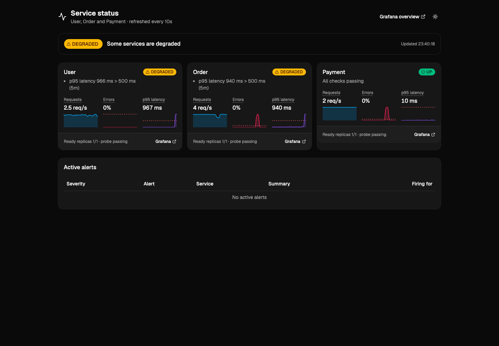
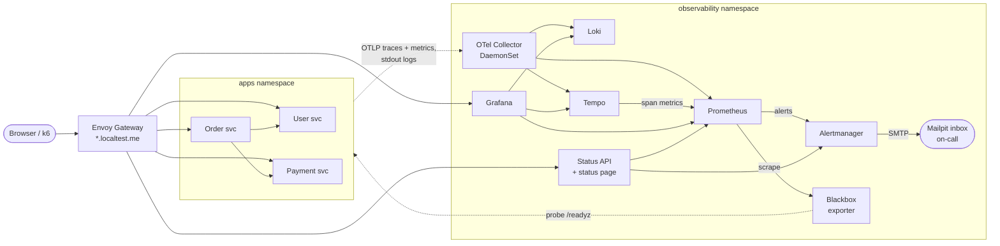

# Service Health Dashboard

A **lightweight observability solution** for three backend services (User, Order and Payment). It shows how R&D teams can:

1. **Collect** health and performance data: metrics, logs, traces and probe status
2. **Visualize** the current status of each service
3. **Detect** problems such as high error rates, slow responses or a service that is down
4. **Notify** an on-call engineer when a critical condition occurs

It is an architecture exercise that focuses on **design decisions and trade-offs**. It is also a demo you can reproduce on a laptop:
`make up` → break a service → see red status → receive an email.

> **Status: Phase 4 (visualization and Status API).** The design, the three instrumented services, the kind platform, the telemetry pipeline,
> Grafana with linked signals and two dashboards, the Status API and the status page are in place. Alert rules and email arrive in Phase 5.



## Documentation

| Document | What it covers |
|---|---|
| [Architecture](docs/architecture.md) | **The main deliverable.** Goals, the architecture, the five main data flows, trade-offs, probe design, alerting, the Status API contract, networking, security, and how the design evolves for production |
| [Diagrams](docs/diagrams/) | Mermaid sources (`.mmd`) and rendered SVG files |
| [Services](services/README.md) | Phase 1: endpoints, probes, fault injection, telemetry. Phase 4: the [Status API contract](services/README.md#status-api) |
| [Web](web/README.md) | Phase 4: pnpm monorepo with the shadcn/ui status page |
| [Local platform](deploy/README.md) | Phase 2: kind, Envoy Gateway, Helm chart, NetworkPolicies, CoreDNS, troubleshooting. Phase 3: telemetry pipeline and storage (Collector, Prometheus, Loki, Tempo, Grafana, blackbox, k6). Phase 4: Grafana correlations and dashboards, status page routing, `make verify` |

## Architecture overview



The services send traces and metrics over OTLP to a node-local OpenTelemetry Collector and write JSON logs to stdout.
The Collector fans the data out to Prometheus, Loki and Tempo. Prometheus also scrapes cluster health data and blackbox probes,
and evaluates the alerting rules. Alertmanager emails the on-call engineer, through Mailpit locally. Grafana is the tool engineers use to investigate,
and the Status API and status page give everyone else a simple UP, DEGRADED or DOWN view.
The [architecture document](docs/architecture.md) explains each flow.

## Tech stack

| Concern | Choice | Why |
|---|---|---|
| Services | Python 3.12, FastAPI | Small, readable services with first-class OpenTelemetry auto-instrumentation |
| Instrumentation | OpenTelemetry SDK (OTLP) | One vendor-neutral API for traces, metrics and logs |
| Collection | OpenTelemetry Collector (contrib) as a DaemonSet | Node-local agent that adds Kubernetes metadata and tails pod logs |
| Traces | Grafana Tempo with the metrics-generator | Cheap object-storage design, TraceQL, span metrics and the service graph |
| Metrics | Prometheus (kube-prometheus-stack): OTLP push and scrape, kube-state-metrics, blackbox exporter | The Kubernetes standard; native OTLP receiver plus target health and synthetic checks |
| Logs | Grafana Loki | Indexes labels only, so it stays light; same label model as Prometheus |
| Dashboards | Grafana (dashboards as code) | Linked signals: metric → exemplar trace → logs |
| Status view | Status API (FastAPI backend for frontend) and a status page in React, TypeScript, Vite, Tailwind and shadcn/ui | A small, stable UP / DEGRADED / DOWN contract for people who do not read PromQL |
| Alerting | Prometheus rules → Alertmanager → email (Mailpit) | Grouping, inhibition, silences and severity routing; the receiver is swappable |
| Edge | Envoy Gateway (Kubernetes Gateway API) on `*.localtest.me` | Gateway API standard with built-in OIDC and JWT policies |
| Identity (Phase 6) | Keycloak through the Keycloak Operator (`customers` and `ops` realms), Envoy Gateway OIDC and JWT | Open-source OIDC provider; realms keep customer and staff identities apart |
| Runtime and deployment | kind on Docker or Podman, Helm 4, helmfile, Makefile | Conformant Kubernetes on a laptop, one command to reproduce |
| Load | k6 | Steady, scriptable background traffic |

## Roadmap

| Phase | Scope | Exit criteria |
|---|---|---|
| **0** Foundations | Architecture document, ADRs, diagrams, repository setup | The design can be reviewed as the interview deliverable |
| **1** Services | FastAPI services, OTel, probes, fault injection, tests, compose | Tests pass. One order produces one distributed trace. |
| **2** Platform | kind, Makefile, Helm chart, Envoy Gateway, CoreDNS rewrite, NetworkPolicies | `make up`. `api.localtest.me` works from the host and from a pod. Readiness behaviour verified. |
| **3** Telemetry | Collector, Prometheus, Loki, Tempo, blackbox exporter, k6 | All three signals can be queried in Grafana, and the service graph is visible |
| **4** Visualization | Grafana dashboards and links between signals, Status API, shadcn/ui status page | An injected fault is visible within about one minute |
| **5** Alerting | Rules, Alertmanager to Mailpit, runbooks, `demo.sh` | Every failure scenario turns the status red and delivers an email |
| **6** Identity | Keycloak, HTTPS, OIDC and JWT, customer shop page | Customer login and order. SSO for engineers. `401` without a token. |
| **7** CI/CD | Placeholder: GitHub Actions CI and Argo CD | — |


## Local URLs

These are available **from Phase 2 onwards**. Each URL appears in the phase that adds its component. `*.localtest.me` resolves to `127.0.0.1` through public DNS (if your resolver filters that answer, use `/etc/hosts`; see [deploy/README.md](deploy/README.md#troubleshooting)).

| URL | What | From phase |
|---|---|---|
| http://api.localtest.me | User, Order and Payment APIs | 2 |
| http://grafana.localtest.me | Grafana | 3 |
| http://prometheus.localtest.me | Prometheus | 3 |
| http://alertmanager.localtest.me | Alertmanager | 3 |
| http://status.localtest.me | Status page; Status API on `/api` (e.g. `/api/v1/services`) | 4 |
| http://grafana.localtest.me/d/shd-overview | Grafana: Service Health Overview (and Service Detail) | 4 |
| http://mail.localtest.me | Mailpit (on-call inbox) | 5 |
| https://sso.localtest.me | Keycloak | 6 |
| https://shop.localtest.me | Customer shop page | 6 |

From Phase 6, every URL uses HTTPS.

## Prerequisites

- **Docker** (preferred), or **Podman** with a rootful machine of at least 4 CPUs and 8 GB of memory (kind's Podman provider is experimental)
- [kind](https://kind.sigs.k8s.io/) **0.33 or later**
- [kubectl](https://kubernetes.io/docs/tasks/tools/), within the supported version skew of the kind node image
- [Helm](https://helm.sh/) **4**
- [helmfile](https://helmfile.readthedocs.io/) and the [helm-diff](https://github.com/databus23/helm-diff) plugin
- Phase 1 local run: [uv](https://docs.astral.sh/uv/) and a compose provider (`docker compose`, or `podman compose` with `docker-compose` installed)
- Optional: [k6](https://grafana.com/docs/k6/latest/) to run `loadgen/scripts/orders.js` from the host (Phase 3 runs it in the cluster)
- Frontend development only (Phase 4, `make web-check`): Node.js ≥ 20.19 and [pnpm](https://pnpm.io/) 12. The images build without them.
- Later phases: [mkcert](https://github.com/FiloSottile/mkcert) (Phase 6)

## Getting started

**Kubernetes (Phases 2–4):** one command creates a kind cluster, installs Envoy Gateway, the observability stack
(OTel Collector, Prometheus, Alertmanager, Grafana with its dashboards, Loki, Tempo, blackbox exporter), the three services,
the Status API and the status page, and starts a k6 load generator:

```bash
make prereqs        # container engine (Podman must be rootful), kind, kubectl, helm 4, helmfile, helm-diff
make up             # kind cluster + images + helmfile apply + CoreDNS rewrite (first run: ~15 min of image pulls)
curl -s -X POST http://api.localtest.me/orders -H 'content-type: application/json' \
  -d '{"user_id":"u-1001","items":[{"sku":"book","quantity":2,"unit_price":"12.50"}],"currency":"EUR"}'
curl -s http://api.localtest.me/users/u-1001
open http://status.localtest.me   # status page; curl http://status.localtest.me/api/v1/services for the JSON
make verify         # automated checks: routes, NetworkPolicy, readiness, metrics/logs/traces, dashboards, status page
make grafana-password  # http://grafana.localtest.me, user admin
make load-stop      # or load-start: the k6 background traffic
make down
```

See [deploy/README.md](deploy/README.md) for the platform design, make targets and troubleshooting
(for example when your DNS resolver does not return `127.0.0.1` for `*.localtest.me`, or Podman on macOS).
`scripts/demo.sh` with the failure scenarios arrives in Phase 5.

**Services only (Phase 1):** run the three instrumented services and an OpenTelemetry Collector locally, without Kubernetes:

```bash
make lint test      # ruff and pytest
make compose-up     # build the images and start the services plus the Collector (debug exporter)
make smoke          # end-to-end check, including one distributed trace across order, user and payment
make compose-down
```

See [services/README.md](services/README.md) for endpoints, probes, fault injection and telemetry details.

## Contributing

The project uses [Conventional Commits](https://www.conventionalcommits.org/) and one branch per phase. Run `make lint test` (and `make web-check`, `make lint-charts`) before you commit.

## License

[MIT](LICENSE)
