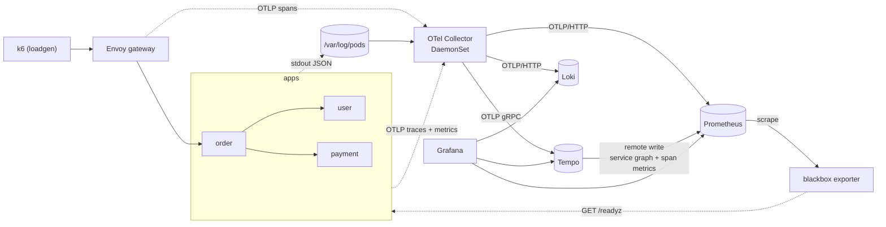
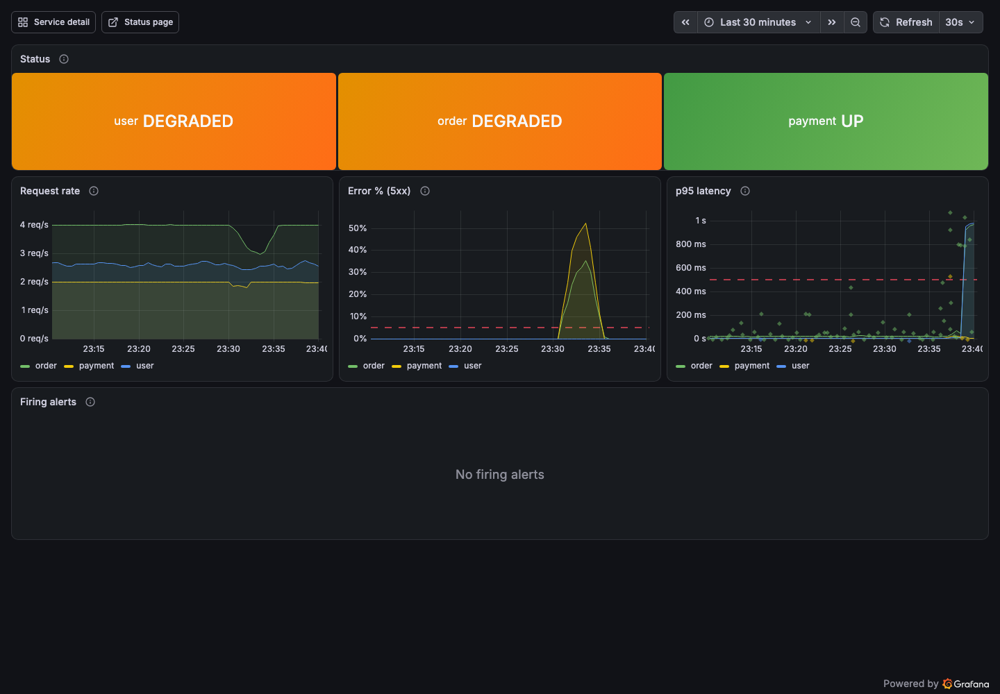
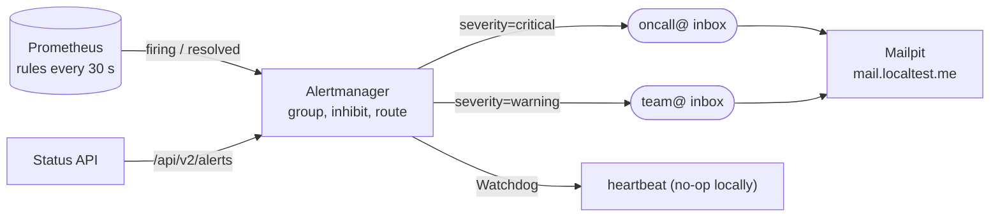
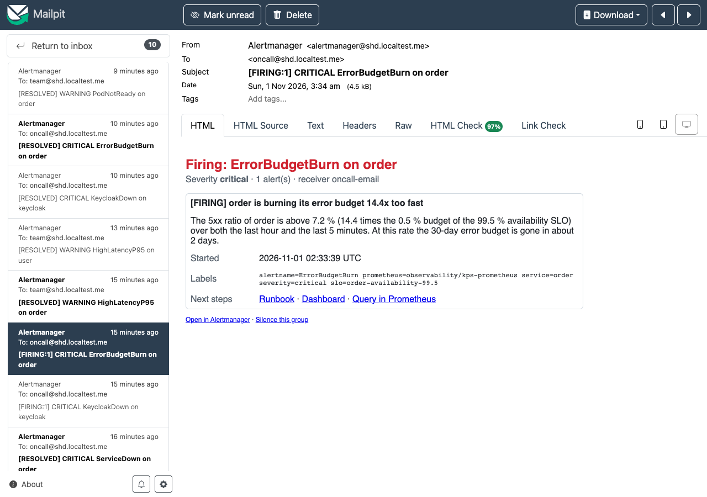
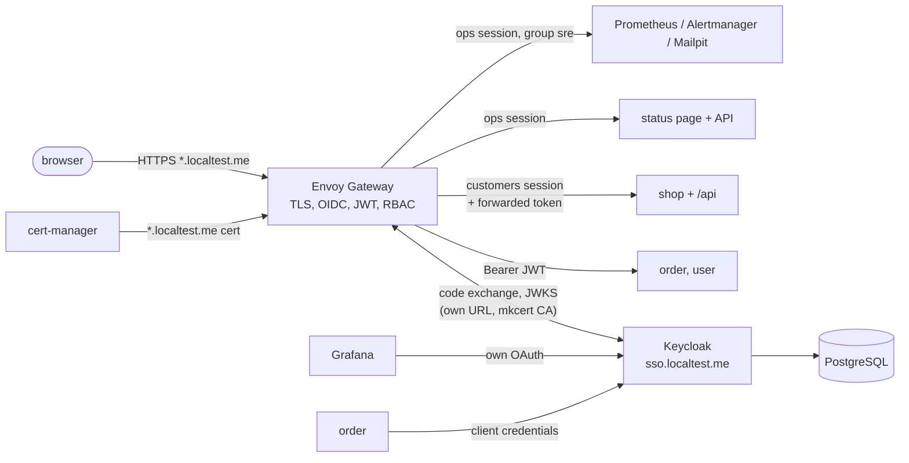
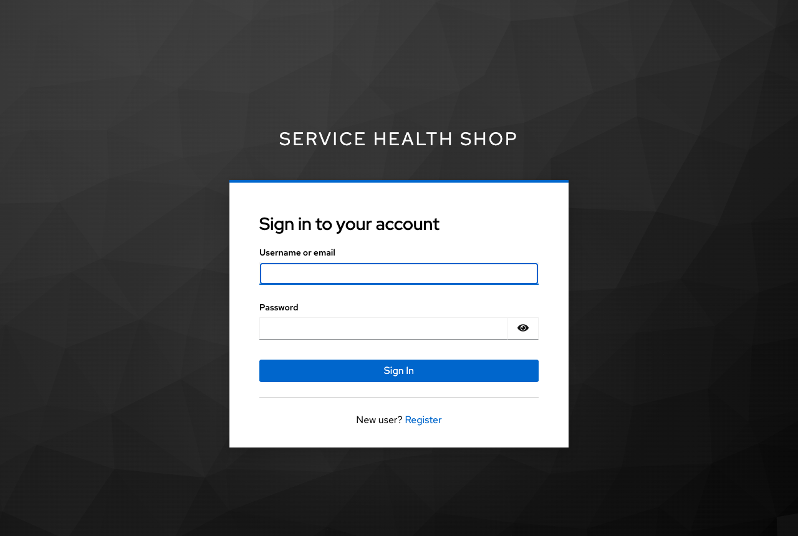
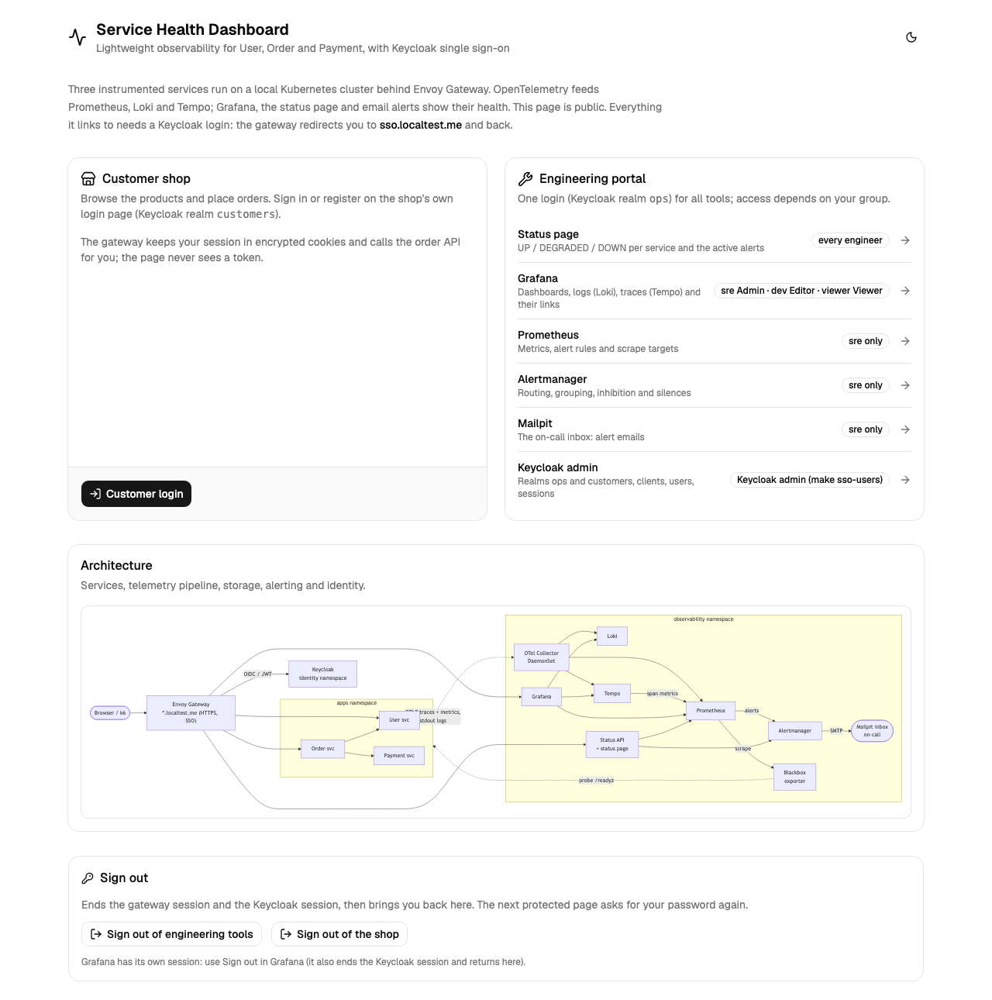
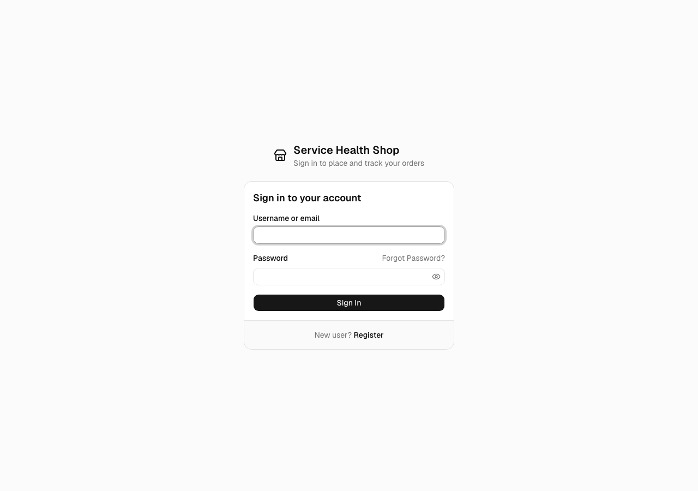

# Local Kubernetes platform (Phases 2–6b)

One command creates a single-node [kind](https://kind.sigs.k8s.io/) cluster on Docker or Podman, installs
[Envoy Gateway](https://gateway.envoyproxy.io/) as the edge, deploys the User, Order and Payment services with
probes, hardened pods and default-deny NetworkPolicies (Phase 2), and the telemetry pipeline and storage: OpenTelemetry
Collector, Prometheus, Alertmanager, Grafana, Loki, Tempo, a blackbox exporter and a k6 load generator (Phase 3,
[details](#telemetry-pipeline-and-storage-phase-3)), then Grafana's linked signals and two dashboards, the Status API and the
status page on https://status.localtest.me (Phase 4, [details](#visualization-and-status-page-phase-4)), and alerting:
promtool-tested rules, Alertmanager routing and inhibition, email to Mailpit on https://mail.localtest.me, runbooks and a
default-deny NetworkPolicy for `observability` (Phase 5, [details](#alerting-and-notification-phase-5)), then HTTPS with a local CA,
Keycloak single sign-on for every UI, JWT-protected APIs, client credentials between services and a customer shop
(Phase 6, [details](#identity-and-single-sign-on-phase-6)), and a public landing page on https://home.localtest.me where every logout
ends, plus a branded login page for customers (Phase 6b, [details](#landing-page-login-and-logout-phase-6b)).

```bash
make up       # prereqs -> kind cluster -> images (services + stack) -> CA, secrets, Keycloak Operator, CoreDNS rewrite -> helmfile apply -> wait for SSO -> status
make verify   # automated checks: gateway, NetworkPolicy, readiness (2); metrics, logs, traces, UIs (3); dashboards, links, status page (4); rules, Alertmanager, Mailpit (5); TLS, SSO, API auth, shop (6)
make demo     # failure scenarios: alert -> email in Mailpit -> status page -> recovery (5, 6)
make sso-users          # demo logins of the Keycloak realms (generated per cluster)
make grafana-password   # Grafana break-glass admin (user admin)
make down     # delete the cluster
```

Every URL is HTTPS with the mkcert CA (trust it once with `mkcert -install`). The API needs a bearer token,
see the [README](../README.md#getting-started) for a client-credentials example.

If `*.localtest.me` does not resolve on your machine, see [DNS blocked on your network](#dns-blocked-on-your-network).

## Architecture


| Piece | Where | What it does |
|---|---|---|
| kind cluster `shd` | [`kind/kind-config.yaml`](kind/kind-config.yaml) | One node, `kindest/node:v1.36.4` pinned by digest, host ports 80/443 → NodePorts 30080/30443 |
| Envoy Gateway v1.9.3 | release `envoy-gateway`, [`values/envoy-gateway.yaml`](values/envoy-gateway.yaml) | Controller from `oci://docker.io/envoyproxy/gateway-helm`; the chart also installs the Gateway API v1.6.1 CRDs |
| Edge | release `edge`, [`charts/edge`](charts/edge) | `EnvoyProxy` (NodePort Service with the fixed name `envoy-edge`), `GatewayClass` and `Gateway` `edge` (HTTP listener on 80 for `*.localtest.me`), `BackendTrafficPolicy` |
| Namespace baseline | release `apps-baseline`, [`charts/namespace-baseline`](charts/namespace-baseline) | `default-deny-all` (ingress and egress) and `allow-dns-egress` |
| Services | releases `user`, `order`, `payment`, [`charts/microservice`](charts/microservice) + [`values/<svc>.yaml`](values) | Deployment, Service (port 80 → 8080), ServiceAccount, NetworkPolicy, HTTPRoute |
| Namespaces | [`scripts/namespaces.sh`](scripts/namespaces.sh) | Creates `apps` and `envoy-gateway-system` with Pod Security Admission `restricted` (enforce, warn, audit) |
| CoreDNS | [`scripts/coredns-localtest.sh`](scripts/coredns-localtest.sh) | `*.localtest.me` → `envoy-edge.envoy-gateway-system.svc.cluster.local` inside the cluster |
| Observability (Phase 3) | releases in namespace `observability`, see [Telemetry pipeline and storage](#telemetry-pipeline-and-storage-phase-3) | Prometheus Operator CRDs, kube-prometheus-stack, Loki, Tempo, OTel Collector, blackbox exporter, `observability-config` (UI routes, Probes, Envoy PodMonitor) |
| Alerting (Phase 5) | releases `alerting`, `observability-baseline`, see [Alerting](#alerting-and-notification-phase-5) | Alert and recording rules, Alertmanager configuration, Mailpit; default-deny NetworkPolicies for `observability` |
| TLS (Phase 6) | release `cert-manager`, `charts/edge` ([`tls.yaml`](charts/edge/templates/tls.yaml)), [`scripts/mkcert-ca.sh`](scripts/mkcert-ca.sh) | mkcert CA → `ClusterIssuer` → `*.localtest.me` certificate of the HTTPS listener; HTTP → HTTPS redirect |
| Identity (Phase 6) | Keycloak Operator ([`keycloak-operator`](keycloak-operator)), releases `identity-baseline`, `identity` ([`charts/identity`](charts/identity)) | Keycloak, PostgreSQL, realms `customers` and `ops`, NetworkPolicies of `identity` |
| Edge auth and shop (Phase 6) | releases `sso-apps`, `sso-observability` ([`charts/sso`](charts/sso)), `shop-web` | Envoy Gateway `SecurityPolicy`s (OIDC, JWT, authorization), the customer shop |
| Load generator (Phase 3) | release `loadgen` in namespace `loadgen`, [`../loadgen`](../loadgen) | k6 Deployment with steady order traffic through the gateway |
| Status (Phase 4) | releases `status-api`, `status-web` in `apps`, [`charts/microservice`](charts/microservice) + [`values/status-*.yaml`](values) | Status API ([`../services/status-api`](../services/status-api)) on `/api` and the static status page ([`../web`](../web)) on `/` of `status.localtest.me` |

[`helmfile.yaml`](helmfile.yaml) orders the releases with `needs`: Envoy Gateway (with its CRDs) first, then the edge, the
namespace baseline and the services; the Prometheus Operator CRDs before everything that creates `ServiceMonitor`,
`PodMonitor` or `Probe` resources; the load generator after the order service. Every chart version is pinned.

### Versions

| Component | Version | Evidence |
|---|---|---|
| kind | ≥ 0.33.0 | Node image digest taken from the [v0.33.0 release notes](https://github.com/kubernetes-sigs/kind/releases/tag/v0.33.0), which require digest pinning |
| Kubernetes (node) | v1.36.4 | kind 0.33 defaults to v1.37.0, but [Envoy Gateway v1.9 is tested on 1.33–1.36](https://gateway.envoyproxy.io/news/releases/matrix/) |
| kubectl | 1.35–1.37 | [Version skew policy](https://kubernetes.io/releases/version-skew-policy/#kubectl): ±1 minor of the API server |
| Envoy Gateway | v1.9.3 (latest stable; v1.10 is still a release candidate) | Gateway API v1.6.1, Envoy distroless v1.39.x |
| Helm / helmfile / helm-diff | 4.x / 1.8 / 3.15 | `make prereqs` checks them |
| CoreDNS | v1.14.2 (from the node image) | Supports `rewrite … answer auto` |
| kube-prometheus-stack | chart 92.17.0 (Operator v0.94.2, Prometheus v3.15.1, Alertmanager v0.34.2, Grafana 13.3.0, kube-state-metrics 2.20.0) | Latest chart; `prometheus-operator-crds` 32.0.2 carries the same Operator version |
| Loki | chart `grafana-community/loki` 20.2.1 (Loki 3.7.9) | [Grafana's install docs](https://grafana.com/docs/loki/latest/setup/install/helm/install-monolithic/) moved to the community chart; `grafana/loki` 7.x now targets Grafana Enterprise Logs |
| Tempo | chart `grafana-community/tempo` 3.2.1 (Tempo 3.1.1) | [Tempo's Helm docs](https://grafana.com/docs/tempo/latest/set-up-for-tracing/setup-tempo/deploy/kubernetes/helm-chart/): `tempo` chart for monolithic mode; Tempo 3 runs monolithic without Kafka |
| OpenTelemetry Collector | chart 0.178.1, image `opentelemetry-collector-contrib` 0.164.0 | Same Collector version as `compose.yaml` |
| Blackbox exporter | chart 11.20.2 (v0.29.1) | |
| Mailpit | `axllent/mailpit` v1.33.0 | Latest release |
| cert-manager | chart and app v1.21.3 (`oci://quay.io/jetstack/charts/cert-manager`, CRDs as templates with `crds.keep`) | [Helm install docs](https://cert-manager.io/docs/installation/helm/) |
| Keycloak / Keycloak Operator | 26.8.1 (official manifests of `keycloak/keycloak-k8s-resources`, CRD API `k8s.keycloak.org/v2beta1`) | [Operator installation](https://www.keycloak.org/operator/installation) |
| PostgreSQL | `postgres:18.6-alpine` | Supported by Keycloak 26 |
| mkcert | ≥ 1.4 (host) | `make prereqs` checks it |
| k6 | `grafana/k6:2.3.0` | Same version as the host `k6` |

## Make targets

| Target | What it does |
|---|---|
| `make prereqs` | Engine reachable (Podman must be **rootful**), ≥ 4 CPUs / 8 GiB, kind ≥ 0.33, kubectl within skew of the node image, Helm 4, helm-diff, helmfile |
| `make cluster-up` / `cluster-down` | Create (idempotent) or delete the kind cluster |
| `make images` | `make build` (the four Python images, the `status-web`, `shop-web` and `home-web` images from [`../web/Dockerfile`](../web/Dockerfile) and the Keycloak image with the customers' login theme from [`keycloak/Dockerfile`](keycloak/Dockerfile)), then load them into kind. Docker: `kind load docker-image`. Podman: `podman save -m` to one archive → `kind load image-archive` |
| `make platform-images` | Renders the releases (`helmfile template`), pulls the third-party images that are not on the node yet with the engine (4 in parallel) and loads them into kind ([`scripts/preload-images.sh`](scripts/preload-images.sh)) |
| `make deploy` | Namespaces with PSA labels → Grafana admin Secret (once) → mkcert CA into the cluster → identity secrets (once) → Keycloak Operator and CRDs → CoreDNS rewrite → `helmfile apply` → wait for `Gateway` `Programmed` → wait until Keycloak serves both realms through the gateway ([`scripts/wait-identity.sh`](scripts/wait-identity.sh)) → apply the Phase 6b realm settings to existing realms ([`scripts/keycloak-realm-sync.sh`](scripts/keycloak-realm-sync.sh)). Idempotent |
| `make up` / `make down` | `cluster-up images platform-images deploy status` / `cluster-down` |
| `make grafana-password` | Prints the generated Grafana break-glass admin password (user `admin`) |
| `make sso-users` | Prints the demo logins of the `ops` and `customers` realms and the Keycloak admin |
| `make browser` | Opens the landing page in Chrome with a separate profile that maps `*.localtest.me` to 127.0.0.1 (trust the mkcert CA first) |
| `make load-start` / `load-stop` | Scale the k6 load generator to 1 / 0 replicas |
| `make redeploy` | Rebuild and reload the images, then `rollout restart` the services (the tag stays `dev`) |
| `make status` | Nodes, Gateway and HTTPRoutes, Envoy Service, workloads and NetworkPolicies |
| `make verify-browser` | Phase 6b browser flows with Playwright (Chromium, `*.localtest.me` mapped to 127.0.0.1): landing page → status page Login → Keycloak (default theme) → data; Prometheus in the same session; sign out → landing page → password asked again; Grafana's Keycloak session makes the status page's Login password-free; Customer login → branded page → order → Sign out → landing page. Writes the screenshots in `docs/screenshots` |
| `make verify` | Loads the `curl` test image into kind, then runs [`scripts/verify.sh`](scripts/verify.sh), [`scripts/verify-telemetry.sh`](scripts/verify-telemetry.sh) and [`scripts/verify-status.sh`](scripts/verify-status.sh), see [Verification](#verification) |
| `make web-check` / `web-dev` | Web monorepo: Prettier, ESLint, typecheck, Vitest, build / Vite dev server (needs Node and pnpm, see [`../web`](../web/README.md)) |
| `make rules-lint` / `rules-test` | `promtool check rules`, `amtool check-config` / promtool unit tests and Alertmanager routing and template tests (part of `make lint` / `make test`) |
| `make demo` / `demo-reset` | The four failure scenarios with recovery ([`../scripts/demo.sh`](../scripts/demo.sh)) / reset all faults |
| `make lint-charts` | `helm lint --strict` and `helm template` for the local charts (edge, namespace-baseline, observability-config, loadgen, microservice with every values file, including `status-api` and `status-web`) |

The engine is detected as in Phase 1 (Podman if it is running, otherwise Docker; `make ENGINE=docker …` forces one).
With Podman the Makefile exports `KIND_EXPERIMENTAL_PROVIDER=podman`. Every `kubectl` and `helmfile` call uses the
`kind-shd` context explicitly, so another current context is never touched.

## Edge and routing

**Envoy proxy Service.** Envoy Gateway creates the proxy Deployment and Service per `Gateway`. The `EnvoyProxy`
resource (referenced by the `GatewayClass`) sets the Service type to `NodePort`, gives it the stable name `envoy-edge`
(`envoyService.name`) and pins `nodePort: 30080` for port 80 and `30443` for 443 with a strategic-merge `patch`, because
the API has no `nodePort` field (only ports of existing listeners may be patched; a missing one would create a broken
Service port). The Envoy container listens on 10080 and 10443 (Envoy Gateway shifts privileged ports because the proxy runs
as non-root). Since Phase 6 the HTTP listener only redirects to HTTPS, see [Identity](#identity-and-single-sign-on-phase-6).

**What is exposed on `api.localtest.me`:**

| Path | Backend | Why |
|---|---|---|
| `/orders`, `/orders/{id}` | order | Public business API |
| `/users/{id}` | user | Public business API |
| `/payments` | – (404 at the edge) | Payment is internal; only order may call it |
| `/admin/*`, `/livez`, `/readyz`, `/docs` | – (404 at the edge) | Operational endpoints stay inside the cluster |

Each service chart renders its own `HTTPRoute` with `PathPrefix` matches (Gateway API prefixes match whole path
segments, so `/ordersX` does not match). Anything else has no rule, so Envoy answers 404 without calling a service.
Envoy normalizes paths before routing (`/orders/../admin/faults` → `/admin/faults`), and escaped slashes get a 307 to
the unescaped path (Envoy Gateway's default `UnescapeAndRedirect`), so traversal tricks also end in 404. The `Gateway`
only accepts routes from the namespaces listed in `gateway.routeNamespaces` (`apps` and, since Phase 3, `observability`).

**BackendTrafficPolicy: readiness at the edge.** Envoy Gateway marks endpoints whose pod is not ready as `DRAINING`.
With Envoy's default [panic threshold](https://www.envoyproxy.io/docs/envoy/latest/intro/arch_overview/upstream/load_balancing/panic_threshold)
of 50 %, a service whose pods are *all* not ready still received traffic through the gateway (verified: 200 instead of 503).
`healthCheck.panicThreshold: 0` disables panic mode, so the edge behaves like a Kubernetes Service: no ready pod, no
traffic, 503. No gateway retries or extra timeouts are configured on purpose: `POST /orders` is not idempotent, and
the services own their upstream timeouts (Envoy's default 15 s route timeout applies).

## Same URL inside and outside the cluster (CoreDNS)

Public DNS resolves `*.localtest.me` to `127.0.0.1`. Inside a pod that is the pod itself, so a CoreDNS
[`rewrite`](https://coredns.io/plugins/rewrite/) rule maps the names to the gateway Service instead:

```
rewrite stop {
    name regex ^(.+\.)?localtest\.me\.$ envoy-edge.envoy-gateway-system.svc.cluster.local. answer auto
}
```

`answer auto` rewrites the answer back to the queried name, so clients get an A record for `api.localtest.me`
(the `envoy-edge` ClusterIP). The regex is anchored, so search-path expansions such as
`api.localtest.me.apps.svc.cluster.local.` are not rewritten and fall through to NXDOMAIN as usual.
This matters from Phase 6, when browsers and pods must use the same OIDC issuer URL.

The script edits the `kube-system/coredns` ConfigMap as the [Kubernetes DNS customization guide](https://kubernetes.io/docs/tasks/administer-cluster/dns-custom-nameservers/)
describes. It is **idempotent**: the rule sits between `BEGIN`/`END` marker comments, is replaced on each run, and
CoreDNS is restarted only if the Corefile changed (the `reload` plugin would also pick it up, but only after one to
two minutes). kubeadm does not reconcile this ConfigMap after cluster creation, so the change lasts for the life of the cluster.

## Workloads (`charts/microservice`)

| Concern | Setting | Reason |
|---|---|---|
| startupProbe | `/livez`, every 2 s, 30 failures (60 s budget) | Protects slow starts; liveness only starts afterwards |
| livenessProbe | `/livez`, every 10 s, timeout 2 s, 3 failures | Event loop only, never dependencies → no cascading restarts |
| readinessProbe | `/readyz`, every 5 s, timeout 2 s, 2 failures | Out of the endpoints within ~10 s when starting, draining or forced not-ready |
| Graceful shutdown | `preStop: sleep 5` (native sleep action), `SHUTDOWN_DRAIN_SECONDS=3`, `SHUTDOWN_TIMEOUT_SECONDS=10`, `terminationGracePeriodSeconds: 25` | Endpoint removal propagates before SIGTERM; then the service fails `/readyz`, drains and finishes in-flight requests. The chart fails to render if the grace period is not larger than the sum |
| Resources | requests 50m / 128Mi, limits 500m / 256Mi | Laptop-sized; memory limit as in compose |
| Pod security | `runAsNonRoot` (UID/GID 10001), `readOnlyRootFilesystem`, drop `ALL` capabilities, `allowPrivilegeEscalation: false`, `seccompProfile: RuntimeDefault` | Meets the `restricted` Pod Security Standard, which the `apps` namespace enforces. No `/tmp` volume is needed: the image writes nothing at runtime |
| API access | Dedicated ServiceAccount per service, `automountServiceAccountToken: false`, `enableServiceLinks: false` | The services never call the Kubernetes API |
| Rollouts | `maxUnavailable: 0`, `maxSurge: 1` | No capacity drop during a rollout |
| OpenTelemetry | `OTEL_SERVICE_NAME`, `OTEL_RESOURCE_ATTRIBUTES` (`deployment.environment.name=kind`, `k8s.namespace.name`, `k8s.pod.name`, `k8s.pod.uid`, `k8s.node.name`, `k8s.deployment.name`, `k8s.container.name`, `service.instance.id=<namespace>.<pod>.<container>` from the downward API), `OTEL_SEMCONV_STABILITY_OPT_IN=http`, `OTEL_LOGS_EXPORTER=none` | `service.instance.id` follows the [OTel Kubernetes guidance](https://opentelemetry.io/docs/specs/semconv/non-normative/k8s-attributes/) |
| OTLP export | `otel.exporter.enabled: true` (Phase 3): traces and metrics over OTLP/gRPC to `http://otel-collector.observability.svc.cluster.local:4317` every 15 s; logs stay on stdout | `enabled: false` sets `OTEL_TRACES_EXPORTER=none` and `OTEL_METRICS_EXPORTER=none` for a cluster without the stack |

## NetworkPolicies (`apps`)

kindnet, kind's default CNI, [enforces NetworkPolicy since kind v0.24](https://github.com/kubernetes-sigs/kind/releases/tag/v0.24.0).
Policies are additive allow-lists on top of the namespace default deny.

| Policy | Selects | Allows |
|---|---|---|
| `default-deny-all` | all pods | nothing (ingress and egress) |
| `allow-dns-egress` | all pods | egress to `kube-system` `k8s-app=kube-dns` on 53/UDP and 53/TCP |
| `user` | user | ingress on 8080 from the Envoy pods of Gateway `edge` and from order |
| `order` | order | ingress on 8080 from the Envoy pods; egress to user and payment on 8080 |
| `payment` | payment | ingress on 8080 from order only |
| all three (Phase 3) | user, order, payment | egress to the OTel Collector agent pods in `observability` on 4317/4318; ingress on 8080 from the blackbox exporter pods (synthetic `/readyz` checks) |
| `status-api` (Phase 4) | status-api | ingress on 8080 from the Envoy pods; egress to the Prometheus pods on 9090 and the Alertmanager pods in `observability` on 9093, and to the Collector (OTLP) |
| `status-web` (Phase 4) | status-web | ingress on 8080 from the Envoy pods; no egress besides DNS (static files only) |

- The Envoy pods are selected by namespace (`kubernetes.io/metadata.name: envoy-gateway-system`) **and** their labels
  (`app.kubernetes.io/name: envoy`, `app.kubernetes.io/component: proxy`, `gateway.envoyproxy.io/owning-gateway-name: edge`).
- Rules use the pod port (8080): NetworkPolicy sees traffic after the Service has translated port 80.
- Kubelet probes come from the node and are not blocked; `kubectl port-forward` enters the pod's network namespace
  directly, so `/admin/faults` stays reachable for operators but not from other pods.
- **Phase 3:** `networkPolicy.otelCollector` (egress) and `networkPolicy.blackboxExporter` (ingress) select the pods by
  namespace and labels. The Collector is reached through its Service, so NetworkPolicy sees the agent's pod IP and the pod
  selector matches; no `ipBlock` for a host port is needed.

## Telemetry pipeline and storage (Phase 3)



### Signals: exactly one path each

| Signal | Source | Path | Store |
|---|---|---|---|
| Traces | services (OTel SDK), Envoy (`EnvoyProxy` telemetry, `service.name=gateway`) | OTLP/gRPC → Collector → `otlp_grpc/tempo` | Tempo |
| Application metrics | services (OTel SDK, every 15 s) | OTLP/gRPC → Collector → `otlp_http/prometheus` → `/api/v1/otlp` | Prometheus |
| Logs | services' JSON on stdout | `/var/log/pods/apps_*` → Collector `file_log` → `otlp_http/loki` → `/otlp` | Loki |
| Service graph, span metrics | Tempo metrics-generator | remote write → `/api/v1/write` (with exemplars) | Prometheus |
| Infrastructure, synthetic checks, self-metrics | kube-state-metrics, kubelet/cAdvisor, node-exporter, CoreDNS, API server, blackbox `Probe`s, Envoy, Collector, Loki, Tempo, Grafana, Operator | Prometheus scrape (`ServiceMonitor`, `PodMonitor`, `Probe`) | Prometheus |

The services set `OTEL_LOGS_EXPORTER=none` and the Collector's logs pipeline has no OTLP receiver, so no log line is
stored twice. The `file_log` receiver parses the CRI format, then the services' JSON: `timestamp`, `level` (→ severity),
`trace_id`/`span_id` (→ the log record's trace context) and `message` (→ body) become log record fields, the remaining keys
(`logger`, `http.route`, `order.id`, …) attributes. Loki stores them as structured metadata, so
`{service_name="order"} | trace_id="<id>"` or `| severity_text="ERROR"` need no `| json` parser. Read offsets are kept in
a hostPath (`file_storage`), so a restarted agent neither re-sends nor skips lines. Only the `apps` namespace is
collected; platform logs stay available through `kubectl logs`.

**How the services reach the node-local agent.** Through the Collector's Service, which the chart creates with
`internalTrafficPolicy: Local` for a DaemonSet: kube-proxy only routes to the agent on the caller's node, and the services
use a normal DNS name (`otel-collector.observability.svc.cluster.local:4317`). The alternative, `hostPort` on the node IP
(downward API `status.hostIP`), would open the receivers to everything that can reach the node and needs an `ipBlock` in
the NetworkPolicy; the Service keeps NetworkPolicy pod-based. If the local agent is down, OTLP export fails (and the SDK
retries) instead of silently crossing nodes; on one node both behave the same.

**Enrichment.** `k8s_attributes` associates OTLP data by the `k8s.pod.uid` the services send, log lines by the uid in the
file path, and Envoy spans by the connection's source IP, then adds pod metadata and `service.name` (from the
`app.kubernetes.io/*` labels, so log lines get the same `service.name` as traces and metrics). `resource` inserts
`deployment.environment.name=kind` and `k8s.cluster.name=shd`. `memory_limiter` is first in every pipeline, `batch` last.

### Stores and access

| Component | Configuration ([`values/`](values)) | Reached at |
|---|---|---|
| Prometheus | `enableOTLPReceiver`; promotes only `service.name`, `k8s.namespace.name`, `k8s.pod.name` to labels (`job`/`instance` come from `service.name`/`service.instance.id`, the rest stays on `target_info`); translation `UnderscoreEscapingWithSuffixes` (→ `http_server_request_duration_seconds_*`); `enableRemoteWriteReceiver`; `exemplar-storage` (100k); `outOfOrderTimeWindow: 30m`; selects every `ServiceMonitor`/`PodMonitor`/`Probe`/`PrometheusRule` in the cluster | http://prometheus.localtest.me |
| Alertmanager | Configuration from the Secret `alertmanager-shd` (release `alerting`): routing by severity, inhibition, email to Mailpit, see [Alerting](#alerting-and-notification-phase-5) | https://alertmanager.localtest.me |
| Grafana | Admin password from the Secret `grafana-admin` that `make deploy` generates once per cluster ([`scripts/grafana-admin-secret.sh`](scripts/grafana-admin-secret.sh)), anonymous access and sign-up off, no PVC, datasources Prometheus (`uid: prometheus`), Loki (`loki`), Tempo (`tempo`), Alertmanager. Correlations and the two dashboards come in Phase 4; the chart's ~25 default dashboards are not installed | https://grafana.localtest.me |
| Loki | Monolithic, filesystem, `retention_period: 24h` (compactor), `allow_structured_metadata`; index labels only `service.name`, `service.namespace`, `k8s.namespace.name`, `k8s.container.name`, `deployment.environment.name` (Loki's default list would also index `k8s.pod.name` and `service.instance.id`); gateway, memcached caches, canary, ruler and Helm test pod off | in-cluster `loki:3100` |
| Tempo | Monolithic (Tempo 3: no Kafka), local backend, 24 h block retention, OTLP receivers; metrics-generator with `service-graphs` and `span-metrics`, remote write with exemplars | in-cluster `tempo:3200` (query), `:4317` (OTLP) |
| Blackbox exporter | Module `http_2xx` without redirects; one `Probe` per service on `http://<svc>.apps.svc.cluster.local/readyz` every 15 s (label `service`) | in-cluster `blackbox-exporter:9115` |
| Envoy gateway | `EnvoyProxy.spec.telemetry`: OpenTelemetry tracing (100 % sampling, `service.name=gateway`, W3C `traceparent`) to the Collector, Prometheus stats on port 19001 scraped by a `PodMonitor` | — |
| k6 | [`../loadgen`](../loadgen): `constant-arrival-rate`, 2 iterations/s (POST order, GET order, 30 % GET user ≈ 4.6 requests/s at the edge) for users u-1001…u-1003 against `https://api.localtest.me` | `make load-stop` / `load-start` |

The UI routes ([`charts/observability-config`](charts/observability-config)) send everything to the backend except
Prometheus' `/api/v1/write`, `/api/v1/otlp`, `/-/reload`, `/-/quit` and Alertmanager's `/-/reload`, `/-/quit`, which an
Envoy Gateway `HTTPRouteFilter` answers with 403 at the edge: the receivers are meant for the Collector and Tempo, and
the lifecycle endpoints for the Operator's config reloader, not for anyone on the network. Until Phase 6 adds SSO, the
UIs have no login besides Grafana's own (see the 0.0.0.0 note in [Troubleshooting](#troubleshooting)).

Not scraped on kind, so they do not show up as down targets: etcd, kube-controller-manager, kube-scheduler (they bind
their metrics to 127.0.0.1 in kind) and kube-proxy (`metricsBindAddress` 127.0.0.1:10249); their default rules are off
too. The other default kube-prometheus-stack rules are loaded (except the `general` group, which the project's own
`Watchdog` and `TelemetryPipelineDown` replace) and routed by severity like the project's alerts.

**Pod Security.** `observability` enforces `privileged`: the Collector reads `/var/log/pods` and writes offsets through
hostPath volumes, node-exporter uses the host network and PID namespaces. All other pods there set restricted-style
security contexts (non-root, no privilege escalation, dropped capabilities, read-only root filesystem where the image
allows it). The Collector runs as root without capabilities, because the pod log files are root-owned with mode 0640.
`loadgen` enforces `restricted`. NetworkPolicies of `observability`: see [Alerting](#networkpolicies-observability).

### Storage

Dynamic provisioning through kind's default `standard` StorageClass (local-path-provisioner, `reclaimPolicy: Delete`,
so `make down` wipes the data). local-path does **not** enforce capacities: the retention settings are the real limit.

| PVC | Size | Contents | Limit that matters |
|---|---|---|---|
| `prometheus-kps-prometheus-db-…-0` | 2 Gi | TSDB, WAL | `retention: 24h`, `retentionSize: 1.5GB` |
| `alertmanager-kps-alertmanager-db-…-0` | 1 Gi | silences, notification log | small |
| `storage-loki-0` | 2 Gi | chunks, TSDB index, WAL, compactor | `retention_period: 24h` |
| `storage-tempo-0` | 2 Gi | blocks, WAL, metrics-generator WAL | block retention 24 h |

No PVC: Grafana (provisioned from ConfigMaps), the services (in-memory). The Collector keeps only file offsets (hostPath
`/var/lib/otelcol`). After 20 minutes of k6 traffic the volumes held 8 MB (Prometheus), 8 MB (Tempo) and 5 MB (Loki).

### Resources (measured)

Every container has requests and limits (the columns show the configured values of the running pods). Working sets measured
with Prometheus (cAdvisor) after `make down && make up && make verify && make demo` with all phases deployed (2026-11-01), k6
running; Podman machine with 4 CPUs and 10 GiB:

| Namespace | Working set | Requests | Limits |
|---|---|---|---|
| observability (incl. Mailpit) | 1676 MiB | 1850 MiB | 5440 MiB |
| kube-system (kind control plane) | 1223 MiB | 290 MiB | 340 MiB |
| identity (Keycloak, operator, PostgreSQL) | 868 MiB | 1154 MiB | 1730 MiB |
| apps (3 services, Status API, status page, shop) | 271 MiB | 544 MiB | 1152 MiB |
| cert-manager | 119 MiB | 120 MiB | 320 MiB |
| envoy-gateway-system | 94 MiB | 288 MiB | 1024 MiB |
| loadgen, local-path-storage | 50 MiB | 64 MiB | 256 MiB |
| **Total** | **4.2 GiB** | **4.2 GiB** | 10.3 GiB |

Largest pods: kube-apiserver 941 MiB, Keycloak 584 MiB, Prometheus 549 MiB, Grafana 459 MiB (incl. two sidecars), Keycloak
Operator 231 MiB, Tempo 203 MiB, Collector 180 MiB, Loki 105 MiB. The node reported 4.8 GiB of 9.7 GiB in use; CPU about
0.6 cores in total (Keycloak 0.27). Phase 6 added about 1.1 GiB (Keycloak, its operator, PostgreSQL, cert-manager). Limits
add up to slightly more than the VM: they are ceilings, not reservations; requests (what the scheduler reserves) are 4.2 GiB.
The two realm import Jobs (Keycloak `kc.sh import`, peak ~570 MiB each) only run while a realm is created. `metrics-server` is
not installed, so `kubectl top` is not available; Prometheus covers it.

## Visualization and status page (Phase 4)


| URL | What |
|---|---|
| https://status.localtest.me | Status page ([`../web/apps/status`](../web/README.md)): UP / DEGRADED / DOWN per service, RPS, 5xx %, p95 with sparklines, active alerts |
| https://status.localtest.me/api/v1/services | Status API JSON ([contract](../services/README.md#status-api)); also `/api/v1/services/{name}` and `/api/v1/alerts` |
| https://grafana.localtest.me/d/shd-overview | Service Health Overview |
| https://grafana.localtest.me/d/shd-service-detail?var-service=payment | Service Detail |

**Routing.** Both releases attach an `HTTPRoute` for `status.localtest.me`: `status-web` with prefix `/`, `status-api` with prefix
`/api`. Gateway API picks the longest matching prefix, so `/api/...` reaches the API and everything else the page: one origin, no
CORS, and the API's `/docs`, `/admin/faults` and probes are not reachable from outside (they fall through to the page).
Both use the generic [`charts/microservice`](charts/microservice); for the nginx image `shdRuntime: false` drops the Python
service variables (PORT, FAULT_*, OTEL_*), `tmpVolume` mounts an emptyDir on `/tmp` (read-only root filesystem), and the pod
runs as UID 101. `/livez` and `/readyz` of the page are answered by nginx itself.

**Grafana correlations** ([`values/kube-prometheus-stack.yaml`](values/kube-prometheus-stack.yaml), all provisioned; Grafana expands
`$VAR` in provisioning files, so its own macros are written `$${...}` / `$$__tags`):

| From → to | How |
|---|---|
| Metric → trace | Prometheus datasource `exemplarTraceIdDestinations` (`trace_id` → Tempo). The p95 panels request exemplars; click a dot |
| Log → trace | Loki derived field of type **label** on `trace_id` (structured metadata, not text in the line) → Tempo ("View trace" in log details) |
| Trace → logs | Tempo `tracesToLogsV2`, custom query `{service_name="<span's service.name>"} \| trace_id="<trace id>"` |
| Trace → metrics | Tempo `tracesToMetrics`: request rate, 5xx ratio and p95 of the span's service |
| Service map / node graph | Tempo `serviceMap` from Prometheus (`traces_service_graph_*` of the metrics-generator), `nodeGraph.enabled` |

**Dashboards: two, minimal (user decision).** JSON in [`charts/observability-config/dashboards`](charts/observability-config/dashboards),
one ConfigMap each (label `grafana_dashboard: "1"`), loaded by the Grafana dashboard sidecar; read-only in the UI. Metric names are the
OTLP translations verified in Prometheus (`http_server_request_duration_seconds_{bucket,count}`, labels `service_name`,
`http_response_status_code`, `http_route`); `/admin` calls are excluded from RED.

| Dashboard | Panels |
|---|---|
| **Service Health Overview** (`shd-overview`, 5 panels) | Status per service (stat: DOWN if `probe_success` = 0, DEGRADED if 5xx ratio > 5% or p95 > 500 ms over 5 m, else UP), request rate, error % (5xx), p95 latency with exemplars and threshold lines, firing alerts (`ALERTS`, critical and warning). Series link to Service Detail |
| **Service Detail** (`shd-service-detail`, `$service`, 7 panels) | Readiness probe, ready vs desired replicas, restarts (1 h) from kube-state-metrics; requests by status code, 5xx %, p50/p95/p99 with exemplars; Loki logs of the service with "View trace" links. Header links: Overview, traces of the service in Explore |

No Telemetry Pipeline dashboard: its health is covered by alerts in Phase 5; ad-hoc analysis uses Explore and the Drilldown apps.



## Alerting and notification (Phase 5)



Release `alerting` ([`charts/alerting`](charts/alerting)) holds everything that decides *when* and *whom* to notify:

| Part | Where | What |
|---|---|---|
| Rules | [`rules/*.rules.yaml`](charts/alerting/rules) | Plain Prometheus rule files, wrapped unchanged in one `PrometheusRule` each. Recording rules per `service`: request rate, 5xx rate and ratio (5 m, 1 h), p95 latency |
| Unit tests | [`tests/*.test.yaml`](charts/alerting/tests) | `promtool test rules`: every alert fires for the faulty input and stays silent for healthy, flapping or out-of-scope input (e.g. `/admin` 500s, 401s) |
| Alertmanager | [`alertmanager/alertmanager.yaml`](charts/alerting/alertmanager/alertmanager.yaml), [`email.tmpl`](charts/alerting/alertmanager/email.tmpl) | Rendered into the Secret `alertmanager-shd`, which kube-prometheus-stack uses through `alertmanagerSpec.configSecret`; tested with `amtool` ([`tests/alertmanager.test.sh`](charts/alerting/tests/alertmanager.test.sh): config, routing per alert, template rendering) |
| Mailpit | [`templates/mailpit.yaml`](charts/alerting/templates/mailpit.yaml) | `axllent/mailpit` v1.33.0, SMTP on 1025, UI and API on 8025 (`mail.localtest.me`; the send API `/api/v1/send` is blocked at the edge), last 500 messages, no PVC, metrics scraped |

**Rules** (thresholds match the Status API, so the page and the email agree; runbooks in [`../docs/runbooks`](../docs/runbooks/README.md)):

| Alert | Expression (simplified) | `for` | Severity |
|---|---|---|---|
| `ServiceDown` | `min by (namespace, service) (probe_success{job="blackbox-readyz"}) == 0` | 1m | critical |
| `HighErrorRate` | `service:http_server_errors:ratio_rate5m > 0.05` (5xx only, `/admin` excluded) | 5m | critical |
| `HighLatencyP95` | `service:http_server_request_duration_seconds:p95_rate5m > 0.5` | 5m | warning |
| `HighLatencyP95` | same for `service="payment"` `> 1` | 5m | critical |
| `ErrorBudgetBurn` | order 5xx ratio over 1 h **and** 5 m `> 14.4 × 0.5 %` (SLO 99.5 %) | 2m | critical |
| `PodNotReady` | `kube_pod_status_ready{namespace="apps", condition="false"} == 1`, `service` from `kube_pod_labels` | 2m | warning |
| `PodCrashLooping` | `CrashLoopBackOff` in the last 5 m (`kube_pod_container_status_waiting_reason`) | 5m | warning |
| `TelemetryPipelineDown` | Collector, Loki, Tempo or blackbox target down; no Collector at all; Collector exporter failures (`reason` label) | 5–10m | warning |
| `Watchdog` | `vector(1)` | – | none |

Every alert has the labels `severity` and `service` and the annotations `summary`, `description`, `runbook_url` (GitHub)
and `dashboard_url` (Service Detail or Overview). The `service` label comes from the blackbox `Probe` (`ServiceDown`), from
the OTLP resource attribute `service.name` (`label_replace` of `service_name`) or from the pod label
`app.kubernetes.io/name`, which kube-state-metrics exports (`metricLabelsAllowlist: pods=[app.kubernetes.io/name]`).

**Routing.** `group_by: [alertname, service]`; `critical` → `oncall-email` (group_wait 30s, group_interval 5m,
repeat 4h), `warning` → `team-email` (1m, 10m, 24h), `Watchdog` → `heartbeat` every minute (a no-op receiver locally; in
production an external dead man's switch), `info`/`none` → `null`, anything else → `team-email`. `send_resolved: true`.
The email (HTML and text) lists each alert with summary, description, labels, start/end and links to the runbook, the
dashboard, the Prometheus query, the Alertmanager view and a pre-filled silence.

**Inhibition.** `ServiceDown` mutes `HighErrorRate`, `HighLatencyP95` and `ErrorBudgetBurn` with the same `service`; the
critical payment latency alert mutes its warning; `PodNotReady`/`PodCrashLooping` mute kube-prometheus-stack's slower
`KubePodNotReady`/`KubePodCrashLooping` for the same pod; `KeycloakDown` mutes `LoginFailureSpike` and `TokenLatencyHigh`.



**Checks.** `make lint` runs `promtool check rules` and `amtool check-config`; `make test` runs the promtool unit tests and
the Alertmanager routing tests (`make rules-test`). Both use the Prometheus and Alertmanager images of the deployed
versions through the container engine, so nothing has to be installed.

### Failure scenarios (`scripts/demo.sh`)

```bash
make demo            # scripts/demo.sh all: a -> c -> b -> d, then recovery and RESOLVED emails (~25 min)
scripts/demo.sh a    # one scenario (a|b|c|d) with reset; NO_RESOLVE=1 skips waiting for the RESOLVED email
scripts/demo.sh status
make demo-reset      # reset fault injection, scale everything back to 1
```

| Scenario | Fault | Expected |
|---|---|---|
| a | payment `error_rate=0.3` | payment `DEGRADED`, then `DOWN`; `HighErrorRate` (critical) email to on-call |
| c | payment scaled to 0 (right after a) | `ServiceDown` (critical) email; payment's still active `HighErrorRate` is **suppressed** by the inhibition rule |
| b | user `latency_ms=800` | user `DEGRADED`; `HighLatencyP95` (warning) email to the team |
| d | order `ready=false` | `PodNotReady` (warning) email to the team (and `ServiceDown`: its only pod gets no traffic); the pod is not restarted |

Each step polls the Alertmanager API, Mailpit's API (subject, recipient, runbook and dashboard links) and the Status API.
The script reaches them, and the services' `/admin/faults`, through `kubectl port-forward`, so it does not depend on the
gateway or on single sign-on. After the reset it waits until every alert has resolved and its `RESOLVED` email arrived.

### NetworkPolicies (`observability`)

Release `observability-baseline` (chart `namespace-baseline`, [`values/observability-baseline.yaml`](values/observability-baseline.yaml))
is installed before any other release of the namespace: `default-deny-all`, DNS, and one allow-list per flow. The
components come from third-party charts that render no policies, so the flows are listed in one place:

| Policy | Allows |
|---|---|
| `allow-kube-apiserver-egress` | every pod → API server (6443/443; operator, sidecars, kube-state-metrics, Collector `k8s_attributes`, admission Jobs) |
| `allow-operator-webhook` | API server → Prometheus Operator admission webhook (10250) |
| `allow-prometheus-egress` / `allow-prometheus-scrape` | Prometheus → pods in every namespace and the node (kubelet 10250, node-exporter 9100); Prometheus → every pod here |
| `allow-prometheus-ingress` | Grafana, Collector (OTLP push), Tempo (remote write), Status API (`apps`), Envoy (UI) → 9090 |
| `allow-alertmanager-*` | Prometheus, Grafana, Status API, Envoy → 9093; Alertmanager → Mailpit 1025; gossip with itself |
| `allow-mailpit-ingress` | Alertmanager → 1025, Envoy → 8025 |
| `allow-grafana-*` | Envoy → 3000; Grafana → Prometheus, Loki, Tempo, Alertmanager, and HTTPS to public addresses (plugin installs from grafana.com at startup) |
| `allow-collector-*`, `allow-loki-*`, `allow-tempo-*` | `apps`, the Envoy proxies and Keycloak → Collector 4317/4318; Collector → Prometheus, Tempo, Loki; Grafana → Loki, Tempo; Tempo → Prometheus |
| `allow-blackbox-egress` | blackbox exporter → `apps` pods on 8080 |

node-exporter uses the host network and kubelet probes come from the node, so NetworkPolicy does not apply to them. The
API server and the kubelet have node IPs (not pods); their rules allow the port to any address rather than guessing the
node network of the container engine.

## Identity and single sign-on (Phase 6)



**TLS.** [`scripts/mkcert-ca.sh`](scripts/mkcert-ca.sh) creates mkcert's local CA if it does not exist (without installing it
anywhere), stores it as the Secret `cert-manager/mkcert-ca` and the public CA certificate as the ConfigMap `localtest-ca` in every
namespace with clients (`apps`, `observability`, `loadgen`, `identity`, `envoy-gateway-system`). cert-manager v1.21 (release
`cert-manager`, CRDs as templates with `crds.keep`) issues the `*.localtest.me` ECDSA certificate (90 days, renewed after 60) for
the Gateway's new HTTPS listener (443 → NodePort 30443). The HTTP listener accepts only the `https-redirect` route of the edge
chart: 301 to HTTPS for the browser hosts, 404 for `api.localtest.me` (no redirect for clients that may send a token).
**Trust the CA once** with `mkcert -install` (it may ask for your password). On macOS, you can trust it for your user
without admin rights using `security add-trusted-cert -r trustRoot -k "$HOME/Library/Keychains/login.keychain-db" "$(mkcert -CAROOT)/rootCA.pem"`.



**Keycloak.** [`scripts/keycloak-operator.sh`](scripts/keycloak-operator.sh) applies the official Keycloak Operator 26.8.1
manifests, pinned and patched with kubectl's built-in kustomize ([`keycloak-operator/`](keycloak-operator)): namespace `identity`
(also the ClusterRoleBinding subject), restricted Pod Security, `IfNotPresent`. The four CRDs (~1 MB together) are applied
server-side. Release `identity` ([`charts/identity`](charts/identity)) holds the `Keycloak` CR, PostgreSQL 18 (StatefulSet, 2 Gi PVC,
UID 70, read-only root filesystem), the `sso.localtest.me` route and the realms:

| `Keycloak` setting | Value | Why |
|---|---|---|
| `hostname` | `https://sso.localtest.me`, strict | One issuer for browsers, the gateway and the services |
| `http.httpEnabled`, `proxy.headers` | `true`, `xforwarded` | Edge TLS at the gateway |
| `networkPolicy` | HTTP 8080 from the Envoy proxies only, management 9000 from Prometheus only | Forwarded headers can only come from the gateway |
| Metrics | `metrics-enabled`, `http-metrics-histograms-enabled`, feature `user-event-metrics` with `event-metrics-user-events` | `ServiceMonitor` by the operator; alerts and the Sign-ins panel |
| `tracing` | OTLP/gRPC to the node-local Collector, `parentbased_traceidratio` 1.0 | Keycloak and its JDBC spans in Tempo |
| `resources` | requests 200m / 640 Mi, limit 1 Gi | Operator default is 1700 Mi requests |
| `bootstrapAdmin` | Secret `keycloak-admin` | Admin console at https://sso.localtest.me/admin |

Realms are YAML `RealmRepresentation`s in [`charts/identity/realms`](charts/identity/realms), imported by `KeycloakRealmImport`
with every secret as a placeholder from the Secret `identity/realm-secrets`. [`scripts/identity-secrets.sh`](scripts/identity-secrets.sh)
generates all client secrets and demo passwords once per cluster and copies each client secret to the namespace that uses it;
`make sso-users` prints the logins. **Realm changes are not applied to an existing realm** (an import only creates): delete the
realm in the admin console (or `kubectl -n identity exec keycloak-0 -- /opt/keycloak/bin/kcadm.sh …`), delete the
`KeycloakRealmImport`, and run `make deploy`; or recreate the cluster.

**Edge authentication** (chart [`sso`](charts/sso): releases `sso-edge` in `envoy-gateway-system`, `sso-apps` in `apps`,
`sso-observability` in `observability`). Since Phase 6b the engineers' login is a **listener-level** `SecurityPolicy` on the Gateway's
HTTPS listener, so a new route is protected by default; route-level policies either merge into it, replace it with their own login,
or declare the route public:

| Policy | Routes | What Envoy does |
|---|---|---|
| `ops-session` (Gateway `edge`, listener `https`) | every route without a policy of its own | OIDC login (`ops` realm, client `ops-gateway`), cookies `ops-access-token`/`ops-id-token` and the rest on `.localtest.me`, access token forwarded, `fetch()` → 401 |
| `ops-ui` (merged) | `prometheus`, `alertmanager`, `mailpit` | the `ops-session` login + JWT validation of the forwarded token (audience `ops-gateway`) + authorization: `groups` contains `sre`, else 403 |
| `status-api` (merged) | `status-api` (`/api`, `/oauth2`, `/login` on `status.localtest.me`) | the `ops-session` login + JWT validation, every engineer |
| `shop` (own login) | `shop-web` (incl. `/api/orders` → order, `/api/me` → user) | OIDC login (`customers` realm, client `shop-gateway`, own cookies), access token forwarded to the services (backend for frontend) |
| `api` | `order`, `user` on `api.localtest.me` | JWT only: `customers` realm, audience `shop-api`, otherwise 401 |
| `home`, `status-page-shell`, `grafana-own-login`, `keycloak-public` | `home-web`, `status-web`, `grafana`, `keycloak` | Public: a route-level policy without authentication replaces the listener-level login (Grafana and Keycloak log in themselves) |

Merging (`mergeType: StrategicMerge`, Envoy Gateway ≥ 1.6) is what makes one session span namespaces: Envoy Gateway names the OIDC
cookies after the policy that **owns** the OIDC configuration (a hash of its UID). Two route-level policies with the same client and
`cookieDomain` would still set differently named HMAC and refresh cookies and log each other out; merged policies all use
`ops-session`'s cookies, so one login and one logout cover the status page, Prometheus, Alertmanager and Mailpit.

The OIDC policies use `redirectURL: https://%REQ(:authority)%/oauth2/callback` (one policy, several hosts), `logoutPath:
/oauth2/logout` with `endSessionEndpoint` (RP-initiated logout, see [below](#landing-page-login-and-logout-phase-6b)), and
`denyRedirect` for requests with `X-Requested-With: fetch` (the web apps' API calls get 401 instead of a login page). Envoy reaches Keycloak for the code exchange and the JWKS at its public URL, served by the gateway itself: the policies'
`backendRefs` point to the gateway's own Service `envoy-edge` (port 443, EDS endpoints; a `ReferenceGrant` in the edge chart allows
it), and a `BackendTLSPolicy` on that Service sets the TLS name `sso.localtest.me` and trusts the mkcert CA, following the
[Envoy Gateway OIDC task](https://gateway.envoyproxy.io/docs/tasks/security/oidc/#connect-to-an-oidc-provider-with-self-signed-certificate);
calls are retried on transient failures. (A DNS-resolved `Backend` for `sso.localtest.me` was tried first: its endpoints briefly
disappeared when cluster DNS answers were empty, which failed logins with "no healthy upstream".) Envoy renews expired access tokens with the refresh token (a redirect to the same URL with new
cookies). Grafana's route is public at the edge (`grafana-own-login`): it uses its own Keycloak OAuth (`ops` realm, client `grafana`,
PKCE, `role_attribute_path` on `groups`, strict), keeps the local admin as break-glass access, and its Sign out ends the Keycloak
session too (`signout_redirect_url`, Grafana adds `id_token_hint`) and lands on the landing page.

**Services and load generator.** `auth.enabled` in the microservice chart sets `AUTH_*` (and `OAUTH_*` for client credentials),
mounts the CA and adds egress to the Envoy proxies (port 10443) to the service's NetworkPolicy: the services fetch the JWKS and
tokens at the public URL, like everyone else. Details in [services/README.md](../services/README.md#authentication). k6 uses the
client credentials of the test client `loadgen` ([loadgen/README.md](../loadgen/README.md)).

**NetworkPolicies (`identity`, release `identity-baseline`).** Default deny and DNS; the operator → API server; every pod of the
namespace (Keycloak and the realm import Jobs) → PostgreSQL 5432 and → the Collector 4317; Keycloak → its own pods on 7800.
Ingress to Keycloak is the operator-managed policy above. `apps` and `observability` allow the services and Grafana to reach the
gateway on 10443, and the Collector to receive OTLP from `identity`.

**Identity observability.** Prometheus scrapes Keycloak (`up{namespace="identity"}`, `keycloak_user_events_total{realm, event,
error}`, `http_server_requests_seconds_*`) and cert-manager (`certmanager_certificate_expiration_timestamp_seconds`); Keycloak's
traces show up in Tempo and in the service graph (gateway → keycloak → postgres). Alerts `KeycloakDown`, `LoginFailureSpike`,
`TokenLatencyHigh` ([rules](charts/alerting/rules/identity.rules.yaml), [runbooks](../docs/runbooks/README.md)); the Overview
dashboard has two more panels: Sign-ins (Keycloak) and Rejected requests (401/403). `scripts/demo.sh e` scales Keycloak to 0.

## Landing page, login and logout (Phase 6b)



[Sequence diagram](../docs/diagrams/login-logout-sequence.svg) ([source](../docs/diagrams/login-logout-sequence.mmd)).

**Landing page.** https://home.localtest.me (release `home-web`, [`../web/apps/home`](../web/apps/home), nginx-unprivileged like the
other web apps, NetworkPolicy: ingress from the Envoy proxies only) is **public** (route policy `home`). It has one explicit login,
**Customer login**, a full-page link to `https://shop.localtest.me/`: the gateway has no shop session, redirects to Keycloak's
`customers` realm (the branded page below) and back to the shop. The engineering cards link to the status page, Grafana, Prometheus,
Alertmanager, Mailpit and the Keycloak admin console; each one visibly goes through `sso.localtest.me` (realm `ops`, Keycloak's
default theme) unless a session exists. Two buttons sign out of the engineers' tools and of the shop.

**Status page.** Its static files are public (`status-page-shell`); its data is not. `/api`, `/login` and `/oauth2` on
`status.localtest.me` belong to the `status-api` route, which merges into the engineers' session. The page calls `/api/v1/me` and
`/api/v1/services` with `X-Requested-With: fetch`:

- **gateway session exists** (e.g. after opening Prometheus: same cookies on `.localtest.me`): the data shows at once, with
  "Signed in as *name* (*groups*)" from `/api/v1/me` (the Status API validates the forwarded access token itself) and **Logout**;
- **no gateway session**: 401 (`denyRedirect`), the page shows **Login**, a full-page link to `/login`. The gateway runs the OIDC flow;
  if Keycloak already has a session (e.g. after Grafana's own Keycloak login) it returns without a password. After the callback the
  route answers `/login` with `302 /` (a Gateway API `RequestRedirect`).

A silent check on page load (`prompt=none`, fall back to the button on `login_required`) was not used: `SecurityPolicy.oidc` in
Envoy Gateway v1.9 cannot add `prompt` to the authorization request, and a redirect on page load is exactly what the page should not
do.

**Logout → landing page.** Every OIDC policy sets `logoutPath: /oauth2/logout` and Keycloak's `endSessionEndpoint`. On the logout
path Envoy's OAuth2 filter deletes its cookies (with `Domain=localtest.me` for the engineers' session) and redirects to Keycloak's
end-session endpoint with `id_token_hint`, `client_id` and `post_logout_redirect_uri` ([OpenID Connect RP-Initiated
Logout](https://openid.net/specs/openid-connect-rpinitiated-1_0.html)); Keycloak ends its session and sends the browser to that URI,
which is registered on the clients (`post.logout.redirect.uris` of `ops-gateway`, `shop-gateway` and `grafana`). The next protected
page therefore asks for the password again.

The URI has to be `https://home.localtest.me/`. Envoy (v1.39) has the field
[`post_logout_redirect_uri`](https://www.envoyproxy.io/docs/envoy/v1.39.0/api-v3/extensions/filters/http/oauth2/v3/oauth.proto),
but Envoy Gateway v1.9's `SecurityPolicy` does not expose it (`oidc.postLogoutRedirect` exists on Envoy Gateway's main branch only), and
without it Envoy sends `https://<host>/`, the protected page itself, which would start a new login right away. The release
`sso-edge` therefore adds one `EnvoyPatchPolicy` ([`charts/sso/templates/logout-redirect.yaml`](charts/sso/templates/logout-redirect.yaml)):
a JSONPatch on the HTTPS listener's route configuration that adds `post_logout_redirect_uri.uri` to every route's OAuth2 per-route
configuration (selected with a JSONPath, so new routes are covered). EnvoyPatchPolicy is off by default and is enabled in
[`values/envoy-gateway.yaml`](values/envoy-gateway.yaml). It depends on Envoy Gateway's generated xDS names, so `make verify` checks
that it is `Programmed` and that each logout really lands on the landing page; replace it with `oidc.postLogoutRedirect` after
upgrading to a release that has the field. Alternatives considered: registering a public "logged out" page per host (still needs
the parameter), or a logout page that calls Keycloak itself (needs the ID token in the browser).

| Sign out from | Ends | Lands on |
|---|---|---|
| Landing page "Sign out of engineering tools", status page **Logout** (`status.localtest.me/oauth2/logout`) | the engineers' gateway session (status page, Prometheus, Alertmanager, Mailpit) and the `ops` Keycloak session | home |
| Landing page "Sign out of the shop", shop **Sign out** (`shop.localtest.me/oauth2/logout`) | the shop's gateway session and the `customers` Keycloak session | home |
| Grafana **Sign out** | Grafana's session and the `ops` Keycloak session | home |

Grafana's own session is separate: after an engineers' logout elsewhere it lasts until its next token refresh fails (access tokens
live 5 minutes) or its own Sign out.

**Branded customer login.** The `customers` realm uses the login theme `shd-shop` (`loginTheme`), built with
[Keycloakify](https://docs.keycloakify.dev) from [`../web/apps/keycloak-theme`](../web/apps/keycloak-theme) with the shop's shadcn/ui
components and Tailwind tokens (`@workspace/ui`): login, registration, password reset (emails to Mailpit), error and the other login
pages. The `ops` realm keeps Keycloak's default theme. The theme JAR goes into a custom image, [`keycloak/Dockerfile`](keycloak/Dockerfile):
`quay.io/keycloak/keycloak:26.8.1` + the JAR in `/opt/keycloak/providers` + `kc.sh build` with the same build-time options as the
`Keycloak` CR, as the [container guide](https://www.keycloak.org/server/containers) describes. The `Keycloak` CR sets `image:
localhost/shd/keycloak:dev` (loaded into kind by `make images`); the operator starts a custom image with `--optimized`.



**Realm changes on an existing cluster.** A `KeycloakRealmImport` only creates a realm. [`scripts/keycloak-realm-sync.sh`](scripts/keycloak-realm-sync.sh)
(last step of `make deploy`) applies the Phase 6b settings (login theme, password reset and SMTP, post-logout redirect URIs) to
existing realms with `kcadm.sh` inside the Keycloak pod (bootstrap admin); on a new cluster the import has set them already and the
script changes nothing. The realm YAML stays the source of truth.

## Verification

`make verify` runs the automated checks against the running cluster, one script per phase:

| Script | Checks |
|---|---|
| [`scripts/verify.sh`](scripts/verify.sh) | Phase 2: gateway and routes from the host (`curl --resolve`, so the host resolver does not matter) and from a throwaway pod in a `netcheck` namespace (CoreDNS rewrite), what is *not* exposed at the edge, the `apps` NetworkPolicies, and readiness (a not-ready pod leaves the endpoints and is not restarted) |
| [`scripts/verify-telemetry.sh`](scripts/verify-telemetry.sh) | Phase 3: observability pods and PVCs, metrics/logs/traces of all three services in Prometheus, Loki and Tempo, the service graph, exemplars, blocked write endpoints at the edge, Grafana login and datasources |
| [`scripts/verify-status.sh`](scripts/verify-status.sh) | Phase 4: status page and Status API contract, NetworkPolicies of the status workloads, both dashboards have data for every service, and the signal correlations followed end to end |
| [`scripts/verify-identity.sh`](scripts/verify-identity.sh) | Phase 6: Keycloak, PostgreSQL and realm imports ready; the served certificate; HTTPS on every host and the HTTP redirects; SSO (no session → Keycloak, `fetch()` → 401, `sre` reaches all four UIs with one login, `viewer` gets 403 on Prometheus/Alertmanager/Mailpit); Grafana roles per group and the break-glass admin; API 401 for missing and forged tokens and 201 with a client-credentials token, 401s not counted as 5xx; the shop flow (login, profile, order, list); Order's client-credentials call to Payment with the customer in the audit log; Keycloak metrics and alert rules; `identity` NetworkPolicies. Phase 6b: the public landing page and status page shell; the policies and the `EnvoyPatchPolicy` accepted; one Prometheus login gives the status page data; logout (status page, Grafana, shop) → Keycloak → landing page, after which the next protected page shows a password form; a Keycloak session from Grafana makes the status page's Login password-free; the branded `customers` login and registration pages and the default `ops` theme |
| [`scripts/verify-alerting.sh`](scripts/verify-alerting.sh) | Phase 5: the project's rules loaded and healthy, recording rules have data, Watchdog firing, Alertmanager runs the project's configuration, a test alert arrives as email in Mailpit, every scrape target is up under the `observability` default deny, and direct access from another namespace is blocked. The failure scenarios themselves run with `make demo` |

Each check prints `PASS`/`FAIL` and the script exits non-zero on any failure. The checks retry while the first export and
scrape cycles complete, so they can run right after `make up`. Since Phase 6 they call the gateway over HTTPS with the mkcert CA,
pin every `*.localtest.me` host to 127.0.0.1 (`curl --resolve`, independent of the host's DNS resolver), get API tokens with client
credentials and log in like a browser with [`scripts/oidc-login.py`](scripts/oidc-login.py) (Python standard library: follows the
redirect to Keycloak, submits the login form, keeps the gateway's cookies). Shared helpers: [`scripts/edge-lib.sh`](scripts/edge-lib.sh).

Readiness by hand:

```bash
kubectl -n apps port-forward deploy/user 18081:8080 &
curl -X PUT localhost:18081/admin/faults -H 'content-type: application/json' -d '{"ready":false}'
kubectl -n apps get endpointslice -l kubernetes.io/service-name=user \
  -o jsonpath='{.items[*].endpoints[*].conditions}'   # ready=false, pod not restarted
curl -X DELETE localhost:18081/admin/faults
```

## DNS blocked on your network

`*.localtest.me` is a public DNS name that resolves to `127.0.0.1`. Some resolvers (home routers, corporate DNS) drop such answers
as DNS-rebinding protection; check with `dig +short shop.localtest.me` (empty) versus `dig +short shop.localtest.me @1.1.1.1`
(`127.0.0.1`). Inside the cluster nothing changes (CoreDNS rewrites the names to the gateway). On the host:

- **Scripts:** `make verify`, `make demo` and [`scripts/oidc-login.py`](scripts/oidc-login.py) do not use the host resolver
  (`curl --resolve`, a pinned resolver in Python, `kubectl port-forward`).
- **Browser without admin rights:** after trusting the CA in your login keychain, use a separate Chrome profile with its own host mapping:

  ```bash
  make browser
  # equivalent to (Chrome or Edge):
  open -na "Google Chrome" --args --user-data-dir="$HOME/.shd-chrome-trusted" \
    --host-resolver-rules="MAP *.localtest.me 127.0.0.1"
  ```

  `make browser CHROME_APP="Microsoft Edge"` uses Edge. The flags only apply to that profile.
- **With admin rights:** add the hosts to `/etc/hosts`, or a DNS resolver that answers `localtest.me` (e.g. `/etc/resolver/localtest.me`).
- **curl by hand:** `curl --resolve shop.localtest.me:443:127.0.0.1 --cacert "$(mkcert -CAROOT)/rootCA.pem" https://shop.localtest.me`.

## Troubleshooting

**First `make up` takes long, or Helm times out waiting for observability pods.** The kubelet pulls images one at a time;
`make platform-images` (part of `make up`) pulls them with the engine in parallel and loads them into the node first.
If a release still times out (`context deadline exceeded`), check `kubectl -n observability get events` for pulls in
progress and run `make deploy` again: it is idempotent.

**Grafana login.** User `admin`, password from `make grafana-password`. The chart's NOTES print the default secret name
and `prom-operator`; neither is used here. The Secret survives `make deploy`; `make down` deletes it with the cluster.

**`api.localtest.me` does not resolve on the host.** Some resolvers (home routers, corporate DNS) drop public answers that
point to private addresses (DNS-rebinding protection). Check with `dig +short api.localtest.me @1.1.1.1` (should print
`127.0.0.1`) and `dscacheutil -q host -a name api.localtest.me` (empty if your resolver filters it). Fix it with
`/etc/hosts` (needs admin rights) or test with `curl --resolve api.localtest.me:80:127.0.0.1 …`:

```text
127.0.0.1 api.localtest.me grafana.localtest.me prometheus.localtest.me alertmanager.localtest.me status.localtest.me mail.localtest.me shop.localtest.me sso.localtest.me
```

**Podman on macOS: port 80 binds to `0.0.0.0`.** The Podman machine publishes ports through `gvproxy`, which runs as
your user. macOS lets unprivileged processes bind ports below 1024 only on the wildcard address, so
`listenAddress: 127.0.0.1` fails with `bind: permission denied`. On Podman + macOS the Makefile therefore writes a copy of
the kind config with `listenAddress: "0.0.0.0"` (and prints a warning). The gateway is then reachable from your network
unless the macOS firewall blocks incoming connections (System Settings → Network → Firewall; check with
`/usr/libexec/ApplicationFirewall/socketfilterfw --getglobalstate`). Since Phase 6 every UI requires a Keycloak login (Prometheus, Alertmanager and Mailpit only for the `sre` group), the API requires a token, and Prometheus' write and lifecycle endpoints answer 403 at the edge; Keycloak's own login pages and admin console are reachable, protected by its passwords and brute-force detection.
To keep everything on loopback instead, use Docker (Docker Desktop binds privileged ports through a privileged helper), or
use unprivileged host ports: `make down && make up GATEWAY_LISTEN_ADDRESS=127.0.0.1 GATEWAY_HTTP_PORT=8080 GATEWAY_HTTPS_PORT=8443`.
URLs from the host then need the port (`https://shop.localtest.me:8443`), while pods keep using port 443. Single sign-on
does not work with a non-default HTTPS port: Keycloak's public URL and the OIDC redirect URLs are `https://<host>` on 443.

**Podman must be rootful.** kind's Podman provider is experimental and needs a rootful machine:
`podman machine stop && podman machine set --rootful && podman machine start`. `make prereqs` checks it.

**`docker-credential-desktop: executable file not found`.** Helm falls back to `~/.docker/config.json` for OCI registry
credentials. If that file still names `"credsStore": "desktop"` after Docker Desktop was removed, every chart pull
fails, including anonymous ones. The Makefile detects a missing credential helper and runs helmfile with
`DOCKER_CONFIG=.cache/docker-config` (an empty config), so public charts are pulled anonymously; your file is not changed.

**kubectl version skew.** `make prereqs` fails if the first `kubectl` in `PATH` is not within one minor version of the node
(1.35–1.37). Put the newer kubectl first in `PATH` or run `make KUBECTL=/path/to/kubectl …`.

**Slow or failing image pulls inside the node (Podman).** The kind node resolves registries through the Podman network's
DNS (`10.89.0.1`), which sometimes answers `server misbehaving`. The kubelet retries, so Envoy Gateway still comes up,
but the first `make up` can take several minutes. Images that the platform builds or tests with (`make images`,
`make verify`) are therefore pulled by the engine on the host side and loaded into kind instead of being pulled by the node.

**Docker Hub rate limits.** The Envoy Gateway chart and images, `kindest/node` and the `curl` test image come from Docker
Hub. Log in with `podman login docker.io` / `docker login` if pulls are throttled.

**Code changes do not show up.** The images keep the tag `dev`, so a new `make images` does not restart pods. Use
`make redeploy`.

**Upgrading Envoy Gateway.** Helm installs CRDs from a chart's `crds/` directory once and never upgrades them. Apply the
new Gateway API and Envoy Gateway CRDs before bumping the chart version
([upgrade guide](https://gateway.envoyproxy.io/docs/install/install-helm/#upgrading-from-the-previous-version)).
