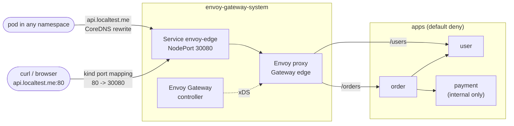
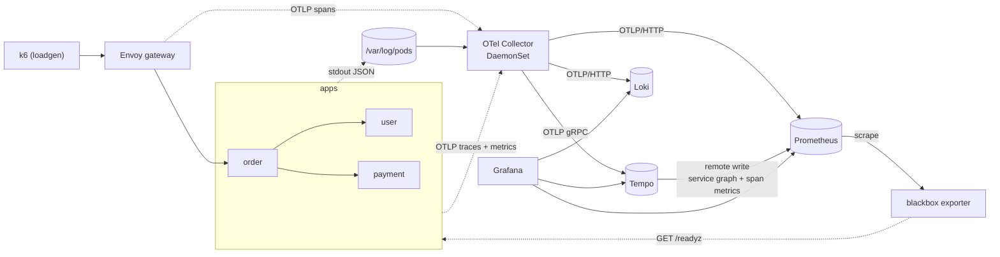
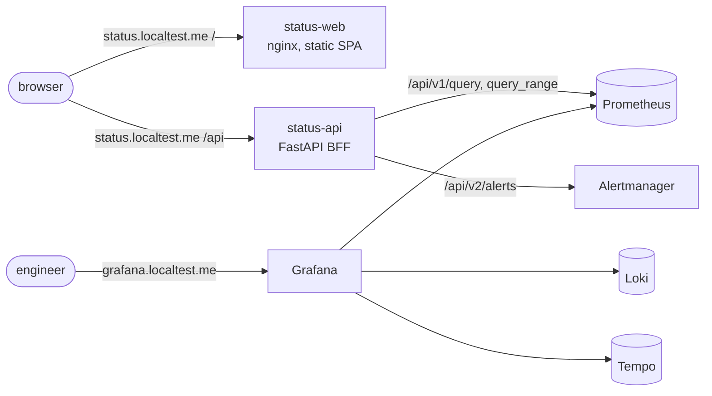

# Local Kubernetes platform (Phases 2–4)

One command creates a single-node [kind](https://kind.sigs.k8s.io/) cluster on Docker or Podman, installs
[Envoy Gateway](https://gateway.envoyproxy.io/) as the edge, deploys the User, Order and Payment services with
probes, hardened pods and default-deny NetworkPolicies (Phase 2), and the telemetry pipeline and storage: OpenTelemetry
Collector, Prometheus, Alertmanager, Grafana, Loki, Tempo, a blackbox exporter and a k6 load generator (Phase 3,
[details](#telemetry-pipeline-and-storage-phase-3)), then Grafana's linked signals and two dashboards, the Status API and the
status page on http://status.localtest.me (Phase 4, [details](#visualization-and-status-page-phase-4)).

```bash
make up       # prereqs -> kind cluster -> images (services + stack) -> helmfile apply -> CoreDNS rewrite -> status
make verify   # automated checks: gateway, NetworkPolicy, readiness (2); metrics, logs, traces, UIs (3); dashboards, links, status page (4)
make grafana-password   # http://grafana.localtest.me, user admin
make down     # delete the cluster
```

```bash
curl -s -X POST http://api.localtest.me/orders -H 'content-type: application/json' \
  -d '{"user_id":"u-1001","items":[{"sku":"book","quantity":2,"unit_price":"12.50"}],"currency":"EUR"}'
curl -s http://api.localtest.me/orders/<id>
curl -s http://api.localtest.me/users/u-1001
```

If `api.localtest.me` does not resolve on your machine, see [Troubleshooting](#troubleshooting).

## Architecture



| Piece | Where | What it does |
|---|---|---|
| kind cluster `shd` | [`kind/kind-config.yaml`](kind/kind-config.yaml) | One node, `kindest/node:v1.36.4` pinned by digest, host ports 80/443 → NodePorts 30080/30443 |
| Envoy Gateway v1.9.3 | release `envoy-gateway`, [`values/envoy-gateway.yaml`](values/envoy-gateway.yaml) | Controller from `oci://docker.io/envoyproxy/gateway-helm`; the chart also installs the Gateway API v1.6.1 CRDs |
| Edge | release `edge`, [`charts/edge`](charts/edge) | `EnvoyProxy` (NodePort Service with the fixed name `envoy-edge`), `GatewayClass` and `Gateway` `edge` (HTTP listener on 80 for `*.localtest.me`), `BackendTrafficPolicy` |
| Namespace baseline | release `apps-baseline`, [`charts/namespace-baseline`](charts/namespace-baseline) | `default-deny-all` (ingress and egress) and `allow-dns-egress` |
| Services | releases `user`, `order`, `payment`, [`charts/microservice`](charts/microservice) + [`values/<svc>.yaml`](values) | Deployment, Service (port 80 → 8080), ServiceAccount, NetworkPolicy, HTTPRoute |
| Namespaces | [`scripts/namespaces.sh`](scripts/namespaces.sh) | Creates `apps` and `envoy-gateway-system` with Pod Security Admission `restricted` (enforce, warn, audit) |
| CoreDNS | [`scripts/coredns-localtest.sh`](scripts/coredns-localtest.sh) | `*.localtest.me` → `envoy-edge.envoy-gateway-system.svc.cluster.local` inside the cluster |
| Observability (Phase 3) | releases in namespace `observability`, see [Telemetry pipeline and storage](#telemetry-pipeline-and-storage-phase-3) | Prometheus Operator CRDs, kube-prometheus-stack, Loki, Tempo, OTel Collector, blackbox exporter, `observability-config` (UI routes, Probes, Envoy PodMonitor) |
| Load generator (Phase 3) | release `loadgen` in namespace `loadgen`, [`../loadgen`](../loadgen) | k6 Deployment with steady order traffic through the gateway |
| Status (Phase 4) | releases `status-api`, `status-web` in `apps`, [`charts/microservice`](charts/microservice) + [`values/status-*.yaml`](values) | Status API ([`../services/status-api`](../services/status-api)) on `/api` and the static status page ([`../web`](../web)) on `/` of `status.localtest.me` |

[`helmfile.yaml`](helmfile.yaml) orders the releases with `needs`: Envoy Gateway (with its CRDs) first, then the edge, the
namespace baseline and the services; the Prometheus Operator CRDs before everything that creates `ServiceMonitor`,
`PodMonitor` or `Probe` resources; the load generator after the order service. Every chart version is pinned.

### Versions

| Component | Version | Evidence |
|---|---|---|
| kind | ≥ 0.33.0 | Node image digest taken from the [v0.33.0 release notes](https://github.com/kubernetes-sigs/kind/releases/tag/v0.33.0), which require digest pinning |
| Kubernetes (node) | v1.36.4 | kind 0.33 defaults to v1.37.0, but [Envoy Gateway v1.9 is tested on 1.33–1.36](https://gateway.envoyproxy.io/news/releases/matrix/) |
| kubectl | 1.35–1.37 | [Version skew policy](https://kubernetes.io/releases/version-skew-policy/#kubectl): ±1 minor of the API server |
| Envoy Gateway | v1.9.3 (latest stable; v1.10 is still a release candidate) | Gateway API v1.6.1, Envoy distroless v1.39.x |
| Helm / helmfile / helm-diff | 4.x / 1.8 / 3.15 | `make prereqs` checks them |
| CoreDNS | v1.14.2 (from the node image) | Supports `rewrite … answer auto` |
| kube-prometheus-stack | chart 92.17.0 (Operator v0.94.2, Prometheus v3.15.1, Alertmanager v0.34.2, Grafana 13.3.0, kube-state-metrics 2.20.0) | Latest chart; `prometheus-operator-crds` 32.0.2 carries the same Operator version |
| Loki | chart `grafana-community/loki` 20.2.1 (Loki 3.7.9) | [Grafana's install docs](https://grafana.com/docs/loki/latest/setup/install/helm/install-monolithic/) moved to the community chart; `grafana/loki` 7.x now targets Grafana Enterprise Logs |
| Tempo | chart `grafana-community/tempo` 3.2.1 (Tempo 3.1.1) | [Tempo's Helm docs](https://grafana.com/docs/tempo/latest/set-up-for-tracing/setup-tempo/deploy/kubernetes/helm-chart/): `tempo` chart for monolithic mode; Tempo 3 runs monolithic without Kafka |
| OpenTelemetry Collector | chart 0.178.1, image `opentelemetry-collector-contrib` 0.164.0 | Same Collector version as `compose.yaml` |
| Blackbox exporter | chart 11.20.2 (v0.29.1) | |
| k6 | `grafana/k6:2.3.0` | Same version as the host `k6` |

## Make targets

| Target | What it does |
|---|---|
| `make prereqs` | Engine reachable (Podman must be **rootful**), ≥ 4 CPUs / 8 GiB, kind ≥ 0.33, kubectl within skew of the node image, Helm 4, helm-diff, helmfile |
| `make cluster-up` / `cluster-down` | Create (idempotent) or delete the kind cluster |
| `make images` | `make build` (the four Python images and the `status-web` image from [`../web/Dockerfile`](../web/Dockerfile)), then load them into kind. Docker: `kind load docker-image`. Podman: `podman save -m` to one archive → `kind load image-archive` |
| `make platform-images` | Renders the releases (`helmfile template`), pulls the third-party images that are not on the node yet with the engine (4 in parallel) and loads them into kind ([`scripts/preload-images.sh`](scripts/preload-images.sh)) |
| `make deploy` | Namespaces with PSA labels → Grafana admin Secret (once) → `helmfile apply` → wait for `Gateway` `Programmed` → CoreDNS rewrite. Idempotent |
| `make up` / `make down` | `cluster-up images platform-images deploy status` / `cluster-down` |
| `make grafana-password` | Prints the generated Grafana admin password (user `admin`) |
| `make load-start` / `load-stop` | Scale the k6 load generator to 1 / 0 replicas |
| `make redeploy` | Rebuild and reload the images, then `rollout restart` the services (the tag stays `dev`) |
| `make status` | Nodes, Gateway and HTTPRoutes, Envoy Service, workloads and NetworkPolicies |
| `make verify` | Loads the `curl` test image into kind, then runs [`scripts/verify.sh`](scripts/verify.sh), [`scripts/verify-telemetry.sh`](scripts/verify-telemetry.sh) and [`scripts/verify-status.sh`](scripts/verify-status.sh), see [Verification](#verification) |
| `make web-check` / `web-dev` | Web monorepo: Prettier, ESLint, typecheck, Vitest, build / Vite dev server (needs Node and pnpm, see [`../web`](../web/README.md)) |
| `make lint-charts` | `helm lint --strict` and `helm template` for the local charts (edge, namespace-baseline, observability-config, loadgen, microservice with every values file, including `status-api` and `status-web`) |

The engine is detected as in Phase 1 (Podman if it is running, otherwise Docker; `make ENGINE=docker …` forces one).
With Podman the Makefile exports `KIND_EXPERIMENTAL_PROVIDER=podman`. Every `kubectl` and `helmfile` call uses the
`kind-shd` context explicitly, so another current context is never touched.

## Edge and routing

**Envoy proxy Service.** Envoy Gateway creates the proxy Deployment and Service per `Gateway`. The `EnvoyProxy`
resource (referenced by the `GatewayClass`) sets the Service type to `NodePort`, gives it the stable name `envoy-edge`
(`envoyService.name`) and pins `nodePort: 30080` for port 80 with a strategic-merge `patch`, because the API has no
`nodePort` field. The HTTPS listener (443 → 30443) is added in Phase 6; patching a port that does not exist yet would
create a broken Service port. The Envoy container listens on 10080 (Envoy Gateway shifts privileged ports because the
proxy runs as non-root).

**What is exposed on `api.localtest.me`:**

| Path | Backend | Why |
|---|---|---|
| `/orders`, `/orders/{id}` | order | Public business API |
| `/users/{id}` | user | Public business API |
| `/payments` | – (404 at the edge) | Payment is internal; only order may call it |
| `/admin/*`, `/livez`, `/readyz`, `/docs` | – (404 at the edge) | Operational endpoints stay inside the cluster |

Each service chart renders its own `HTTPRoute` with `PathPrefix` matches (Gateway API prefixes match whole path
segments, so `/ordersX` does not match). Anything else has no rule, so Envoy answers 404 without calling a service.
Envoy normalizes paths before routing (`/orders/../admin/faults` → `/admin/faults`), and escaped slashes get a 307 to
the unescaped path (Envoy Gateway's default `UnescapeAndRedirect`), so traversal tricks also end in 404. The `Gateway`
only accepts routes from the namespaces listed in `gateway.routeNamespaces` (`apps` and, since Phase 3, `observability`).

**BackendTrafficPolicy: readiness at the edge.** Envoy Gateway marks endpoints whose pod is not ready as `DRAINING`.
With Envoy's default [panic threshold](https://www.envoyproxy.io/docs/envoy/latest/intro/arch_overview/upstream/load_balancing/panic_threshold)
of 50 %, a service whose pods are *all* not ready still received traffic through the gateway (verified: 200 instead of 503).
`healthCheck.panicThreshold: 0` disables panic mode, so the edge behaves like a Kubernetes Service: no ready pod, no
traffic, 503. No gateway retries or extra timeouts are configured on purpose: `POST /orders` is not idempotent, and
the services own their upstream timeouts (Envoy's default 15 s route timeout applies).

## Same URL inside and outside the cluster (CoreDNS)

Public DNS resolves `*.localtest.me` to `127.0.0.1`. Inside a pod that is the pod itself, so a CoreDNS
[`rewrite`](https://coredns.io/plugins/rewrite/) rule maps the names to the gateway Service instead:

```
rewrite stop {
    name regex ^(.+\.)?localtest\.me\.$ envoy-edge.envoy-gateway-system.svc.cluster.local. answer auto
}
```

`answer auto` rewrites the answer back to the queried name, so clients get an A record for `api.localtest.me`
(the `envoy-edge` ClusterIP). The regex is anchored, so search-path expansions such as
`api.localtest.me.apps.svc.cluster.local.` are not rewritten and fall through to NXDOMAIN as usual.
This matters from Phase 6, when browsers and pods must use the same OIDC issuer URL.

The script edits the `kube-system/coredns` ConfigMap as the [Kubernetes DNS customization guide](https://kubernetes.io/docs/tasks/administer-cluster/dns-custom-nameservers/)
describes. It is **idempotent**: the rule sits between `BEGIN`/`END` marker comments, is replaced on each run, and
CoreDNS is restarted only if the Corefile changed (the `reload` plugin would also pick it up, but only after one to
two minutes). kubeadm does not reconcile this ConfigMap after cluster creation, so the change lasts for the life of the cluster.

## Workloads (`charts/microservice`)

| Concern | Setting | Reason |
|---|---|---|
| startupProbe | `/livez`, every 2 s, 30 failures (60 s budget) | Protects slow starts; liveness only starts afterwards |
| livenessProbe | `/livez`, every 10 s, timeout 2 s, 3 failures | Event loop only, never dependencies → no cascading restarts |
| readinessProbe | `/readyz`, every 5 s, timeout 2 s, 2 failures | Out of the endpoints within ~10 s when starting, draining or forced not-ready |
| Graceful shutdown | `preStop: sleep 5` (native sleep action), `SHUTDOWN_DRAIN_SECONDS=3`, `SHUTDOWN_TIMEOUT_SECONDS=10`, `terminationGracePeriodSeconds: 25` | Endpoint removal propagates before SIGTERM; then the service fails `/readyz`, drains and finishes in-flight requests. The chart fails to render if the grace period is not larger than the sum |
| Resources | requests 50m / 128Mi, limits 500m / 256Mi | Laptop-sized; memory limit as in compose |
| Pod security | `runAsNonRoot` (UID/GID 10001), `readOnlyRootFilesystem`, drop `ALL` capabilities, `allowPrivilegeEscalation: false`, `seccompProfile: RuntimeDefault` | Meets the `restricted` Pod Security Standard, which the `apps` namespace enforces. No `/tmp` volume is needed: the image writes nothing at runtime |
| API access | Dedicated ServiceAccount per service, `automountServiceAccountToken: false`, `enableServiceLinks: false` | The services never call the Kubernetes API |
| Rollouts | `maxUnavailable: 0`, `maxSurge: 1` | No capacity drop during a rollout |
| OpenTelemetry | `OTEL_SERVICE_NAME`, `OTEL_RESOURCE_ATTRIBUTES` (`deployment.environment.name=kind`, `k8s.namespace.name`, `k8s.pod.name`, `k8s.pod.uid`, `k8s.node.name`, `k8s.deployment.name`, `k8s.container.name`, `service.instance.id=<namespace>.<pod>.<container>` from the downward API), `OTEL_SEMCONV_STABILITY_OPT_IN=http`, `OTEL_LOGS_EXPORTER=none` | `service.instance.id` follows the [OTel Kubernetes guidance](https://opentelemetry.io/docs/specs/semconv/non-normative/k8s-attributes/) |
| OTLP export | `otel.exporter.enabled: true` (Phase 3): traces and metrics over OTLP/gRPC to `http://otel-collector.observability.svc.cluster.local:4317` every 15 s; logs stay on stdout | `enabled: false` sets `OTEL_TRACES_EXPORTER=none` and `OTEL_METRICS_EXPORTER=none` for a cluster without the stack |

## NetworkPolicies (`apps`)

kindnet, kind's default CNI, [enforces NetworkPolicy since kind v0.24](https://github.com/kubernetes-sigs/kind/releases/tag/v0.24.0).
Policies are additive allow-lists on top of the namespace default deny.

| Policy | Selects | Allows |
|---|---|---|
| `default-deny-all` | all pods | nothing (ingress and egress) |
| `allow-dns-egress` | all pods | egress to `kube-system` `k8s-app=kube-dns` on 53/UDP and 53/TCP |
| `user` | user | ingress on 8080 from the Envoy pods of Gateway `edge` and from order |
| `order` | order | ingress on 8080 from the Envoy pods; egress to user and payment on 8080 |
| `payment` | payment | ingress on 8080 from order only |
| all three (Phase 3) | user, order, payment | egress to the OTel Collector agent pods in `observability` on 4317/4318; ingress on 8080 from the blackbox exporter pods (synthetic `/readyz` checks) |
| `status-api` (Phase 4) | status-api | ingress on 8080 from the Envoy pods; egress to the Prometheus pods on 9090 and the Alertmanager pods in `observability` on 9093, and to the Collector (OTLP) |
| `status-web` (Phase 4) | status-web | ingress on 8080 from the Envoy pods; no egress besides DNS (static files only) |

- The Envoy pods are selected by namespace (`kubernetes.io/metadata.name: envoy-gateway-system`) **and** their labels
  (`app.kubernetes.io/name: envoy`, `app.kubernetes.io/component: proxy`, `gateway.envoyproxy.io/owning-gateway-name: edge`).
- Rules use the pod port (8080): NetworkPolicy sees traffic after the Service has translated port 80.
- Kubelet probes come from the node and are not blocked; `kubectl port-forward` enters the pod's network namespace
  directly, so `/admin/faults` stays reachable for operators but not from other pods.
- **Phase 3:** `networkPolicy.otelCollector` (egress) and `networkPolicy.blackboxExporter` (ingress) select the pods by
  namespace and labels. The Collector is reached through its Service, so NetworkPolicy sees the agent's pod IP and the pod
  selector matches; no `ipBlock` for a host port is needed.

## Telemetry pipeline and storage (Phase 3)



### Signals: exactly one path each

| Signal | Source | Path | Store |
|---|---|---|---|
| Traces | services (OTel SDK), Envoy (`EnvoyProxy` telemetry, `service.name=gateway`) | OTLP/gRPC → Collector → `otlp_grpc/tempo` | Tempo |
| Application metrics | services (OTel SDK, every 15 s) | OTLP/gRPC → Collector → `otlp_http/prometheus` → `/api/v1/otlp` | Prometheus |
| Logs | services' JSON on stdout | `/var/log/pods/apps_*` → Collector `file_log` → `otlp_http/loki` → `/otlp` | Loki |
| Service graph, span metrics | Tempo metrics-generator | remote write → `/api/v1/write` (with exemplars) | Prometheus |
| Infrastructure, synthetic checks, self-metrics | kube-state-metrics, kubelet/cAdvisor, node-exporter, CoreDNS, API server, blackbox `Probe`s, Envoy, Collector, Loki, Tempo, Grafana, Operator | Prometheus scrape (`ServiceMonitor`, `PodMonitor`, `Probe`) | Prometheus |

The services set `OTEL_LOGS_EXPORTER=none` and the Collector's logs pipeline has no OTLP receiver, so no log line is
stored twice. The `file_log` receiver parses the CRI format, then the services' JSON: `timestamp`, `level` (→ severity),
`trace_id`/`span_id` (→ the log record's trace context) and `message` (→ body) become log record fields, the remaining keys
(`logger`, `http.route`, `order.id`, …) attributes. Loki stores them as structured metadata, so
`{service_name="order"} | trace_id="<id>"` or `| severity_text="ERROR"` need no `| json` parser. Read offsets are kept in
a hostPath (`file_storage`), so a restarted agent neither re-sends nor skips lines. Only the `apps` namespace is
collected; platform logs stay available through `kubectl logs`.

**How the services reach the node-local agent.** Through the Collector's Service, which the chart creates with
`internalTrafficPolicy: Local` for a DaemonSet: kube-proxy only routes to the agent on the caller's node, and the services
use a normal DNS name (`otel-collector.observability.svc.cluster.local:4317`). The alternative, `hostPort` on the node IP
(downward API `status.hostIP`), would open the receivers to everything that can reach the node and needs an `ipBlock` in
the NetworkPolicy; the Service keeps NetworkPolicy pod-based. If the local agent is down, OTLP export fails (and the SDK
retries) instead of silently crossing nodes; on one node both behave the same.

**Enrichment.** `k8s_attributes` associates OTLP data by the `k8s.pod.uid` the services send, log lines by the uid in the
file path, and Envoy spans by the connection's source IP, then adds pod metadata and `service.name` (from the
`app.kubernetes.io/*` labels, so log lines get the same `service.name` as traces and metrics). `resource` inserts
`deployment.environment.name=kind` and `k8s.cluster.name=shd`. `memory_limiter` is first in every pipeline, `batch` last.

### Stores and access

| Component | Configuration ([`values/`](values)) | Reached at |
|---|---|---|
| Prometheus | `enableOTLPReceiver`; promotes only `service.name`, `k8s.namespace.name`, `k8s.pod.name` to labels (`job`/`instance` come from `service.name`/`service.instance.id`, the rest stays on `target_info`); translation `UnderscoreEscapingWithSuffixes` (→ `http_server_request_duration_seconds_*`); `enableRemoteWriteReceiver`; `exemplar-storage` (100k); `outOfOrderTimeWindow: 30m`; selects every `ServiceMonitor`/`PodMonitor`/`Probe`/`PrometheusRule` in the cluster | http://prometheus.localtest.me |
| Alertmanager | Chart default configuration (all alerts to the `null` receiver); routing and Mailpit arrive in Phase 5 | http://alertmanager.localtest.me |
| Grafana | Admin password from the Secret `grafana-admin` that `make deploy` generates once per cluster ([`scripts/grafana-admin-secret.sh`](scripts/grafana-admin-secret.sh)), anonymous access and sign-up off, no PVC, datasources Prometheus (`uid: prometheus`), Loki (`loki`), Tempo (`tempo`), Alertmanager. Correlations and the two dashboards come in Phase 4; the chart's ~25 default dashboards are not installed | http://grafana.localtest.me |
| Loki | Monolithic, filesystem, `retention_period: 24h` (compactor), `allow_structured_metadata`; index labels only `service.name`, `service.namespace`, `k8s.namespace.name`, `k8s.container.name`, `deployment.environment.name` (Loki's default list would also index `k8s.pod.name` and `service.instance.id`); gateway, memcached caches, canary, ruler and Helm test pod off | in-cluster `loki:3100` |
| Tempo | Monolithic (Tempo 3: no Kafka), local backend, 24 h block retention, OTLP receivers; metrics-generator with `service-graphs` and `span-metrics`, remote write with exemplars | in-cluster `tempo:3200` (query), `:4317` (OTLP) |
| Blackbox exporter | Module `http_2xx` without redirects; one `Probe` per service on `http://<svc>.apps.svc.cluster.local/readyz` every 15 s (label `service`) | in-cluster `blackbox-exporter:9115` |
| Envoy gateway | `EnvoyProxy.spec.telemetry`: OpenTelemetry tracing (100 % sampling, `service.name=gateway`, W3C `traceparent`) to the Collector, Prometheus stats on port 19001 scraped by a `PodMonitor` | — |
| k6 | [`../loadgen`](../loadgen): `constant-arrival-rate`, 2 iterations/s (POST order, GET order, 30 % GET user ≈ 4.6 requests/s at the edge) for users u-1001…u-1003 against `http://api.localtest.me` | `make load-stop` / `load-start` |

The UI routes ([`charts/observability-config`](charts/observability-config)) send everything to the backend except
Prometheus' `/api/v1/write`, `/api/v1/otlp`, `/-/reload`, `/-/quit` and Alertmanager's `/-/reload`, `/-/quit`, which an
Envoy Gateway `HTTPRouteFilter` answers with 403 at the edge: the receivers are meant for the Collector and Tempo, and
the lifecycle endpoints for the Operator's config reloader, not for anyone on the network. Until Phase 6 adds SSO, the
UIs have no login besides Grafana's own (see the 0.0.0.0 note in [Troubleshooting](#troubleshooting)).

Not scraped on kind, so they do not show up as down targets: etcd, kube-controller-manager, kube-scheduler (they bind
their metrics to 127.0.0.1 in kind) and kube-proxy (`metricsBindAddress` 127.0.0.1:10249); their default rules are off
too. The other default kube-prometheus-stack rules are loaded; Phase 5 adds the project's alerts and routing.

**Pod Security.** `observability` enforces `privileged`: the Collector reads `/var/log/pods` and writes offsets through
hostPath volumes, node-exporter uses the host network and PID namespaces. All other pods there set restricted-style
security contexts (non-root, no privilege escalation, dropped capabilities, read-only root filesystem where the image
allows it). The Collector runs as root without capabilities, because the pod log files are root-owned with mode 0640.
`loadgen` enforces `restricted`. `observability` has no default-deny NetworkPolicy yet: its components talk to the API
server and the node (kubelet, node-exporter) on host IPs, which kindnet only matches with `ipBlock`s; see Deviations.

### Storage

Dynamic provisioning through kind's default `standard` StorageClass (local-path-provisioner, `reclaimPolicy: Delete`,
so `make down` wipes the data). local-path does **not** enforce capacities: the retention settings are the real limit.

| PVC | Size | Contents | Limit that matters |
|---|---|---|---|
| `prometheus-kps-prometheus-db-…-0` | 2 Gi | TSDB, WAL | `retention: 24h`, `retentionSize: 1.5GB` |
| `alertmanager-kps-alertmanager-db-…-0` | 1 Gi | silences, notification log | small |
| `storage-loki-0` | 2 Gi | chunks, TSDB index, WAL, compactor | `retention_period: 24h` |
| `storage-tempo-0` | 2 Gi | blocks, WAL, metrics-generator WAL | block retention 24 h |

No PVC: Grafana (provisioned from ConfigMaps), the services (in-memory). The Collector keeps only file offsets (hostPath
`/var/lib/otelcol`). After 20 minutes of k6 traffic the volumes held 8 MB (Prometheus), 8 MB (Tempo) and 5 MB (Loki).

### Resources (measured)

Every container has requests and limits (the columns show the configured values). Working sets measured with Prometheus
(cAdvisor) about 15 minutes after `make up`, k6 running; Podman machine with 4 CPUs and 10 GiB:

| Namespace | Working set | Requests | Limits |
|---|---|---|---|
| observability | 1306 MiB | 1818 MiB | 5312 MiB |
| kube-system (kind control plane) | 959 MiB | 290 MiB | 340 MiB |
| envoy-gateway-system | 79 MiB | 288 MiB | 1024 MiB |
| apps | 154 MiB | 384 MiB | 768 MiB |
| loadgen | 14 MiB | 64 MiB | 256 MiB |
| **Total** | **2.5 GiB** | **2.8 GiB** | 7.5 GiB |

Largest consumers in `observability`: Grafana 440 MiB (incl. two sidecars), Prometheus 291 MiB (58k head series),
Collector 70–220 MiB, Tempo 154 MiB, Loki 91 MiB. The node reported 3.3 GiB of 9.7 GiB in use; CPU stayed below
0.25 cores in total. `metrics-server` is not installed, so `kubectl top` is not available; Prometheus covers it.

### Deviations from the plan

- **Charts.** Loki and Tempo come from `grafana-community` (where Grafana's documentation now points), not from
  `grafana/helm-charts`. Tempo is 3.x: the compactor is replaced by the backend scheduler/worker, retention is set there.
- **Tempo's Jaeger receivers** stay at the chart defaults: the chart's Service templates require them (`receivers.jaeger:
  null` fails to render). Nothing sends Jaeger and the Service is internal.
- **Prometheus Operator CRDs** come from the `prometheus-operator-crds` chart (server-side apply, upgraded with the chart)
  instead of kube-prometheus-stack's `crds/` directory.
- **No default-deny in `observability`** yet (see Pod Security above); the apps keep theirs. To be revisited with Phase 6.
- **Collector component names** follow the Collector's renames (`file_log`, `k8s_attributes`, `otlp_grpc`, `otlp_http`);
  the `debug` exporter is not in any pipeline.
- **Image preload** (`make platform-images`): not in the plan; added because kubelet pulls of ~15 images one by one
  through the Podman DNS took longer than Helm's timeout.

## Visualization and status page (Phase 4)



| URL | What |
|---|---|
| http://status.localtest.me | Status page ([`../web/apps/status`](../web/README.md)): UP / DEGRADED / DOWN per service, RPS, 5xx %, p95 with sparklines, active alerts |
| http://status.localtest.me/api/v1/services | Status API JSON ([contract](../services/README.md#status-api)); also `/api/v1/services/{name}` and `/api/v1/alerts` |
| http://grafana.localtest.me/d/shd-overview | Service Health Overview |
| http://grafana.localtest.me/d/shd-service-detail?var-service=payment | Service Detail |

**Routing.** Both releases attach an `HTTPRoute` for `status.localtest.me`: `status-web` with prefix `/`, `status-api` with prefix
`/api`. Gateway API picks the longest matching prefix, so `/api/...` reaches the API and everything else the page: one origin, no
CORS, and the API's `/docs`, `/admin/faults` and probes are not reachable from outside (they fall through to the page).
Both use the generic [`charts/microservice`](charts/microservice); for the nginx image `shdRuntime: false` drops the Python
service variables (PORT, FAULT_*, OTEL_*), `tmpVolume` mounts an emptyDir on `/tmp` (read-only root filesystem), and the pod
runs as UID 101. `/livez` and `/readyz` of the page are answered by nginx itself.

**Grafana correlations** ([`values/kube-prometheus-stack.yaml`](values/kube-prometheus-stack.yaml), all provisioned; Grafana expands
`$VAR` in provisioning files, so its own macros are written `$${...}` / `$$__tags`):

| From → to | How |
|---|---|
| Metric → trace | Prometheus datasource `exemplarTraceIdDestinations` (`trace_id` → Tempo). The p95 panels request exemplars; click a dot |
| Log → trace | Loki derived field of type **label** on `trace_id` (structured metadata, not text in the line) → Tempo ("View trace" in log details) |
| Trace → logs | Tempo `tracesToLogsV2`, custom query `{service_name="<span's service.name>"} \| trace_id="<trace id>"` |
| Trace → metrics | Tempo `tracesToMetrics`: request rate, 5xx ratio and p95 of the span's service |
| Service map / node graph | Tempo `serviceMap` from Prometheus (`traces_service_graph_*` of the metrics-generator), `nodeGraph.enabled` |

**Dashboards: two, minimal (user decision).** JSON in [`charts/observability-config/dashboards`](charts/observability-config/dashboards),
one ConfigMap each (label `grafana_dashboard: "1"`), loaded by the Grafana dashboard sidecar; read-only in the UI. Metric names are the
OTLP translations verified in Prometheus (`http_server_request_duration_seconds_{bucket,count}`, labels `service_name`,
`http_response_status_code`, `http_route`); `/admin` calls are excluded from RED.

| Dashboard | Panels |
|---|---|
| **Service Health Overview** (`shd-overview`, 5 panels) | Status per service (stat: DOWN if `probe_success` = 0, DEGRADED if 5xx ratio > 5% or p95 > 500 ms over 5 m, else UP), request rate, error % (5xx), p95 latency with exemplars and threshold lines, firing alerts (`ALERTS`, critical and warning). Series link to Service Detail |
| **Service Detail** (`shd-service-detail`, `$service`, 7 panels) | Readiness probe, ready vs desired replicas, restarts (1 h) from kube-state-metrics; requests by status code, 5xx %, p50/p95/p99 with exemplars; Loki logs of the service with "View trace" links. Header links: Overview, traces of the service in Explore |

No Telemetry Pipeline dashboard: its health is covered by alerts in Phase 5; ad-hoc analysis uses Explore and the Drilldown apps.


## Verification

`make verify` runs [`scripts/verify.sh`](scripts/verify.sh) (Phase 2), [`scripts/verify-telemetry.sh`](scripts/verify-telemetry.sh)
([Phase 3](#phase-3-evidence)) and [`scripts/verify-status.sh`](scripts/verify-status.sh) ([Phase 4](#phase-4-evidence)) against the running cluster. `verify.sh` checks the Phase 2 exit criteria. It uses
`curl --resolve api.localtest.me:80:127.0.0.1` on the host so it does not depend on the host resolver, and a throwaway
`curl` pod in a `netcheck` namespace (outside `apps`) for the in-cluster checks.

Evidence from `make down && make up && make verify` (Podman 6.1.4 rootful machine, macOS arm64), trimmed:

```text
$ make down && make up        # from scratch: 376 s (two runs: 376 s and 468 s; mostly Envoy Gateway image pulls)
Container engine: podman
  ok    podman 6.1.4, rootful, running
  ok    engine resources: 4 CPUs / 9 GiB
  ok    kind v0.33.0
  ok    kubectl v1.37.2 (node image v1.36)
  ok    helm v4.3.1
  ok    helm-diff plugin
  ok    helmfile version v1.8.2
WARNING: gateway ports 80/443 bind to 0.0.0.0 (reachable from the network); see deploy/README.md
...
NAME            NAMESPACE              CHART                                     VERSION   DURATION
apps-baseline   apps                   ./charts/namespace-baseline               0.1.0           0s
envoy-gateway   envoy-gateway-system   oci://docker.io/envoyproxy/gateway-helm   v1.9.3       1m48s
edge            envoy-gateway-system   ./charts/edge                             0.1.0           0s
payment         apps                   ./charts/microservice                     0.1.0           3s
user            apps                   ./charts/microservice                     0.1.0           3s
order           apps                   ./charts/microservice                     0.1.0           3s
coredns: *.localtest.me -> envoy-edge.envoy-gateway-system.svc.cluster.local (configured, CoreDNS restarted)

$ make verify
== 1. Readiness of the platform
  PASS  Gateway envoy-gateway-system/edge Programmed=True
  PASS  deployment apps/user available
  PASS  deployment apps/order available
  PASS  deployment apps/payment available
== 2. Host -> gateway (http://api.localtest.me:80)
  WARN  host DNS does not resolve api.localtest.me; add it to /etc/hosts (see deploy/README.md)
  PASS  POST /orders -> 201
  PASS  GET /orders/32c2dacf27d2 -> 200
  PASS  GET /users/u-1001 -> 200
  PASS  GET /payments (not exposed) -> 404
  PASS  GET /admin/faults (not exposed) -> 404
  PASS  GET /livez (not exposed) -> 404
  PASS  GET /readyz (not exposed) -> 404
  PASS  GET /docs (not exposed) -> 404
  PASS  GET /orders/../admin/faults (not exposed) -> 404
  PASS  GET /orders/%2e%2e/admin/faults (not exposed) -> 404
  PASS  GET /users/..%2fadmin/faults (not exposed) -> 404
  PASS  POST /payments (not exposed) -> 404
  PASS  PUT /admin/faults (not exposed) -> 404
== 3. Pod -> gateway via CoreDNS rewrite (namespace netcheck, outside apps)
  PASS  api.localtest.me resolves in-cluster to the envoy-edge Service -> 10.96.232.202
  PASS  pod: POST http://api.localtest.me/orders -> 201
  PASS  pod: GET http://api.localtest.me/users/u-1001 -> 200
== 4. NetworkPolicy (default deny in apps)
  PASS  pod outside apps -> payment.apps directly (blocked) -> 000
  PASS  pod outside apps -> user.apps directly (blocked) -> 000
  PASS  pod outside apps -> order.apps directly (blocked) -> 000
  PASS  order -> user and order -> payment allowed (POST /orders returned 201 above)
== 5. Readiness probe: not ready => out of endpoints, not restarted
  PASS  EndpointSlice user: endpoint ready (after 8 s) -> false
  PASS  gateway GET /users/u-1001 while not ready -> 503
  PASS  /livez still healthy -> 200
  PASS  restartCount unchanged after 35 s -> 0
  PASS  EndpointSlice user: endpoint ready after restore -> true
  PASS  gateway GET /users/u-1001 after restore -> 200

verify: 30 passed, 0 failed

$ make cluster-up deploy      # second run: idempotent, 5 s
kind cluster 'shd' already exists
coredns: *.localtest.me rewrite already present (unchanged)

# Graceful shutdown: 150 requests (every 0.2 s) through the gateway during `kubectl rollout restart deploy/user`
    150 200
```

Before the `BackendTrafficPolicy` was added, check 5 returned **200** instead of 503 through the gateway (Envoy panic
mode, see [Edge and routing](#edge-and-routing)), although the EndpointSlice already showed `ready=false`.

Readiness by hand:

```bash
kubectl -n apps port-forward deploy/user 18081:8080 &
curl -X PUT localhost:18081/admin/faults -H 'content-type: application/json' -d '{"ready":false}'
kubectl -n apps get endpointslice -l kubernetes.io/service-name=user \
  -o jsonpath='{.items[*].endpoints[*].conditions}'   # ready=false, pod not restarted
curl -X DELETE localhost:18081/admin/faults
```

### Phase 3 evidence

[`scripts/verify-telemetry.sh`](scripts/verify-telemetry.sh) runs after `verify.sh`. It queries through the gateway
(`--resolve <ui>.localtest.me:80:127.0.0.1`), Grafana's datasource proxy for Loki and Tempo, and retries each check for up
to 4 minutes while the first export and scrape cycles complete. Final run from scratch (Podman 6.1.4, macOS arm64), trimmed:

```text
$ make down && make up        # 352 s (images cached by the engine; first ever run ~15 min of pulls)
platform images: 15 referenced, 15 not on the node yet
platform images: loaded 15 into shd-control-plane
NAME                       NAMESPACE              CHART                                               VERSION   DURATION
prometheus-operator-crds   observability          prometheus-community/prometheus-operator-crds       32.0.2          4s
blackbox-exporter          observability          prometheus-community/prometheus-blackbox-exporter   11.20.2         3s
otel-collector             observability          open-telemetry/opentelemetry-collector              0.178.1        12s
kube-prometheus-stack      observability          prometheus-community/kube-prometheus-stack          92.17.0        25s
tempo                      observability          grafana-community/tempo                             3.2.1          26s
loki                       observability          grafana-community/loki                              20.2.1         47s
observability-config       observability          ./charts/observability-config                       0.1.0           0s
loadgen                    loadgen                ../loadgen                                          0.1.0           1s

$ make verify                 # 86 s; Phase 2 part: 30 passed, 0 failed (as above)
== 1. Observability workloads and storage
  PASS  all pods Ready in observability (10)
  PASS  all pods Ready in loadgen (1)
  PASS  OTel Collector DaemonSet: one agent per node
  PASS  PVC prometheus-kps-prometheus-db-prometheus-kps-prometheus-0 -> Bound 2Gi
  PASS  PVC alertmanager-kps-alertmanager-db-alertmanager-kps-alertmanager-0 -> Bound 1Gi
  PASS  PVC storage-loki-0 -> Bound 2Gi
  PASS  PVC storage-tempo-0 -> Bound 2Gi
== 2. Prometheus (via http://prometheus.localtest.me)
  PASS  no scrape target down -> 22 targets, down: 0
  PASS  OTLP http_server_request_duration_seconds for user/order/payment -> order payment user
  PASS  business metric orders_created_total -> 178
  PASS  business metric payments_processed_total -> 201
  PASS  Tempo service graph edges (traces_service_graph_request_total) -> gateway->order gateway->user order->payment order->user user->gateway user->user
  PASS  Tempo span metrics (traces_spanmetrics_calls_total) -> 1953
  PASS  blackbox probe_success for user/order/payment -> order=1 payment=1 user=1
  PASS  Envoy gateway metrics (envoy_cluster_upstream_rq_total) -> 764
  PASS  Collector metrics: spans accepted -> 1963
  PASS  Collector metrics: log records accepted -> 1403
  PASS  Collector metrics: metric points accepted -> 126
  INFO  Collector export failures since start -> 0
  PASS  exemplars on http_server_request_duration_seconds -> 31 exemplars with trace_id
== 3. Edge routes for the UIs
  PASS  GET http://grafana.localtest.me/api/health -> 200
  PASS  GET http://prometheus.localtest.me/-/ready -> 200
  PASS  GET http://alertmanager.localtest.me/-/ready -> 200
  PASS  POST prometheus.localtest.me/api/v1/write (blocked at the edge) -> 403
  PASS  POST prometheus.localtest.me/api/v1/otlp/v1/metrics (blocked at the edge) -> 403
  PASS  POST prometheus.localtest.me/-/reload (blocked at the edge) -> 403
  PASS  POST prometheus.localtest.me/-/quit (blocked at the edge) -> 403
== 4. Grafana (via http://grafana.localtest.me)
  PASS  anonymous API access refused -> 401
  PASS  chart default password rejected -> 401
  PASS  login with the generated admin password -> 200
  PASS  datasource prometheus health -> OK
  PASS  datasource loki health -> OK
  PASS  datasource tempo health -> OK
== 5. Loki logs and Tempo traces (through Grafana's datasource proxy)
  PASS  Loki: user JSON log line with trace_id, severity, message -> 6ef055ae6abf8d88e619c39b49414abf INFO 'request completed'
  PASS  Loki: order JSON log line with trace_id, severity, message -> 85c961c87ac24de7119f4bbb981c16ce INFO 'request completed'
  PASS  Loki: payment JSON log line with trace_id, severity, message -> 6ef055ae6abf8d88e619c39b49414abf INFO 'request completed'
  PASS  Tempo: POST /orders trace (trace_id from a Loki line) spans gateway -> order -> user/payment -> trace_id 4792ae6fe56a5c72a9f9cbc2e9e7e2c0 from Loki: 7 spans, edges: gateway->order order->payment order->user

verify-telemetry: 36 passed, 0 failed
```

One `POST /orders` trace as Tempo returns it (service, kind, span name; indentation = parent):

```text
gateway  SERVER  ingress                                      http.url=http://api.localtest.me/orders
gateway  CLIENT    router httproute/apps/order/rule/0 egress
order    SERVER      POST /orders                               201
order    CLIENT        GET  -> user    SERVER  GET /users/{user_id}   200
order    CLIENT        POST -> payment SERVER  POST /payments         201
```

A Loki line of the same request (structured metadata trimmed): `{service_name="order", k8s_namespace_name="apps",
k8s_container_name="order", deployment_environment_name="kind"}` `request completed` with `severity_text=INFO`,
`trace_id`, `span_id`, `http_route=/orders`, `http_response_status_code=201`, `k8s_pod_name`, `logger=shd.runtime`.

In the service graph, `user->gateway` and `user->user` are Tempo's **virtual client node**, which Tempo always calls
`user`: requests whose caller sends no spans (k6 and curl at the edge, `kubectl port-forward` calls to `/admin/faults`
in `verify.sh`). They are not the User service.

### Phase 4 evidence

[`scripts/verify-status.sh`](scripts/verify-status.sh) runs last in `make verify`. It checks the status page and the documented JSON
through the gateway, the NetworkPolicies from a pod outside `apps`, both dashboards through Grafana's API (every Prometheus query of
the Overview has data for all three services, every panel of Service Detail including the logs panel has data for each service),
and the correlations by following them: an exemplar of the p95 panel to its trace in Tempo, a Loki line's `trace_id` to its trace,
the trace-to-logs query back to Loki, and the service-graph metrics behind the service map. Final run from scratch
(`make down && make up && make verify`, Podman 6.1.4, macOS arm64): `make up` 429 s, `make verify` 290 s,
**Phase 2: 30 passed, Phase 3: 36 passed, Phase 4: 27 passed, 0 failed**. The Phase 4 part:

```text
== 1. Status workloads
  PASS  deployment apps/status-api available
  PASS  deployment apps/status-web available
== 2. Status page and Status API (http://status.localtest.me)
  PASS  GET / (status page) -> 200 text/html
  PASS  index.html is the status page
  PASS  GET /services/payment (SPA fallback) -> 200 text/html
  PASS  GET /assets/index-Dq5nv3id.js (hashed asset, long-lived cache) -> public, max-age=31536000, immutable
  PASS  GET /api/v1/services matches the contract -> keys, sources ok, metrics and series for user/order/payment
  PASS  all three services UP -> overall=UP user=UP order=UP payment=UP
  PASS  GET /api/v1/services/payment -> 200 payment
  PASS  GET /api/v1/services/unknown -> 404
  PASS  GET /api/v1/alerts -> 200 ok
  PASS  GET /admin/faults is not the Status API (served by the page) -> text/html
  PASS  GET /docs is not the Status API (served by the page) -> text/html
  PASS  GET /openapi.json is not the Status API (served by the page) -> text/html
  PASS  GET /api/../admin/faults is not the Status API (served by the page) -> text/html
  PASS  PUT /admin/faults (not routed to the API) -> 405
== 3. NetworkPolicy (namespace netcheck-status, outside apps)
  PASS  pod outside apps -> status-api.apps directly (blocked) -> 000
  PASS  pod outside apps -> status-web.apps directly (blocked) -> 000
  PASS  pod: GET http://status.localtest.me/api/v1/services via the gateway -> 200
  PASS  status-api -> Prometheus 9090 and Alertmanager 9093 allowed (both sources ok above)
== 4. Grafana dashboards (via http://grafana.localtest.me)
  PASS  dashboards provisioned (sidecar): Service Health Overview, Service Detail -> Service Detail (7 panels); Service Health Overview (5 panels)
  PASS  Overview: every panel has data for all three services -> data for user/order/payment in: Status, Request rate, Error % (5xx), p95 latency
  PASS  Service Detail: every panel has data for each service -> all panels (incl. logs) have data for user/order/payment
== 5. Correlations
  PASS  datasource correlation settings (provisioned, macros not expanded) -> exemplars->tempo, loki trace_id->tempo, tempo->loki/prometheus, service map, node graph
  PASS  exemplar on the p95 panel -> trace in Tempo -> trace_id b8786953191dee761f858d42275fdf57: 7 spans in Tempo
  PASS  log line -> trace (derived field) -> logs of another service (traces to logs) -> trace_id b4208fa803efbe466ac22a74f65bddc2 (payment log line) -> Tempo services ['gateway', 'order', 'payment', 'user'] -> 2 order log lines
  PASS  service map metrics (Tempo service graph) for the Tempo datasource -> gateway->order order->payment order->user

verify-status: 27 passed, 0 failed
```

**Fault test** (k6 running, faults set with `kubectl port-forward` + `PUT /admin/faults`, Status API and the Overview's status query
polled every 5 s; both always agreed):

| Fault | Status API and Overview | After reset |
|---|---|---|
| Payment `error_rate=0.5` | payment `DEGRADED` after **41 s** (5xx 5.6%), order `DEGRADED` after **62 s** (its `POST /orders` return 502); peak 5xx ratio ≈ 50% payment / 35% order on the Error % panel | order `UP` after 242 s, payment after 263 s |
| User `latency_ms=800` | user `DEGRADED` after **31 s** (p95 872 ms); order follows (it waits for user: p95 940 ms) | order `UP` after 269 s, user after 290 s |

Detection within about one minute is the exit criterion. Recovery takes about five minutes on purpose: the status uses the
5-minute windows of the alert rules, so the page and the on-call email (Phase 5) never disagree, and a short dip does not flap.
The sparklines use 1-minute windows and show the recovery first. The Overview screenshot in
[Visualization and status page](#visualization-and-status-page-phase-4) was taken during the User fault, with the earlier Payment
error spike still in the 30-minute window; the status page screenshot is in [`../web/README.md`](../web/README.md).

**Resources:** status-api 50 MiB, status-web (nginx) 5 MiB working set; images 200 MB (Python) and 63 MB (nginx).

**Phase 4 deviations from the plan**

- **Dashboards in `charts/observability-config/dashboards/`**, not `deploy/dashboards/`: Helm only reads files inside a chart
  (`.Files.Glob`), and that chart already owns the other observability resources.
- **Status rule thresholds**: 5xx > 5% (the `HighErrorRate` threshold); the architecture document said 1%, which would have
  contradicted the alert. A fourth status `UNKNOWN` covers a missing data source. Both are noted in ADR 0006.
- **Overview "firing alerts" is a Prometheus `ALERTS` table**, not Grafana's alert list panel, which lists Grafana-managed rules;
  the project's rules are Prometheus rules (Phase 5). The Status API reads Alertmanager instead (silences and inhibition applied).
- **Status API uses `/api/v1/query_range` too**, for the sparkline series, besides `/api/v1/query`.
- **`microservice` chart**: `shdRuntime` and `tmpVolume` values so that the nginx image reuses the chart; the three services render
  unchanged.
- **shadcn CLI and TLS**: the CLI's HTTP client rejected `ui.shadcn.com`'s certificate chain with Node's bundled CA store; it ran with
  `NODE_EXTRA_CA_CERTS=/etc/ssl/cert.pem` (macOS system CAs). The `--monorepo` scaffold uses turbo; the app was renamed from
  `apps/web` to `apps/status`.

## Troubleshooting

**First `make up` takes long, or Helm times out waiting for observability pods.** The kubelet pulls images one at a time;
`make platform-images` (part of `make up`) pulls them with the engine in parallel and loads them into the node first.
If a release still times out (`context deadline exceeded`), check `kubectl -n observability get events` for pulls in
progress and run `make deploy` again: it is idempotent.

**Grafana login.** User `admin`, password from `make grafana-password`. The chart's NOTES print the default secret name
and `prom-operator`; neither is used here. The Secret survives `make deploy`; `make down` deletes it with the cluster.

**`api.localtest.me` does not resolve on the host.** Some resolvers (home routers, corporate DNS) drop public answers that
point to private addresses (DNS-rebinding protection). Check with `dig +short api.localtest.me @1.1.1.1` (should print
`127.0.0.1`) and `dscacheutil -q host -a name api.localtest.me` (empty if your resolver filters it). Fix it with
`/etc/hosts` (needs admin rights) or test with `curl --resolve api.localtest.me:80:127.0.0.1 …`:

```text
127.0.0.1 api.localtest.me grafana.localtest.me prometheus.localtest.me alertmanager.localtest.me status.localtest.me mail.localtest.me
```

**Podman on macOS: port 80 binds to `0.0.0.0`.** The Podman machine publishes ports through `gvproxy`, which runs as
your user. macOS lets unprivileged processes bind ports below 1024 only on the wildcard address, so
`listenAddress: 127.0.0.1` fails with `bind: permission denied`. On Podman + macOS the Makefile therefore writes a copy of
the kind config with `listenAddress: "0.0.0.0"` (and prints a warning). The gateway is then reachable from your network
unless the macOS firewall blocks incoming connections (System Settings → Network → Firewall; check with
`/usr/libexec/ApplicationFirewall/socketfilterfw --getglobalstate`). Phase 2 exposes only the routed business APIs; Phase 3 adds Grafana (own login, generated password, no anonymous access), Prometheus and Alertmanager (no authentication until Phase 6 SSO; their write and lifecycle endpoints answer 403 at the edge).
To keep everything on loopback instead, use Docker (Docker Desktop binds privileged ports through a privileged helper), or
use unprivileged host ports: `make down && make up GATEWAY_LISTEN_ADDRESS=127.0.0.1 GATEWAY_HTTP_PORT=8080 GATEWAY_HTTPS_PORT=8443`.
URLs from the host then need the port (`http://api.localtest.me:8080`), while pods keep using port 80.

**Podman must be rootful.** kind's Podman provider is experimental and needs a rootful machine:
`podman machine stop && podman machine set --rootful && podman machine start`. `make prereqs` checks it.

**`docker-credential-desktop: executable file not found`.** Helm falls back to `~/.docker/config.json` for OCI registry
credentials. If that file still names `"credsStore": "desktop"` after Docker Desktop was removed, every chart pull
fails, including anonymous ones. The Makefile detects a missing credential helper and runs helmfile with
`DOCKER_CONFIG=.cache/docker-config` (an empty config), so public charts are pulled anonymously; your file is not changed.

**kubectl version skew.** `make prereqs` fails if the first `kubectl` in `PATH` is not within one minor version of the node
(1.35–1.37). Put the newer kubectl first in `PATH` or run `make KUBECTL=/path/to/kubectl …`.

**Slow or failing image pulls inside the node (Podman).** The kind node resolves registries through the Podman network's
DNS (`10.89.0.1`), which sometimes answers `server misbehaving`. The kubelet retries, so Envoy Gateway still comes up,
but the first `make up` can take several minutes. Images that the platform builds or tests with (`make images`,
`make verify`) are therefore pulled by the engine on the host side and loaded into kind instead of being pulled by the node.

**Docker Hub rate limits.** The Envoy Gateway chart and images, `kindest/node` and the `curl` test image come from Docker
Hub. Log in with `podman login docker.io` / `docker login` if pulls are throttled.

**Code changes do not show up.** The images keep the tag `dev`, so a new `make images` does not restart pods. Use
`make redeploy`.

**Upgrading Envoy Gateway.** Helm installs CRDs from a chart's `crds/` directory once and never upgrades them. Apply the
new Gateway API and Envoy Gateway CRDs before bumping the chart version
([upgrade guide](https://gateway.envoyproxy.io/docs/install/install-helm/#upgrading-from-the-previous-version)).
