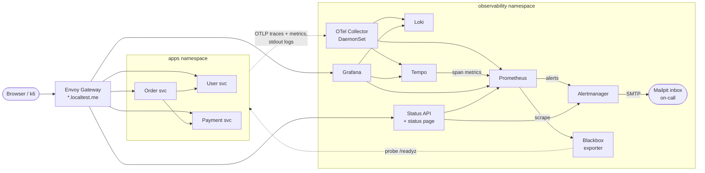
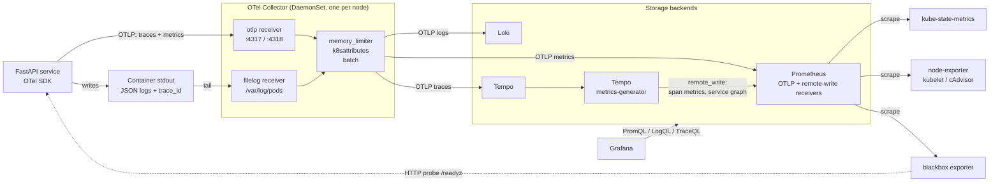
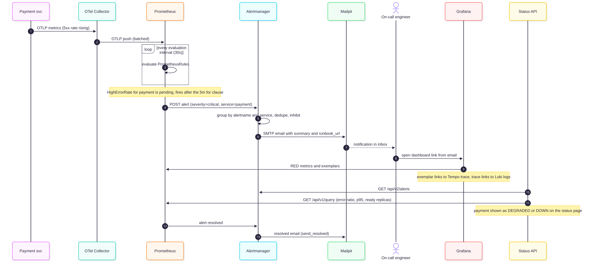
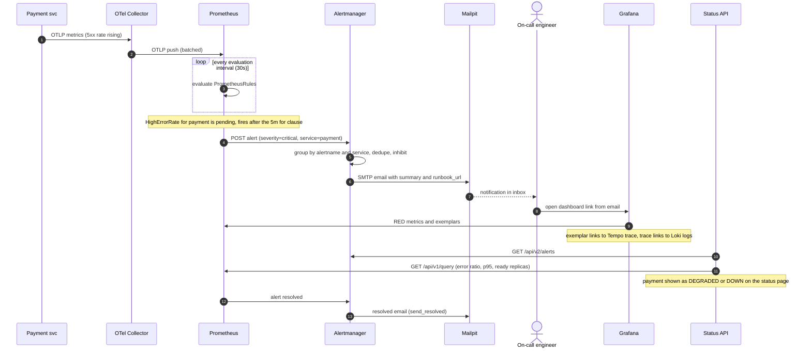
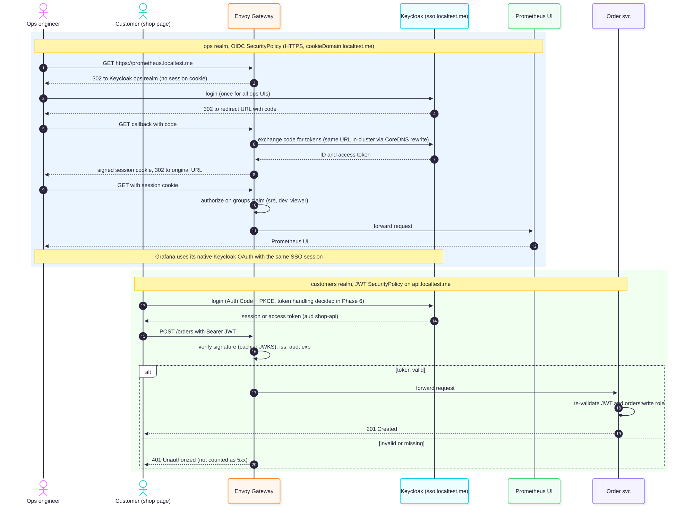
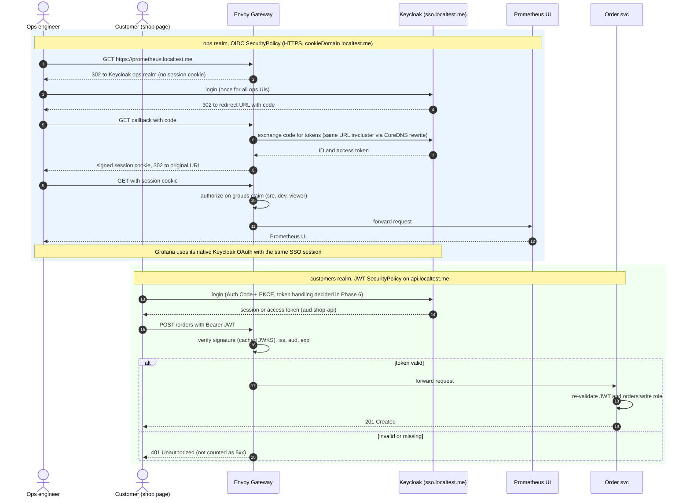

# Architecture: Service Health Dashboard

> A lightweight observability solution for three backend services (User, Order, Payment).
> This document is the design deliverable. Each decision has an ADR in [`adr/`](adr/README.md).
> The phased delivery plan is in [`roadmap.md`](roadmap.md).

## Contents

1. [Problem, goals and non-goals](#1-problem-goals-and-non-goals)
2. [Architecture overview](#2-architecture-overview)
3. [Component responsibilities](#3-component-responsibilities)
4. [Main data flows](#4-main-data-flows)
5. [Key decisions and trade-offs](#5-key-decisions-and-trade-offs)
6. [Health probe design](#6-health-probe-design)
7. [Detection and alerting strategy](#7-detection-and-alerting-strategy)
8. [Status API contract](#8-status-api-contract)
9. [Networking](#9-networking)
10. [Security and identity (Phase 6)](#10-security-and-identity-phase-6)
11. [Evolving to production](#11-evolving-to-production)
12. [Risks and mitigations](#12-risks-and-mitigations)
13. [References](#13-references)

---

## 1. Problem, goals and non-goals

**Brief:** design a lightweight observability solution for three backend services (User, Order and
Payment) that helps R&D teams to:

| # | Requirement | How this design meets it |
|---|---|---|
| R1 | Collect health and performance data | The OpenTelemetry SDK in each service sends traces, metrics and logs through an OpenTelemetry Collector. Prometheus scrapes Kubernetes and node health data. |
| R2 | Show the current status of each service | A **Status API** (backend for frontend) and a status page built with React and shadcn/ui show UP, DEGRADED or DOWN for each service. Grafana dashboards show the RED metrics (rate, errors, duration) and give a path from a metric to its traces and logs. |
| R3 | Detect problems such as high error rates or slow responses | Prometheus alerting rules watch the error ratio, p95 latency, black-box availability, pod readiness and the telemetry pipeline itself. The paging alerts are symptom-based. |
| R4 | Notify an on-call engineer when a critical condition occurs | Alertmanager groups, deduplicates, inhibits and routes alerts by severity, then sends email. Locally, Mailpit catches the email. |

**Goals**

- Use open standards and avoid vendor lock-in. Instrument once with OpenTelemetry (OTLP) and keep the backends replaceable.
- Keep it **lightweight**. The whole stack runs on a laptop in a `kind` cluster and installs with one command (`make up`, from Phase 2).
- Correlate the three signals. A metric spike links to an exemplar trace, and the trace links to its logs.
- Run every component as it would run in production, so the system can grow (see [§11](#11-evolving-to-production)).
- Write down the trade-offs so reviewers can challenge each decision.

**Non-goals (for this exercise)**

- High availability, multi-cluster deployment and long-term retention. These are covered on paper in §11 but not built.
- Real paging integrations such as PagerDuty or Opsgenie. Mailpit stands in for them, and the receiver can be swapped by changing configuration.
- Real business logic, persistence or payment processing. The services are small FastAPI apps with in-memory stores and a fault-injection endpoint (`/admin/faults`: error rate, added latency, not-ready), so that failures can be demonstrated. Because there is no database, traces contain no DB spans.
- A working CI/CD pipeline. Only a placeholder exists (see [`.github/workflows/README.md`](../.github/workflows/README.md)).

## 2. Architecture overview



<details>
<summary>Mermaid source (<a href="diagrams/overview.mmd">overview.mmd</a>)</summary>



</details>

**In one paragraph:** the services are instrumented with the OpenTelemetry SDK. They send traces and
metrics over OTLP to a node-local OpenTelemetry Collector, and they write structured JSON logs to stdout,
which the same Collector reads from the node. The Collector enriches each signal with Kubernetes metadata
and fans it out: metrics go to **Prometheus**, logs go to **Loki** and traces go to **Tempo**. Tempo's
metrics-generator derives span metrics and a service graph and writes them back to Prometheus. Prometheus also
**scrapes** cluster health data (kube-state-metrics, kubelet and node-exporter) and a **blackbox exporter** that
probes each service's `/readyz` from outside, and it evaluates alerting rules. **Alertmanager** routes firing alerts
to email (**Mailpit** locally). **Grafana** is the analysis UI for engineers. The **Status API** reduces Prometheus
and Alertmanager data to a simple per-service status, which a React and shadcn/ui **status page** displays.
**Envoy Gateway**, which implements the Kubernetes Gateway API, is the single entry point on `*.localtest.me`.
A k6 load generator sends steady traffic so that there is always something to observe.

## 3. Component responsibilities

| Component | Responsibility | Deployed as (local) | ADR |
|---|---|---|---|
| User / Order / Payment services | Business APIs in Python 3.12 and FastAPI: User `GET /users/{id}`, Order `POST /orders` and `GET /orders/{id}`, Payment `POST /payments`. Order calls User and Payment. They expose `/livez`, `/readyz` and `/admin/faults`, send OTLP telemetry including business metrics (`orders_created_total`, `payments_processed_total{result}`), and write JSON logs to stdout. | Deployment per service | [0001](adr/0001-opentelemetry-for-instrumentation.md) |
| OpenTelemetry SDK | Auto- and manual instrumentation. Propagates W3C Trace Context and uses the HTTP semantic conventions. | Library in each service | [0001](adr/0001-opentelemetry-for-instrumentation.md) |
| OpenTelemetry Collector | Receives OTLP data and tails pod logs (`filelog`). Applies `memory_limiter`, `k8sattributes` and `batch`, then exports to the backends. | DaemonSet (agent) | [0002](adr/0002-collector-topology.md) |
| Prometheus (kube-prometheus-stack) | Metrics storage. Native OTLP receiver and remote-write receiver. Scrapes cluster targets and evaluates recording and alerting rules. | StatefulSet (Prometheus Operator) | [0004](adr/0004-prometheus-otlp-push-and-scrape.md) |
| kube-state-metrics, node-exporter | Kubernetes object state (replicas, readiness, restarts) and node resources | Part of kube-prometheus-stack | [0004](adr/0004-prometheus-otlp-push-and-scrape.md) |
| Blackbox exporter | Synthetic HTTP checks of each service's `/readyz`. `probe_success` is the basis of `ServiceDown`. | Deployment | [0004](adr/0004-prometheus-otlp-push-and-scrape.md) |
| Loki | Log storage. Indexes labels only and accepts OTLP log ingestion. | Single-binary mode | [0005](adr/0005-loki-for-logs.md) |
| Tempo | Trace storage, TraceQL queries, and a metrics-generator for span metrics and the service graph | Single-binary mode | [0003](adr/0003-tempo-vs-jaeger.md) |
| Alertmanager | Grouping, deduplication, inhibition, silences and severity-based routing | Part of kube-prometheus-stack | [0007](adr/0007-alertmanager-routing-and-mailpit.md) |
| Mailpit | Local SMTP sink with a web UI. Stands in for the on-call notification channel. | Deployment | [0007](adr/0007-alertmanager-routing-and-mailpit.md) |
| Grafana | Dashboards as code (Service Health Overview, Service Detail, Telemetry Pipeline), Explore, Traces Drilldown, and links between signals (exemplars to traces to logs) | Part of kube-prometheus-stack | [0004](adr/0004-prometheus-otlp-push-and-scrape.md) |
| Status API | FastAPI backend for frontend, itself instrumented with OTel. Queries Prometheus and Alertmanager and computes each service's status. | Deployment | [0006](adr/0006-status-api-bff-and-status-page.md) |
| Web frontends | React, TypeScript, Vite, Tailwind and shadcn/ui in a pnpm monorepo under `web/`: `apps/status` (status page, Phase 4), `apps/shop` (customer page, Phase 6) and the shared `packages/ui` (`@workspace/ui`). Built as static assets. | `nginx-unprivileged` Deployment per app | [0006](adr/0006-status-api-bff-and-status-page.md) |
| k6 | Steady, low background traffic for the demo | Job or Deployment | — |
| Envoy Gateway | Gateway API implementation. Host-based routing on `*.localtest.me`, TLS, and OIDC and JWT authentication from Phase 6. | Deployment and managed Envoy proxy | [0008](adr/0008-envoy-gateway-as-edge.md) |
| Keycloak (Phase 6) | Identity provider at `sso.localtest.me`. A `customers` realm for the shop and API, and an `ops` realm for operations UIs. | Official **Keycloak Operator** (`Keycloak` and `KeycloakRealmImport` CRs) with a plain PostgreSQL StatefulSet (official image, PVC) | [0009](adr/0009-keycloak-and-sso.md) |
| kind on Podman or Docker | Local Kubernetes runtime | Containers on the host | [0010](adr/0010-local-runtime-kind.md) |

### Custom resources (CRDs)

The design uses **only vendor CRDs** and defines **none of its own**. This keeps the API surface small and puts upgrades in upstream hands.

| Provider | CRDs used | From phase |
|---|---|---|
| Gateway API (upstream, installed with Envoy Gateway) | `GatewayClass`, `Gateway`, `HTTPRoute` | 2 |
| Envoy Gateway | `EnvoyProxy` (proxy telemetry and NodePorts), `SecurityPolicy` (OIDC and JWT) | 2, 6 |
| Prometheus Operator (kube-prometheus-stack) | `Prometheus`, `Alertmanager`, `ServiceMonitor`, `PodMonitor`, `Probe`, `PrometheusRule`, `AlertmanagerConfig` | 3, 5 |
| cert-manager | `ClusterIssuer`, `Certificate` | 6 |
| Keycloak Operator | `Keycloak`, `KeycloakRealmImport` | 6 |

**Not used on purpose:**
- **OpenTelemetry Operator.** We do not use auto-instrumentation injection, because the services instrument themselves with the SDK. One Collector
  DaemonSet is easier to manage with the Helm chart than through `OpenTelemetryCollector` resources and the operator's admission webhooks.
- **Grafana Operator.** kube-prometheus-stack's Grafana sidecar already provisions datasources and dashboards from labelled ConfigMaps, which is enough for dashboards as code.

**CRD lifecycle.** Helm installs CRDs from a chart's `crds/` directory on the first install only. It [never upgrades or deletes them][helm-crds].
helmfile therefore installs the CRDs first, as separate releases ordered with `needs:`, before the releases that use them. The large
Prometheus Operator CRDs are applied with **server-side apply**, because client-side `kubectl apply` would exceed the 256 KiB limit on the
`last-applied-configuration` annotation.

## 4. Main data flows



<details>
<summary>Mermaid source (<a href="diagrams/telemetry-flow.mmd">telemetry-flow.mmd</a>)</summary>



</details>

### Flow 1: Telemetry push (application to backends)

1. Each service runs the OpenTelemetry Python SDK with FastAPI, `httpx` and logging instrumentation. Spans and
   metrics (for example the `http.server.request.duration` histogram from the HTTP semantic conventions) go over **OTLP/gRPC** to the
   Collector on the same node. A Service with `internalTrafficPolicy: Local` keeps that traffic on the node.
2. Logs are written to **stdout as JSON**, with `trace_id` and `span_id` added by the logging instrumentation. The
   Collector's `filelog` receiver tails `/var/log/pods`. This is the pattern OpenTelemetry recommends for
   Kubernetes. It also collects logs from pods that are not instrumented, and it avoids depending on the
   OTel **Python logs SDK**, which is still at *Development* status.
3. The Collector runs `memory_limiter` (back-pressure), `k8sattributes` (pod, namespace and deployment metadata) and
   `batch`, then exports:
   - metrics to Prometheus `/api/v1/otlp/v1/metrics` (native OTLP receiver)
   - logs to Loki's native OTLP endpoint
   - traces to Tempo over OTLP
4. Tempo's **metrics-generator** derives RED span metrics and service-graph edges and **remote-writes** them to
   Prometheus. This gives a service map with no extra instrumentation.

### Flow 2: Health and infrastructure pull (Prometheus scrapes)

- The kubelet runs each container's `startup`, `liveness` and `readiness` probes (see [§6](#6-health-probe-design)).
  The results appear as pod readiness and restart counts.
- Prometheus **scrapes** kube-state-metrics (replica availability, readiness, restarts), kubelet and cAdvisor (CPU, memory and
  throttling), node-exporter, the **blackbox exporter**, and the self-metrics of the Collector, Loki and Tempo ("watch the watcher").
  Targets are declared with `ServiceMonitor`, `PodMonitor` and `Probe` resources, which the Prometheus Operator manages.
- The **blackbox exporter** calls each service's `/readyz` over HTTP from outside the pod. `probe_success == 0` is the
  signal for `ServiceDown`. It also catches a service that is running but unreachable, which in-process telemetry cannot report.
- **Why both push and pull?** Push (OTLP) gives one instrumentation path for all three signals. Pull
  gives Prometheus its built-in target health (`up`) and black-box checks for infrastructure. Pushed application metrics have
  no `up` series, so "is the service alive?" is answered by the blackbox probes and kube-state-metrics, not by whether telemetry is arriving.

### Flow 3: Detection and notification



<details>
<summary>Mermaid source (<a href="diagrams/alerting-sequence.mmd">alerting-sequence.mmd</a>)</summary>



</details>

Prometheus evaluates `PrometheusRule` resources. An alert must stay true for its `for:` duration before it fires,
which suppresses flapping. Alertmanager groups, deduplicates and **inhibits** alerts, then routes them by
`severity`. Critical alerts email the on-call engineer. Each email includes a `runbook_url` and a dashboard link.
Details are in [§7](#7-detection-and-alerting-strategy).

### Flow 4: Visualization and query

- **Engineers use Grafana.** Its datasources are Prometheus (PromQL), Loki (LogQL), Tempo (TraceQL) and Alertmanager, with links
  between them: *exemplars → trace* (Prometheus to Tempo), *trace → logs* by `trace_id` (Tempo to Loki), and
  *log line → trace* through a derived field (Loki to Tempo). The dashboards are provisioned as code: Service Health Overview,
  Service Detail (templated by `$service`) and Telemetry Pipeline.
- **Everyone else uses the status page.** It is a React and shadcn/ui single-page app served as static files from
  `status.localtest.me`. It polls the Status API on the same origin (`/api`, so no CORS) every 10 seconds. The Status API queries
  the Prometheus HTTP API (`/api/v1/query`) and the Alertmanager API (`/api/v2/alerts`) and caches results for 10 seconds, so page
  traffic never adds load to the monitoring backends. See [§8](#8-status-api-contract).

### Flow 5: Business request path

`k6 or browser → Envoy Gateway (api.localtest.me) → Order → {User, Payment}`. The W3C `traceparent` header is
propagated on every hop, so each order produces one distributed trace. Envoy Gateway also emits its own
OTLP traces and metrics through `EnvoyProxy` telemetry, which makes the edge the root span. NetworkPolicies permit
only the expected calls: the Gateway to the services, Order to User and Payment, every pod to the Collector and DNS, and Prometheus and the blackbox exporter to the probe and metrics ports.

## 5. Key decisions and trade-offs

| Decision | Chosen | Main alternative(s) | Why | Accepted trade-off | ADR |
|---|---|---|---|---|---|
| Instrumentation | OpenTelemetry SDK + OTLP | Prometheus client libraries, vendor agents | One vendor-neutral API for all three signals and the CNCF standard. Backends can be swapped. | The SDK is more complex than a Prometheus client. The Python logs SDK is not yet stable, so logs go through stdout. | [0001](adr/0001-opentelemetry-for-instrumentation.md) |
| Collector topology | One-tier **DaemonSet** locally. Agent + gateway in production. | Sidecar per pod, gateway only | Node-local, cheap, and adds Kubernetes metadata and log tailing. Lightest option for one node. | No central tail sampling and no persistent buffering locally | [0002](adr/0002-collector-topology.md) |
| Tracing backend | **Tempo** | Jaeger v2 | Object-storage-only backend, TraceQL, Traces Drilldown, a metrics-generator for span metrics and the service graph, and native Grafana links | No standalone UI and no index-based search. Governed by Grafana Labs (AGPLv3) rather than CNCF-graduated like Jaeger. | [0003](adr/0003-tempo-vs-jaeger.md) |
| Metrics | **Prometheus** (OTLP push + scrape) via kube-prometheus-stack | Mimir, VictoriaMetrics, OTel-only | The de facto standard. Native OTLP and remote-write receivers. The Operator and default rules are included. | A single node with local disk. Scaling needs Mimir or Thanos (see §11). | [0004](adr/0004-prometheus-otlp-push-and-scrape.md) |
| Logs | **Loki** | OpenSearch / Elasticsearch | Indexes labels only, so it is cheap and light, and it uses the same label model as Prometheus | Full-text search scans data. Label cardinality needs discipline. | [0005](adr/0005-loki-for-logs.md) |
| Status view | Custom **Status API (BFF)** + status page in **React, Vite and shadcn/ui** | Grafana public dashboard, Uptime Kuma, Statuspage | A small, stable contract for non-experts. Hides PromQL and caches results. Accessible, consistent components that the Phase 6 shop page reuses. | An extra service plus a Node and pnpm build toolchain | [0006](adr/0006-status-api-bff-and-status-page.md) |
| Notification | **Alertmanager** → email (**Mailpit** locally) | Grafana Alerting, direct webhooks | Grouping, inhibition, silences and routing. Mature, and fits the Prometheus rules model. | Email is not real paging. Swap the receiver in production. | [0007](adr/0007-alertmanager-routing-and-mailpit.md) |
| Edge | **Envoy Gateway** (Gateway API) | Traefik, ingress-nginx (retired) | Gateway API is the successor to Ingress. Built-in OIDC and JWT `SecurityPolicy` for Phase 6, with no oauth2-proxy. | More CRDs to learn. Heavier than Traefik (about 250–350 MB). | [0008](adr/0008-envoy-gateway-as-edge.md) |
| Identity | **Keycloak**, realms `customers` and `ops` (Phase 6, *Proposed*) | Dex, a hosted identity provider | Open source, full OIDC support, and realms keep customer and staff identities apart | Heavy (JVM plus PostgreSQL, about 1–1.5 GB more RAM). Requires HTTPS. | [0009](adr/0009-keycloak-and-sso.md) |
| Local runtime | **kind** on Docker (preferred) or Podman | k3d, minikube, Docker Compose | Conformant Kubernetes, also usable in CI, and the Makefile detects either container engine | The Podman provider is experimental and needs a rootful Podman machine | [0010](adr/0010-local-runtime-kind.md) |

## 6. Health probe design

Each service exposes two endpoints. The names follow the Kubernetes API server convention (`/livez`, `/readyz`).
Neither endpoint is routed through the Gateway, and both are excluded from tracing to keep traces clean.

| Probe | Endpoint | Question it answers | What it checks | Effect when it fails |
|---|---|---|---|---|
| **startupProbe** | `/livez` | "Has the process finished starting?" | Same as liveness, but with a longer `failureThreshold × periodSeconds` budget | Liveness and readiness are held back until it passes. The container is restarted if it never passes. |
| **livenessProbe** | `/livez` | "Is this process stuck and beyond recovery?" | Only the process itself: the event loop responds and no fatal internal state is set. **No dependency checks.** | The kubelet **restarts** the container |
| **readinessProbe** | `/readyz` | "Can *this instance* serve traffic right now?" | Instance-local readiness: startup has finished, the service is not draining after SIGTERM, and fault injection has not set it to not-ready | The pod is **removed from Service endpoints**. It is not restarted. |

**Why liveness never checks dependencies.** If `/livez` checked the database or a downstream service, an
outage in that shared dependency would fail liveness on **every** replica at the same time. The kubelet would
restart them all. That does not fix the dependency, it removes capacity, and it can cause a restart storm
that turns a partial outage into a total one. The Kubernetes documentation warns that a misconfigured liveness probe can
cause cascading failures. Liveness should detect only problems that a restart can fix, such as a deadlock.

**Why readiness does not check shared downstream services either.** If Order's `/readyz` checked
Payment, a Payment outage would remove *all* Order pods from the endpoints. Order would then fail completely,
including requests that do not need Payment. Instead, Order uses timeouts and returns errors for the calls that are
affected. The failure appears in metrics and alerts, and the status page shows it, without the scheduler taking
action. Readiness covers **instance-local** conditions only.

**Graceful shutdown.** On SIGTERM a service fails `/readyz` first, then drains in-flight requests
(a `preStop` delay plus `terminationGracePeriodSeconds`), then exits. This avoids returning 5xx during rollouts.

## 7. Detection and alerting strategy

**Principles** (from the [Prometheus alerting practices][prom-alerting] and [Google SRE][sre-monitoring] guidance):

- **Page on symptoms, not causes.** Critical alerts describe what users experience: the service is unreachable, requests fail or responses are slow.
  Causes such as pod restarts or pipeline problems are `warning` alerts and dashboard panels.
- **Every page must be actionable.** Each alert has `summary`, `description`, `runbook_url` and `dashboard_url` annotations.
  Runbooks, one for each critical alert, live in `docs/runbooks/` (Phase 5).
- **Two severities.** `critical` pages the on-call engineer. `warning` goes to the team mailbox and never pages.
- **`for:` durations** stop transient spikes from firing alerts. Alertmanager `group_by: [alertname, service]`
  turns one incident into one notification.
- The thresholds below are **starting points**. They are tuned against SLOs once real traffic has been observed.

**Initial rule set** (Phase 5. The PromQL is illustrative. Final metric names depend on how Prometheus translates OTLP names, which is fixed in Phase 3):

| Alert | Condition (initial) | Severity |
|---|---|---|
| `ServiceDown` | blackbox `probe_success == 0` for 1m | critical |
| `HighErrorRate` | 5xx ratio > **5%** for 5m, per service | critical |
| `HighLatencyP95` | p95 of `http.server.request.duration` > **500 ms** for 5m | warning (critical for Payment above 1 s) |
| `PodNotReady`, `PodCrashLooping` | kube-state-metrics | warning |
| `TelemetryPipelineDown` | Collector export failures or a scrape target down | warning |
| `ErrorBudgetBurn` (stretch) | multi-window burn rate 14.4× (1h and 5m) on a 99.5% SLO | critical |
| `Watchdog` (from kube-prometheus-stack) | always firing. Used as a dead man's switch. | none |

Authentication failures (401 and 403, from Phase 6) are tracked separately from 5xx, so they never trigger `HighErrorRate`.

Example error-ratio expression:

```promql
sum by (service_name) (rate(http_server_request_duration_seconds_count{http_response_status_code=~"5.."}[5m]))
/
sum by (service_name) (rate(http_server_request_duration_seconds_count[5m]))
```

**Routing and inhibition (Alertmanager)**

- `severity="critical"` goes to the `oncall-email` receiver: `group_wait: 30s`, `group_interval: 5m`, `repeat_interval: 4h`, `send_resolved: true`.
- `severity="warning"` goes to the `team-email` receiver, with a longer repeat interval.
- `alertname="Watchdog"` goes to `null` locally. In production it goes to an external heartbeat service, which raises an alert if the alerting
  pipeline itself stops working.
- **Inhibition:** `ServiceDown` inhibits `HighErrorRate` and `HighLatencyP95` when the `service` label matches. The on-call
  engineer gets one email about the cause, not several about its symptoms.

**Stretch goal: SLO burn-rate alerts.** Given an availability SLO of 99.5% over 30 days, which leaves a 0.5%
error budget, use **multi-window, multi-burn-rate** alerts from the [SRE Workbook][sre-slo-alerting]:
page when the burn rate is above 14.4 over 1h **and** 5m, and open a ticket when it is above 6 over 6h **and** 30m. This replaces
fixed thresholds with alerts tied to user impact and error budget.

**Demo scenarios** (`scripts/demo.sh`, Phase 5): (a) Payment returns 30% errors → `HighErrorRate` email. (b) User adds 800 ms latency →
`HighLatencyP95`. (c) Payment scaled to 0 → `ServiceDown`. (d) readiness set to false → `PodNotReady`.

## 8. Status API contract

The Status API is a backend for frontend written in FastAPI and instrumented with OTel. It converts raw telemetry into a **small, stable, read-only contract**
that the status page and any other consumer can use without knowing PromQL.

**Inputs for each service** (`user`, `order`, `payment`):

| Signal | Source |
|---|---|
| `probe_success` (blackbox `/readyz`) | Prometheus |
| `ready_replicas` / `desired_replicas` | Prometheus (kube-state-metrics) |
| `error_ratio_5m`, `latency_p95_5m`, request rate | Prometheus (OTLP HTTP server metrics) |
| `firing_alerts` (labels `service`, `severity`) | Alertmanager `/api/v2/alerts` |

**Status rules** (checked in order. The first rule that matches wins. Thresholds are configuration and match the alert thresholds by default):

| Status | Rule |
|---|---|
| `DOWN` | The blackbox probe fails (`probe_success == 0`), **or** a `critical` alert is firing for the service |
| `DEGRADED` | A `warning` alert is firing for the service, **or** a threshold is breached (error ratio > 1%, p95 > 500 ms, or fewer ready replicas than desired) |
| `UP` | None of the above |

The status uses the **same signals and thresholds as alerting**, so the status page and the on-call email never contradict each other.
If Prometheus cannot be reached, the response says so in `reasons[]` and keeps the last known `updated_at`, rather than silently reporting `UP`.

**Endpoints (v1)**

| Method and path | Description |
|---|---|
| `GET /api/v1/services` | All services with `status`, `reasons[]`, a metrics snapshot and `updated_at` |
| `GET /api/v1/services/{name}` | A single service |
| `GET /api/v1/alerts` | Active alerts with a reduced set of fields (name, service, severity, summary, `startsAt`) |
| `GET /livez`, `GET /readyz` | Probes. `/readyz` does **not** fail when Prometheus is down, because the API can still answer and report the problem |

Results are cached on the server for 10 seconds to protect Prometheus.

Example response:

```json
{
  "name": "payment",
  "status": "DEGRADED",
  "reasons": ["error_ratio_5m 3.2% > 1%"],
  "metrics": { "ready_replicas": 2, "desired_replicas": 2, "rps": 4.1, "error_ratio_5m": 0.032, "latency_p95_ms": 180 },
  "updated_at": "2026-10-31T18:00:00Z"
}
```

**Status page (Phase 4).** A React, TypeScript, Vite, Tailwind and [shadcn/ui][shadcn-vite] single-page app in `web/apps/status`.
It polls `/api/v1/services` every 10 seconds with TanStack Query and is built from shadcn components: `Card`, `Badge`, `Table`,
`Alert`, `Tooltip`, and shadcn Charts (Recharts) for rate, error and p95 sparklines. It supports dark mode and links into Grafana
(Explore and Traces Drilldown). The app lives in a pnpm monorepo created with shadcn's `--monorepo` option (`apps/status`,
`apps/shop`, `packages/ui` = `@workspace/ui`). It is built to static files and served by an `nginx-unprivileged` container behind
Envoy Gateway. The `status.localtest.me` route sends `/api` to the Status API and everything else to the static app, so both are on the same origin and no CORS is needed.

## 9. Networking

| Hostname | Routes to | From |
|---|---|---|
| `api.localtest.me` | User, Order and Payment services (path-based) | Phase 2 |
| `grafana.localtest.me` | Grafana | Phase 3 |
| `prometheus.localtest.me` | Prometheus UI | Phase 3 |
| `alertmanager.localtest.me` | Alertmanager UI | Phase 3 |
| `status.localtest.me` | Status page (`/`) and Status API (`/api`) | Phase 4 |
| `mail.localtest.me` | Mailpit UI | Phase 5 |
| `sso.localtest.me` | Keycloak | Phase 6 |
| `shop.localtest.me` | Customer shop page | Phase 6 |

- **Envoy Gateway** implements the Kubernetes **Gateway API**. There is one `Gateway` with a listener for `*.localtest.me`
  and `HTTPRoute`s per hostname; on `api.localtest.me` each service owns a route for its public path prefix (`/orders`, `/users`),
  so Payment, `/admin`, `/livez` and `/readyz` are not reachable through the edge. A `BackendTrafficPolicy` disables Envoy's
  panic mode so that the gateway, like a Kubernetes Service, never sends traffic to pods that are not ready. The Gateway API is the successor to Ingress, and the Kubernetes project has
  [retired ingress-nginx][ingress-nginx-retirement].
- **`localtest.me`** is a public wildcard DNS name. Every subdomain resolves to `127.0.0.1`, so normally no `/etc/hosts` changes are needed.
  `/etc/hosts` is the fallback if a resolver blocks it. kind `extraPortMappings` forward host ports 80 and 443 to the gateway NodePorts
  30080 and 30443, with `listenAddress: 127.0.0.1` so that nothing is exposed to the LAN. With Podman, a rootful Podman machine forwards these ports to macOS localhost.
  Exception: Podman on macOS publishes ports through the unprivileged `gvproxy`, and macOS only allows unprivileged binds below 1024 on the wildcard
  address, so there the ports bind to `0.0.0.0` (or use host ports ≥ 1024 on loopback); see [deploy/README.md](../deploy/README.md#troubleshooting).
- **CoreDNS rewrite.** Inside the cluster `*.localtest.me` would also resolve to `127.0.0.1`, which is the pod itself. A
  CoreDNS `rewrite` rule maps `*.localtest.me` to the gateway Service, so **the same URL works from the
  browser and from inside the cluster**. Phase 6 needs this: the OIDC issuer URL (`https://sso.localtest.me/realms/...`) must
  be identical for browsers and for in-cluster token validation.
- **TLS.** Phases 1 to 5 use plain HTTP. **Phase 6 requires HTTPS**, because Envoy Gateway OIDC requires an HTTPS redirect URL.
  A mkcert local CA and cert-manager issue a `*.localtest.me` wildcard certificate for the Gateway's HTTPS listener.
- **NetworkPolicy.** Every namespace denies all traffic by default. These flows are allowed: the Gateway to the apps, the apps to the Collector,
  Prometheus and the blackbox exporter to metrics and probe ports, and Order to User and Payment, plus DNS egress. kindnet, the default
  CNI, has [enforced NetworkPolicy since kind v0.24][kind-v024].

## 10. Security and identity (Phase 6)



<details>
<summary>Mermaid source (<a href="diagrams/identity-sso-sequence.mmd">identity-sso-sequence.mmd</a>)</summary>



</details>

Status: **Proposed** ([ADR 0009](adr/0009-keycloak-and-sso.md)). The design:

- **Keycloak** is deployed with the official **Keycloak Operator**. A `Keycloak` resource defines the server, and `KeycloakRealmImport` resources keep realms, clients,
  roles and groups as code. It uses a plain **PostgreSQL StatefulSet** (official `postgres` image, PVC) and is served at `sso.localtest.me`.
  The Bitnami chart is not used. See [ADR 0009](adr/0009-keycloak-and-sso.md).
  - **`customers` realm:** self-registration, a public client `customer-web` (authorization code flow with PKCE), API audience `shop-api`, and roles `orders:read` and `orders:write`.
  - **`ops` realm:** groups `sre`, `dev` and `viewer`, with SSO across every monitoring UI.
- **Ops UIs.** Grafana uses its **native Keycloak OAuth** and maps groups to Admin, Editor or Viewer with `role_attribute_path`. The gateway only routes it.
  Prometheus, Alertmanager and Mailpit are protected by an **Envoy Gateway OIDC `SecurityPolicy`** (`ops` realm, HMAC-signed cookie session,
  `cookieDomain: localtest.me` for SSO across subdomains), and access is restricted by group claims. No oauth2-proxy is needed.
- **Status page and Status API.** OIDC login with PKCE. The Status API validates `ops` JWTs.
- **Business APIs.** A gateway **JWT `SecurityPolicy`** (`customers` realm) is the first check. The services re-validate the JWT themselves
  (JWKS-cached signature, `iss`, `aud`, `exp` and roles) through a shared FastAPI dependency, as defense in depth.
  Service-to-service calls (Order to User and Payment) use the **client credentials** grant, with a token restricted to the target's audience, and pass the end-user subject in a header for audit.
- **Customer shop page** (`web/apps/shop`, React and shadcn/ui, sharing `@workspace/ui`): log in with the `customers` realm, then list and create orders.
  How the shop handles tokens is an **open decision** for the start of Phase 6. The recommended option is a gateway-managed session (Envoy OIDC cookie
  plus `forwardAccessToken`), so no tokens are held in browser JavaScript. This is the backend-for-frontend pattern recommended by [OAuth 2.0 for Browser-Based Apps][oauth-bba].
  The alternative is for the SPA to hold tokens itself (authorization code with PKCE, using `oidc-client-ts`).
- **Never authenticated:** `/livez`, `/readyz` and metrics. They are not routed through the gateway, and NetworkPolicy limits them to the kubelet and Prometheus.
- **Observability of identity:** Keycloak metrics and OTel tracing, panels for 401 and 403 responses, and alerts `LoginFailureSpike`, `KeycloakDown` and `TokenLatencyHigh`.
- Before Phase 6, every UI is open but bound to loopback only. This is acceptable on a laptop and **not** in any shared environment.

## 11. Evolving to production

| Area | Local (this repo) | Production evolution |
|---|---|---|
| Collector | One-tier DaemonSet | **Agent (DaemonSet) + gateway (Deployment, HPA)** tiers. The gateway handles **tail sampling** (keep errors and slow traces), redaction, routing and persistent `sending_queue` storage. Use a `loadbalancing` exporter with trace-ID affinity. |
| Metrics | Single Prometheus with local TSDB | HA pairs plus **Thanos** or **Mimir** for global query, deduplication and long-term storage in object storage. Use recording rules for expensive queries. |
| Logs and traces | Loki and Tempo in single-binary mode on local disk | Microservices or simple-scalable mode with **object storage** (S3, GCS), retention by tenant, and caching |
| Alerting | One Alertmanager, email to Mailpit | An Alertmanager cluster (gossip), PagerDuty or Opsgenie for critical alerts, chat for warnings, an external dead man's switch, and SLO burn-rate alerts |
| Multi-cluster | One kind cluster | Agents in each cluster add `cluster` and `env` labels. A central or regional backend with multi-tenancy (`X-Scope-OrgID`). |
| Security | Open UIs (Phase 6 adds SSO) | mTLS or authentication on OTLP endpoints (Collector `auth` extensions), network segmentation, secrets in a vault, PII redaction in the Collector |
| Cost and cardinality | Low retention | Attribute allow-lists (`transform` and `filter` processors), limits per tenant, monitoring of active series, sampling, and log level and volume budgets |
| Delivery | Makefile + helmfile | CI (lint, test, Trivy, multi-arch images to GHCR) and **Argo CD** GitOps. See [`.github/workflows/README.md`](../.github/workflows/README.md). |

## 12. Risks and mitigations

| Risk | Impact | Mitigation |
|---|---|---|
| Laptop resources: the stack needs about 3.5–4.5 GB of RAM, and Keycloak adds about 1–1.5 GB | Slow or unstable cluster | Single-binary modes, 24-hour retention, requests and limits on every component, Keycloak only from Phase 6. Give the container VM at least 4 CPUs and 8 GB. |
| OTLP to Prometheus name translation (suffixes, dots, label promotion) | Dashboards and alerts break | Fix the translation strategy and the promoted resource attributes in Phase 3, and test queries in Phases 4 and 5 |
| Version-sensitive configuration (Prometheus Operator OTLP fields, Tempo chart values, Python exemplar support) | Configuration drift | Check against current documentation when each phase is implemented, and pin chart versions in helmfile |
| High-cardinality attributes (user IDs, order IDs) used as labels | Memory pressure and slow queries | Put IDs in spans and logs, never in metric labels. Promote only a few resource attributes. Keep Loki labels disciplined. |
| No buffering in the one-tier Collector | Data loss while a backend restarts | `memory_limiter` and `sending_queue` with retry. Persistent queue and gateway tier in production. |
| Pushed application metrics have no `up` series | A silent service looks healthy | Blackbox probes on `/readyz`, kube-state-metrics readiness, and `TelemetryPipelineDown` |
| The kind Podman provider is experimental, and a corporate VPN can disrupt VM networking | Setup friction | Docker is preferred. Podman runs in a dedicated rootful machine. The Makefile detects the engine and checks prerequisites. |
| Docker Hub rate limits | Image pulls fail | Prefer ghcr.io and quay.io images, or log in to docker.io |
| Monitoring stack fails together with the workload (same cluster) | Blind during incidents | Watchdog sent to an external heartbeat, and a separate monitoring cluster or SaaS in production |
| CoreDNS rewrite and HTTPS add complexity | Hard-to-debug failures | Done in separate phases (2 and 6), each with smoke tests |

## 13. References

Official documentation used for the claims in this document:

- OpenTelemetry: [Concepts](https://opentelemetry.io/docs/concepts/) ·
  [Python status](https://opentelemetry.io/docs/languages/python/) ·
  [Collector deployment patterns](https://opentelemetry.io/docs/collector/deploy/) ·
  [Collector components on Kubernetes (filelog, k8sattributes)](https://opentelemetry.io/docs/platforms/kubernetes/collector/components/) ·
  [HTTP metrics semantic conventions](https://opentelemetry.io/docs/specs/semconv/http/http-metrics/) ·
  [Sampling](https://opentelemetry.io/docs/concepts/sampling/)
- Prometheus: [Using Prometheus as an OpenTelemetry backend](https://prometheus.io/docs/guides/opentelemetry/) ·
  [HTTP API (incl. remote-write receiver)](https://prometheus.io/docs/prometheus/latest/querying/api/) ·
  [Alerting rules](https://prometheus.io/docs/prometheus/latest/configuration/alerting_rules/) ·
  [Alerting practices][prom-alerting] ·
  [Alertmanager](https://prometheus.io/docs/alerting/latest/alertmanager/) ·
  [Alertmanager configuration](https://prometheus.io/docs/alerting/latest/configuration/) ·
  [Blackbox exporter](https://github.com/prometheus/blackbox_exporter) ·
  [kube-prometheus-stack chart](https://github.com/prometheus-community/helm-charts/tree/main/charts/kube-prometheus-stack)
- Grafana: [Loki overview](https://grafana.com/docs/loki/latest/get-started/overview/) ·
  [Loki OTLP ingestion](https://grafana.com/docs/loki/latest/send-data/otel/) ·
  [Loki label best practices](https://grafana.com/docs/loki/latest/get-started/labels/bp-labels/) ·
  [Tempo](https://grafana.com/docs/tempo/latest/) ·
  [Tempo metrics-generator](https://grafana.com/docs/tempo/latest/metrics-generator/) ·
  [Tempo data source and trace-to-logs](https://grafana.com/docs/grafana/latest/datasources/tempo/configure-tempo-data-source/)
- Kubernetes: [Probes](https://kubernetes.io/docs/concepts/workloads/pods/probes/) ·
  [Configure probes](https://kubernetes.io/docs/tasks/configure-pod-container/configure-liveness-readiness-startup-probes/) ·
  [API health endpoints (`/livez`, `/readyz`)](https://kubernetes.io/docs/reference/using-api/health-checks/) ·
  [Network policies](https://kubernetes.io/docs/concepts/services-networking/network-policies/) ·
  [Customizing DNS](https://kubernetes.io/docs/tasks/administer-cluster/dns-custom-nameservers/) ·
  [Ingress NGINX retirement][ingress-nginx-retirement]
- Edge and identity: [Gateway API](https://gateway-api.sigs.k8s.io/) ·
  [Envoy Gateway](https://gateway.envoyproxy.io/docs/) ·
  [Envoy Gateway OIDC](https://gateway.envoyproxy.io/docs/tasks/security/oidc/) ·
  [Envoy Gateway JWT](https://gateway.envoyproxy.io/docs/tasks/security/jwt-authentication/) ·
  [CoreDNS rewrite plugin](https://coredns.io/plugins/rewrite/) ·
  [Keycloak documentation](https://www.keycloak.org/documentation) ·
  [Keycloak Operator](https://www.keycloak.org/operator/installation) ·
  [Keycloak realm import](https://www.keycloak.org/operator/realm-import) ·
  [OAuth 2.0 for Browser-Based Apps][oauth-bba] ·
  [mkcert](https://github.com/FiloSottile/mkcert) · [cert-manager](https://cert-manager.io/docs/)
- Frontend: [shadcn/ui with Vite (including monorepo)][shadcn-vite]
- Runtime: [kind quick start (incl. Podman provider)](https://kind.sigs.k8s.io/docs/user/quick-start/) ·
  [kind configuration (extraPortMappings)](https://kind.sigs.k8s.io/docs/user/configuration/#extra-port-mappings) ·
  [kind v0.24.0 release (NetworkPolicy in kindnet)][kind-v024] ·
  [Helm](https://helm.sh/docs/) · [Helm and CRDs][helm-crds] · [helmfile](https://helmfile.readthedocs.io/) · [helm-diff](https://github.com/databus23/helm-diff) ·
  [Mailpit](https://mailpit.axllent.org/) · [k6](https://grafana.com/docs/k6/latest/)
- SRE practice: [Monitoring distributed systems (four golden signals)][sre-monitoring] ·
  [Alerting on SLOs (multi-window, multi-burn-rate)][sre-slo-alerting] ·
  [RED method](https://grafana.com/blog/2018/08/02/the-red-method-how-to-instrument-your-services/)

[prom-alerting]: https://prometheus.io/docs/practices/alerting/
[sre-monitoring]: https://sre.google/sre-book/monitoring-distributed-systems/
[sre-slo-alerting]: https://sre.google/workbook/alerting-on-slos/
[ingress-nginx-retirement]: https://kubernetes.io/blog/2025/11/11/ingress-nginx-retirement/
[shadcn-vite]: https://ui.shadcn.com/docs/installation/vite
[oauth-bba]: https://datatracker.ietf.org/doc/draft-ietf-oauth-browser-based-apps/
[kind-v024]: https://github.com/kubernetes-sigs/kind/releases/tag/v0.24.0
[helm-crds]: https://helm.sh/docs/chart_best_practices/custom_resource_definitions/
