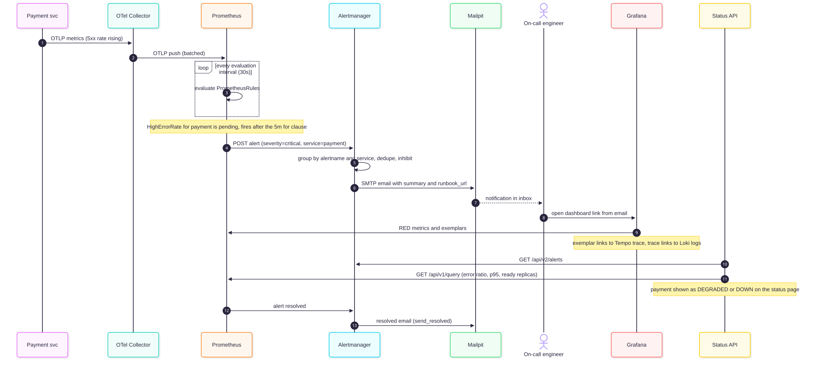
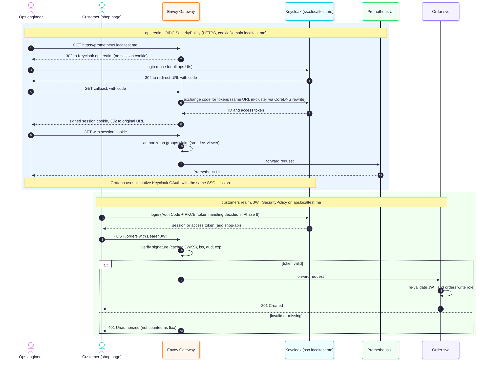

# Diagrams

Each diagram has a Mermaid source (`.mmd`), which GitHub renders when it is embedded in Markdown, and a rendered SVG.
To render an SVG again, run `npx -y @mermaid-js/mermaid-cli -i <name>.mmd -o <name>.svg`.

| Diagram | Source | Rendered | Used in |
|---|---|---|---|
| Architecture overview | [overview.mmd](overview.mmd) | [overview.svg](overview.svg) | [architecture §2](../architecture.md#2-architecture-overview), [README](../../README.md) |
| Telemetry data flow (push and pull) | [telemetry-flow.mmd](telemetry-flow.mmd) | [telemetry-flow.svg](telemetry-flow.svg) | [architecture §4](../architecture.md#4-main-data-flows) |
| Detection and notification sequence | [alerting-sequence.mmd](alerting-sequence.mmd) | [alerting-sequence.svg](alerting-sequence.svg) | [architecture §4, flow 3](../architecture.md#flow-3-detection-and-notification) |
| Identity and SSO sequence | [identity-sso-sequence.mmd](identity-sso-sequence.mmd) | [identity-sso-sequence.svg](identity-sso-sequence.svg) | [architecture §10](../architecture.md#10-security-and-identity) |

