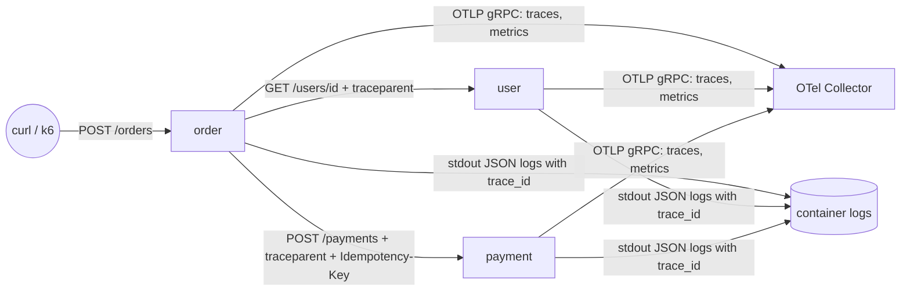

# Services

Three small FastAPI services (Python 3.12) that generate realistic telemetry for the Service Health
Dashboard, a shared library that sets up OpenTelemetry, logging, health probes and fault injection, and
(Phase 4) the [Status API](#status-api) that turns that telemetry into an UP / DEGRADED / DOWN contract.

| Directory | Package | `service.name` | Purpose |
|---|---|---|---|
| `telemetry-lib/` | `shd_telemetry` | – | Shared OTel SDK setup, JSON logs, probes, fault injection, graceful shutdown |
| `user-service/` | `user_service` | `user` | `GET /users/{id}` from a seeded in-memory directory |
| `order-service/` | `order_service` | `order` | `POST /orders`, `GET /orders/{id}`. Calls User, then Payment |
| `payment-service/` | `payment_service` | `payment` | `POST /payments`, idempotent by `Idempotency-Key` |
| `status-api/` | `status_api` | `status-api` | Phase 4: read-only status contract over Prometheus and Alertmanager ([below](#status-api)) |

`service.name` uses the short names (`user`, `order`, `payment`) that the architecture document uses in
queries and in the Status API. Stores are in memory, so there are no database spans and data is lost on restart.



## Quick start

Prerequisites: [uv](https://docs.astral.sh/uv/), and Docker or Podman with a compose provider
(`docker compose`, or `podman compose` with `docker-compose` installed).

```bash
make lint test      # ruff + uv.lock check, pytest
make compose-up     # build images, start the 3 services + OTel Collector
make smoke          # end-to-end check, including the distributed trace
make compose-logs   # follow the Collector debug output
make compose-down
```

`make` uses Podman when it is running, otherwise Docker (`make ENGINE=docker ...` to force).
Host ports (bound to 127.0.0.1): user 8081, order 8082, payment 8083, Collector OTLP 4317/4318, Collector health 13133.

```bash
curl -s -X POST localhost:8082/orders -H 'content-type: application/json' \
  -d '{"user_id":"u-1001","items":[{"sku":"book","quantity":2,"unit_price":"12.50"}],"currency":"EUR"}'
```

Seeded users: `u-1001`, `u-1002`, `u-1003` (active) and `u-1004` (suspended).

## API

| Service | Method and path | Success | Client errors | Server or upstream errors |
|---|---|---|---|---|
| user | `GET /users/{id}` | 200 user | 404 unknown user | 500 (injected fault) |
| user | `GET /users/me` | 200 the signed-in customer's profile, created on first use from the token | 404 without authentication | 500 (injected fault) |
| order | `POST /orders` | 201 order (`confirmed`), `Location` header | 402 payment declined (order `payment_declined`), 422 invalid body, unknown or suspended user, `user_id` missing for a service account | 502, 503, 504 (see below), 500 (injected fault) |
| order | `GET /orders` | 200 newest orders (`limit`, default 20): a customer's own, all for a service account | – | 500 (injected fault) |
| order | `GET /orders/{id}` | 200 order | 404 (also for another customer's order) | 500 (injected fault) |
| payment | `POST /payments` | 201 `approved` | 400 missing `Idempotency-Key`, 402 `declined` (amount above `PAYMENT_APPROVAL_LIMIT`), 422 invalid body, or the key was reused with a different body | 500 (injected fault) |
| user, order, payment | business endpoints with authentication on | – | 401 missing or invalid token, 403 missing role (see [Authentication](#authentication)) | – |
| all | `GET /livez`, `GET /readyz` | 200 | – | `/readyz` 503 when not ready |
| all | `GET`, `PUT`, `DELETE /admin/faults` | 200 current settings | 422 invalid values | – |

OpenAPI docs are at `/docs` on each service.

### How Order handles upstream failures

Order calls User and Payment with `httpx` and explicit timeouts. W3C `traceparent` is injected by the
httpx instrumentation.

| Upstream outcome | Order responds | Stored order status (payment call) |
|---|---|---|
| Connect error, connect timeout or pool timeout (request never sent) | **503** | `payment_failed` |
| Read or write timeout (request may have been processed) | **504** | `payment_unknown` |
| Other transport error, upstream 5xx, or unexpected status | **502** | `payment_unknown` (5xx) or `payment_failed` (4xx) |

When the payment step fails, the order is stored and the 502/503/504 body includes `order_id`, with a
`Location: /orders/<id>` header. The client can then check the order instead of blindly retrying and creating a
second one. Failures while validating the user happen before any order exists, so those responses have no `order_id`.

The User `GET` is idempotent, so the transport retries a failed *connection* once. The Payment `POST` is **never retried
automatically**. It carries `Idempotency-Key: order-<order id>` (following
[draft-ietf-httpapi-idempotency-key-header](https://datatracker.ietf.org/doc/draft-ietf-httpapi-idempotency-key-header/)).
Payment replays the stored result for a repeated key with `Idempotent-Replayed: true` and counts it only once.

**Limits (demo scope):** the key store is an in-memory dict inside each Payment process. The guarantee therefore holds only
while the same Payment instance is running. A restart, a rolling update or a second replica loses or splits the keys.
`POST /orders` also does not accept a client idempotency key yet, so a client retry creates a new order. In production the key
store would be shared and durable (for example a database table with a unique key), and Order would accept a client
`Idempotency-Key` and derive the Payment key from it.

## Authentication

Since Phase 6 the business endpoints require an OAuth 2.0 access token from Keycloak (realm `customers`) when `AUTH_ENABLED=true`,
which the Kubernetes deployment sets. The shared module [`shd_telemetry.auth`](telemetry-lib/src/shd_telemetry/auth.py) provides:

- **Token validation** (FastAPI dependency `current_principal`): `Authorization: Bearer` token, RS256/ES256/PS256 signature with the
  realm's JSON Web Key Set (cached for 5 minutes, refetched at once for an unknown `kid`, at most every 10 s), `iss`, `aud` (any of
  `AUTH_AUDIENCES`), `exp`/`iat` with 30 s leeway. Missing or invalid token: **401** with `WWW-Authenticate: Bearer`. The JWKS is
  fetched from the public issuer URL through the gateway (`AUTH_CA_FILE` = the mkcert CA).
- **Authorization per endpoint** (`authorize`): realm roles (`realm_access.roles`) or client roles (`resource_access.<client>.roles`).
  Valid token without the permission: **403**.
- **Client credentials** (`ClientCredentialsAuth`, an `httpx.Auth`): Order's token for User and Payment, cached until 30 s before it
  expires and renewed once on a 401. If no token can be obtained, Order answers 503 for that upstream.
- **Metrics and traces:** `auth.failures{reason, http.response.status_code}` (Prometheus: `auth_failures_total`); the server span gets
  `enduser.id` and `oauth.client_id`. 401 and 403 are 4xx, so they never count as errors in the RED metrics or the alerts.

| Service | Accepted audience (`aud`) | Permission |
|---|---|---|
| order | `shop-api` | `POST /orders`: realm role `orders:write`; `GET /orders[/{id}]`: `orders:read`. A customer's order always belongs to the token's `sub` (`user_id` in the body must be absent or equal); a service account such as the load generator names the `user_id` |
| user | `shop-api`, `user-service` | `GET /users/{id}`: client role `users:read` of `user-service` (Order, k6), or a customer reading their own profile; `GET /users/me`: customers only |
| payment | `payment-service` | `POST /payments`: client role `payments:write` of `payment-service` (only Order's service account has it) |

Order calls User and Payment with **its own** token, not the customer's, and adds `X-End-User-Sub: <customer sub>`; User and
Payment log it as `enduser.id` (audit), trusting it only from an authenticated service account. Probes, `/admin/faults` and `/docs`
never need a token: they are not routed through the gateway.

| Variable | Meaning |
|---|---|
| `AUTH_ENABLED` | `true` enables validation (default off, e.g. for `make compose-up` and the unit tests) |
| `AUTH_ISSUER`, `AUTH_AUDIENCES`, `AUTH_JWKS_URL`, `AUTH_CA_FILE` | Issuer (`https://sso.localtest.me/realms/customers`), accepted audiences (comma-separated), JWKS URL (default: Keycloak's `<issuer>/protocol/openid-connect/certs`), CA bundle |
| `OAUTH_TOKEN_URL`, `OAUTH_CLIENT_ID`, `OAUTH_CLIENT_SECRET`, `OAUTH_SCOPE` | Client credentials for outbound calls (Order) |

## Health probes and graceful shutdown

| Endpoint | Answers | Checks | Never checks |
|---|---|---|---|
| `/livez` | "Is the process alive?" | The event loop responds | Dependencies, readiness, fault settings |
| `/readyz` | "Can this instance take traffic?" | Startup finished (`starting`), not draining after SIGTERM (`draining`), not forced unready by fault injection (`fault_injected`) | Downstream services. A Payment outage makes Order return 503 for affected requests, but Order stays ready. |

`/readyz` returns `{"status":"ready"}` or 503 with `{"status":"not_ready","reasons":[...]}`. Both probes send
`Cache-Control: no-store`. They are excluded from traces and from HTTP metrics, so probe traffic does not distort the RED metrics.

**SIGTERM:** the server (`shd_telemetry.server.DrainingServer`, a uvicorn subclass) immediately fails
`/readyz`, keeps serving for `SHUTDOWN_DRAIN_SECONDS` so that endpoints are updated, then stops accepting
connections, waits up to `SHUTDOWN_TIMEOUT_SECONDS` for in-flight requests, and flushes telemetry. A second signal skips
the rest of the drain. In Kubernetes (Phase 2) combine this with a short `preStop` sleep and a
`terminationGracePeriodSeconds` greater than drain plus timeout.

## Fault injection

Each service has `/admin/faults` with three settings. They are read from the environment at startup and can be changed at runtime:

| Field | Env default | Range | Effect |
|---|---|---|---|
| `error_rate` | `FAULT_ERROR_RATE` (0) | 0 to 1 | Share of business requests answered with HTTP 500 `{"detail":"Injected fault"}`. The span gets a `fault.injected` event. |
| `latency_ms` | `FAULT_LATENCY_MS` (0) | 0 to 30000 | Delay added before each business request. It is visible in `http.server.request.duration`. |
| `ready` | `FAULT_READY` (true) | bool | `false` makes `/readyz` return 503. `/livez` and traffic are unaffected. |

```bash
curl -X PUT localhost:8083/admin/faults -H 'content-type: application/json' -d '{"error_rate":0.3}'
curl -X PUT localhost:8081/admin/faults -H 'content-type: application/json' -d '{"latency_ms":800}'
curl -X PUT localhost:8081/admin/faults -H 'content-type: application/json' -d '{"ready":false}'
curl -X DELETE localhost:8083/admin/faults    # back to the env defaults
```

`PUT` is a partial update. Unknown fields or out-of-range values return 422. Faults never affect `/livez`,
`/readyz` or `/admin`.

> **Security:** `/admin/faults` has no authentication. It is for demos only and **must not be reachable
> from outside the cluster**. Phase 2 routes only business paths through the gateway and restricts `/admin` with
> NetworkPolicy. Phase 6 adds authentication. In compose, ports are bound to 127.0.0.1 only.

## Telemetry

`shd_telemetry.configure_telemetry()` creates the tracer, meter and (optional) logger providers. They are configured with
the [standard `OTEL_*` variables](https://opentelemetry.io/docs/specs/otel/configuration/sdk-environment-variables/).

- **Resource:** `service.name`, `service.version`, `service.instance.id` (a UUID for each process), `deployment.environment.name`
  (default `local`). `OTEL_SERVICE_NAME` and `OTEL_RESOURCE_ATTRIBUTES` override them (Phase 2 sets the pod UID and namespace).
- **Traces:** FastAPI server spans and httpx client spans, W3C Trace Context with parent-based always-on sampling (SDK defaults).
  The per-message ASGI `http send/receive` spans are disabled.
- **HTTP metrics:** the stable HTTP semantic conventions, `http.server.request.duration` and `http.client.request.duration`
  (seconds, buckets 5 ms to 10 s). In `opentelemetry-instrumentation-*` 0.66b2 they are still **opt-in**, and the default is the old
  `http.server.duration` in ms. The library therefore sets `OTEL_SEMCONV_STABILITY_OPT_IN=http` (which the image also sets) before
  instrumenting. See the [HTTP semconv migration guide](https://opentelemetry.io/docs/specs/semconv/non-normative/http-migration/). A test asserts that no
  old-style metric is emitted.
- **Business metrics** (attributes have low cardinality: never user, order or payment IDs. `currency` is an allow-list of
  `EUR`, `USD` and `GBP` in both APIs, so clients cannot create new series):

  | OTel instrument | Type, unit | Attributes | Prometheus name after OTLP translation |
  |---|---|---|---|
  | `orders.created` | Counter, `{order}` | – | `orders_created_total` |
  | `payments.processed` | Counter, `{payment}` | `result` = `approved` or `declined` | `payments_processed_total{result}` |
  | `payment.amount` | Histogram, `{currency_unit}`, buckets 5 to 10000 | `currency`, `result` | `payment_amount_bucket` / `_sum` / `_count` |

  The OTel names follow the [metric naming rules](https://opentelemetry.io/docs/specs/semconv/general/naming/) (no `_total` and no unit in the
  name). Prometheus adds `_total` and drops `{annotation}` units, which gives the names used in the plan.
- **Logs:** JSON on stdout, one object per line: `timestamp`, `level`, `logger`, `message`, `service.name`,
  `trace_id`, `span_id`, `trace_sampled`, plus `extra=` fields (for example `order.id`, `http.route`, `duration_ms`). Trace context
  comes from `opentelemetry-instrumentation-logging`. Each business request writes one `request completed` access log line inside its span.
  In Kubernetes the Collector's `filelog` receiver collects stdout (ADR 0001/0002), so **OTLP log export is off by default**
  (`OTEL_LOGS_EXPORTER=none`). Compose sets `OTEL_LOGS_EXPORTER=otlp` because it has no filelog receiver.

### Environment variables

| Variable | Default | Used by |
|---|---|---|
| `OTEL_EXPORTER_OTLP_ENDPOINT` | `http://localhost:4317` (SDK default) | all |
| `OTEL_EXPORTER_OTLP_PROTOCOL` (also per signal) | `grpc` | all; `http/protobuf` is supported |
| `OTEL_TRACES_EXPORTER` / `OTEL_METRICS_EXPORTER` | `otlp` | all; `console` and `none` are also accepted |
| `OTEL_LOGS_EXPORTER` | `none` | all; `otlp` or `console` to also export logs over OTLP |
| `OTEL_METRIC_EXPORT_INTERVAL` | 60000 ms (compose: 10000) | all |
| `OTEL_SERVICE_NAME`, `OTEL_RESOURCE_ATTRIBUTES` | – | all |
| `OTEL_SEMCONV_STABILITY_OPT_IN` | `http` | all |
| `LOG_LEVEL` | `INFO` | all |
| `HOST`, `PORT` | `0.0.0.0`, `8080` | all |
| `SHUTDOWN_DRAIN_SECONDS` | 5 (compose: 2) | all |
| `SHUTDOWN_TIMEOUT_SECONDS` | 10 | all |
| `FAULT_ERROR_RATE`, `FAULT_LATENCY_MS`, `FAULT_READY` | 0, 0, true | all |
| `USER_SERVICE_URL`, `PAYMENT_SERVICE_URL` | `http://localhost:8081`, `http://localhost:8083` | order |
| `USER_SERVICE_TIMEOUT_SECONDS`, `PAYMENT_SERVICE_TIMEOUT_SECONDS` | 2, 3 | order |
| `UPSTREAM_CONNECT_TIMEOUT_SECONDS` | 1 | order |
| `PAYMENT_APPROVAL_LIMIT` | 5000 | payment |

## Status API

`status-api/` is the backend for frontend of the status page
([architecture §8](../docs/architecture.md#8-status-api-contract)). It uses `shd_telemetry` like the other services (OTel traces and
metrics, JSON logs, `/livez`, `/readyz`, graceful shutdown), queries the
[Prometheus HTTP API](https://prometheus.io/docs/prometheus/latest/querying/api/) (`/api/v1/query`, `/api/v1/query_range`) and the
[Alertmanager v2 API](https://github.com/prometheus/alertmanager/blob/main/api/v2/openapi.yaml) (`/api/v2/alerts?active=true&silenced=false&inhibited=false`)
with an instrumented `httpx` client, and serves the result read-only. OpenAPI docs: `/docs` (cluster-internal only).

| Method and path | Response |
|---|---|
| `GET /api/v1/services` | `ServicesResponse` (below), `Cache-Control: no-store` |
| `GET /api/v1/services/{name}` | One `ServiceStatus`; 404 for a name that is not configured |
| `GET /api/v1/alerts` | `{"alerts": [Alert], "source": Source, "generated_at"}`: active alerts, critical first, without `severity` `none`/`info` |
| `GET /livez`, `GET /readyz` | Probes. `/readyz` never depends on Prometheus or Alertmanager: the API keeps answering (with `UNKNOWN`) when they are down |

```jsonc
{
  "status": "DEGRADED",                        // worst service status: DOWN > DEGRADED > UNKNOWN > UP
  "services": [{
    "name": "payment",
    "status": "DEGRADED",                      // UP | DEGRADED | DOWN | UNKNOWN
    "reasons": ["5xx error ratio 7.8% > 5.0% (5m)"],   // empty when UP, worst first
    "metrics": {
      "probe_success": true,                   // blackbox GET /readyz (null: no probe result)
      "ready_replicas": 1, "desired_replicas": 1,      // kube-state-metrics
      "rps": 2.0,                              // requests/s, 5 m; /admin excluded
      "error_ratio_5m": 0.0781,                // share of 5xx (0-1), 5 m; null without traffic
      "latency_p95_ms": 4.9                    // p95 of http.server.request.duration, 5 m
    },
    "series": {                                // last 30 min, 1-min step, 1-min windows (sparklines)
      "rps": [{"t": 1793485800, "v": 2.0}], "error_ratio": [...], "latency_p95_ms": [...]
    },
    "alerts": [],                              // this service's active alerts (Alert, below)
    "links": {"dashboard": "https://grafana.localtest.me/d/shd-service-detail/service-detail?var-service=payment"},
    "updated_at": "2026-10-31T22:31:15Z"       // last successful Prometheus read (kept while it is down)
  }],
  "sources": {                                 // health of the two backends
    "prometheus":   {"status": "ok", "error": null, "last_success_at": "..."},
    "alertmanager": {"status": "unavailable", "error": "alertmanager: ConnectError", "last_success_at": "..."}
  },
  "thresholds": {"error_ratio": 0.05, "latency_p95_ms": 500.0},
  "links": {"grafana": "https://grafana.localtest.me", "overview_dashboard": "https://grafana.localtest.me/d/shd-overview/service-health-overview"},
  "generated_at": "2026-10-31T22:31:15Z"
}
```

`Alert`: `name`, `service` (or `null` when the alert is not about one of the services), `severity`, `summary`, `description`,
`runbook_url`, `starts_at`. An alert belongs to a service through its `service` (or `service_name`) label, or for generic
Kubernetes rules through `namespace` plus `deployment` or `container`, so the Phase 5 rules need no changes in the API.

**Status rules** (`status_api/rules.py`, all evaluated, worst wins): `DOWN` if the probe fails or a `critical` alert fires;
`DEGRADED` if a `warning` alert fires, the 5xx ratio is above 5% or p95 above 500 ms over 5 minutes, or fewer replicas are ready
than desired; `UNKNOWN` if Prometheus is unreachable or there is no probe result; otherwise `UP`. The thresholds are those of
the alert rules. The PromQL is in `status_api/queries.py`; the Grafana dashboards use the same expressions.

**Protecting the backends.** One snapshot (6 instant and 3 range queries, plus one Alertmanager call, all concurrent) is cached
for `CACHE_TTL_SECONDS`; concurrent requests during a refresh wait for the same refresh (single flight). Every call has a
`QUERY_TIMEOUT_SECONDS` timeout, also passed to Prometheus as `timeout`. Any network error, timeout, HTTP error or error payload
marks that source `unavailable` instead of failing the request.

| Variable | Default (chart value) |
|---|---|
| `PROMETHEUS_URL` | `http://localhost:9090` (`http://kps-prometheus.observability.svc:9090`) |
| `ALERTMANAGER_URL` | `http://localhost:9093` (`http://kps-alertmanager.observability.svc:9093`) |
| `STATUS_SERVICES`, `STATUS_NAMESPACE` | `user,order,payment`, `apps`. Names must match `^[a-z0-9][a-z0-9-]*$` (they go into PromQL) |
| `CACHE_TTL_SECONDS`, `QUERY_TIMEOUT_SECONDS` | 10, 3 |
| `ERROR_RATIO_THRESHOLD`, `LATENCY_P95_THRESHOLD_MS` | 0.05, 500 |
| `SERIES_MINUTES`, `SERIES_STEP_SECONDS` | 30, 60 |
| `GRAFANA_URL` | `https://grafana.localtest.me` |

Run it against the cluster: `kubectl -n observability port-forward svc/kps-prometheus 9090` (and `svc/kps-alertmanager 9093`), then
`OTEL_TRACES_EXPORTER=none OTEL_METRICS_EXPORTER=none uv run status-api`. Tests (`tests/test_status_api.py`, 37 cases) replace both backends with
an `httpx.MockTransport`: every rule, unreachable, failing or malformed backends (UNKNOWN, never 500), stale data, the cache TTL and single flight,
alert matching, and PromQL-injection-safe settings.

The status page that consumes this API is in [`web/`](../web/README.md).

## Container images

A single multi-stage `services/Dockerfile` builds every service, including the Status API, (`--build-arg SERVICE=<dir>`; the build context is the repository root):

- The builder stage uses `uv sync --frozen --no-dev --no-editable`. Dependencies are installed in their own cached layer, and the workspace
  packages are installed as wheels. Only `/app/.venv` is copied into the runtime stage, so there are no sources, no build tools and no dev dependencies.
- The runtime stage uses `python:3.12-slim` (multi-arch, works on arm64), runs as non-root UID/GID 10001, has root-owned read-only application files, and sets
  `PYTHONDONTWRITEBYTECODE` (bytecode is precompiled), so it **runs with a read-only root filesystem**. Compose uses
  `read_only: true`, `cap_drop: [ALL]` and `no-new-privileges`. There is no `HEALTHCHECK`, because Kubernetes probes are used instead.
- `.dockerignore` is an allow-list: only the workspace manifests, `uv.lock` and `services/*/src` are in the build context.
- Image size is about 200 MB (arm64), mostly CPython plus `grpcio`.

## Development

The services form one [uv workspace](https://docs.astral.sh/uv/concepts/projects/workspaces/) (root `pyproject.toml` and a single `uv.lock`).

```bash
uv sync --all-packages                      # create .venv with all services and dev tools
uv run pytest services/order-service        # one service
OTEL_TRACES_EXPORTER=console OTEL_METRICS_EXPORTER=none PORT=8081 uv run user-service
```

The tests use in-memory span and metric exporters (`shd_telemetry.testing`). The Order tests run the real User and
Payment apps in-process over `httpx.ASGITransport`, with an isolated OTel context. This proves that the trace is linked
**through the `traceparent` header**, not through shared in-process context. The tests cover business logic, fault injection, probe
semantics (including readiness while draining), the mapping of upstream failures, idempotency, metric attributes and JSON log correlation.

### Troubleshooting

- **`docker-credential-desktop: executable file not found`** from `podman compose`: a leftover Docker Desktop
  `credsStore` entry in `~/.docker/config.json`. `make compose-up` avoids it by building and pulling with the engine CLI and running
  `compose up --no-build`.
- **uv DNS errors (`failed to lookup address information: Try again`) in a Podman build:** the static musl `uv`
  binary from `ghcr.io/astral-sh/uv` cannot resolve names through the Podman machine's gvproxy DNS. The Dockerfile installs
  the glibc `uv` wheel from PyPI instead.
