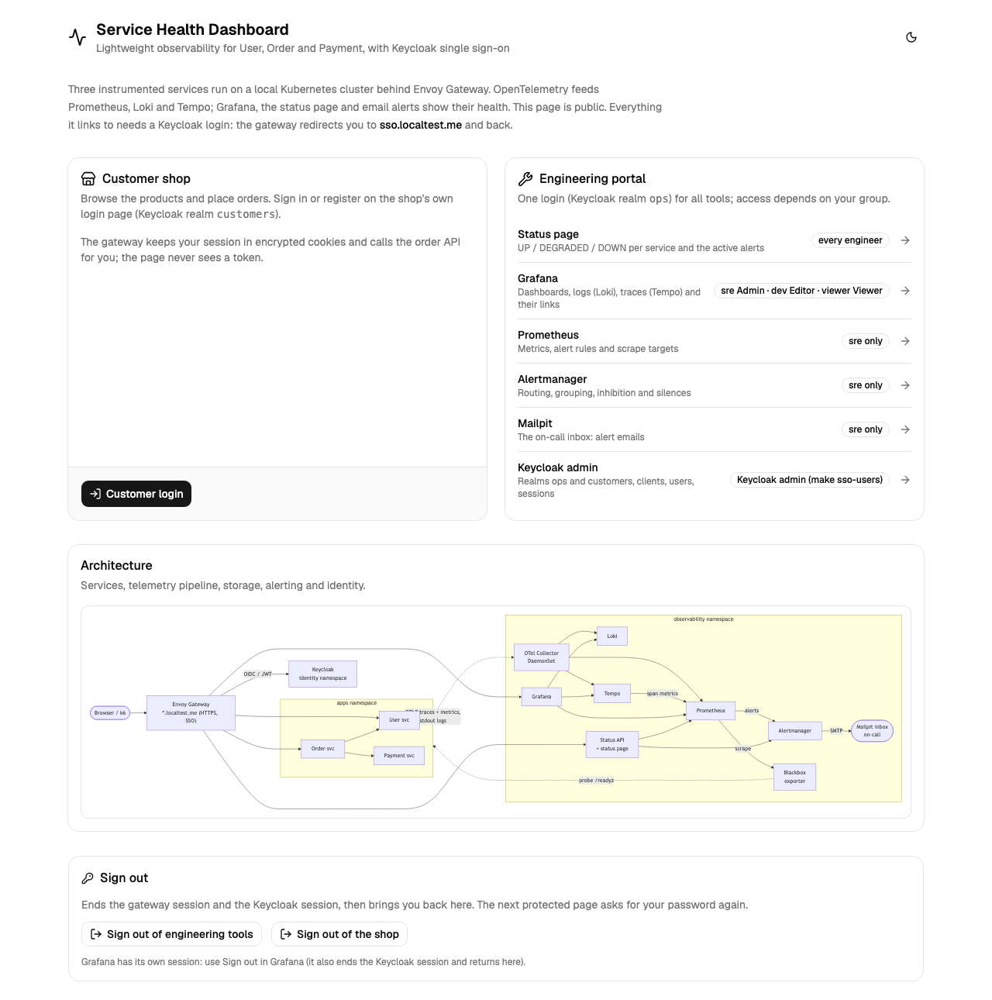
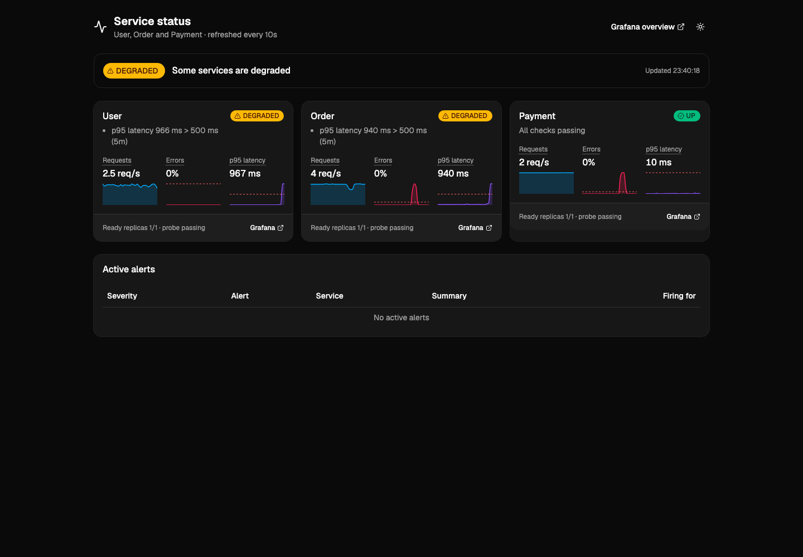
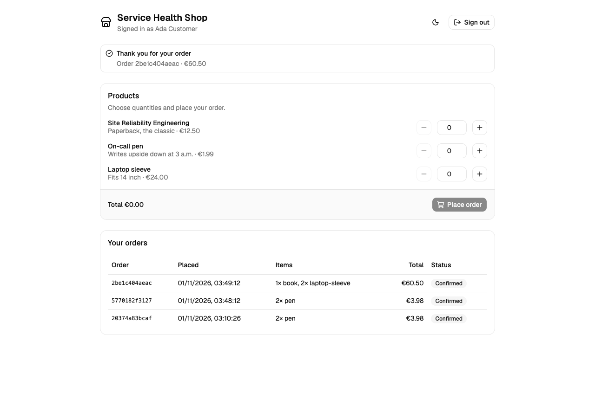
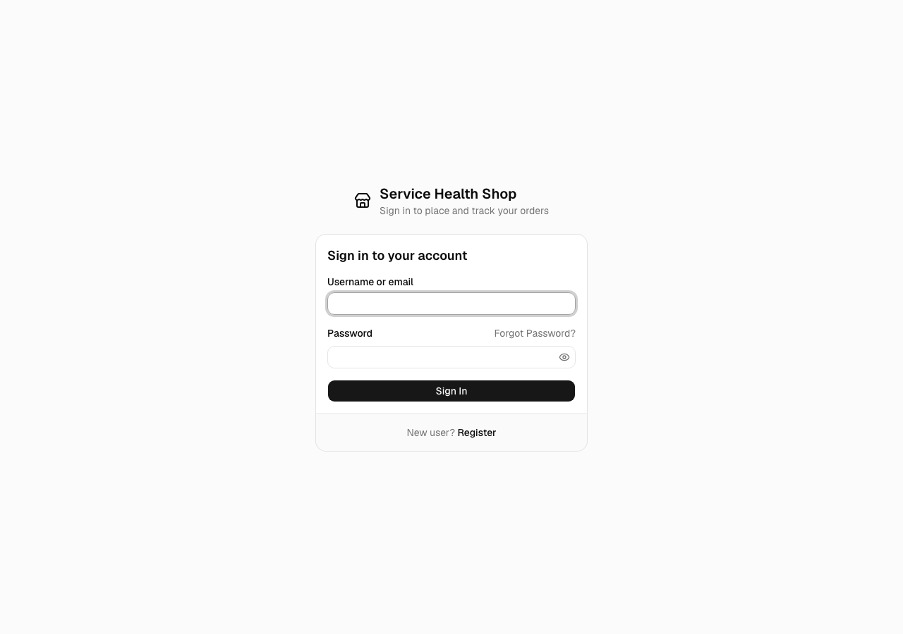

# Web frontends (pnpm monorepo)

React, TypeScript, Vite, Tailwind CSS and [shadcn/ui](https://ui.shadcn.com/docs/installation/vite).
Scaffolded with the official CLI, `shadcn@4.23.0 init -t vite --monorepo -b radix -p nova`, and built with turbo.

| Path | What |
|---|---|
| `apps/status` | Status page on https://status.localtest.me (engineers, `ops` realm) |
| `apps/shop` | Customer shop on https://shop.localtest.me (`customers` realm) |
| `apps/home` | Public landing page on https://home.localtest.me: Customer login, engineering tools, sign-out buttons |
| `apps/keycloak-theme` | Keycloakify login theme `shd-shop` of the `customers` realm (packaged as a JAR into the Keycloak image) |
| `packages/ui` (`@workspace/ui`) | Shared shadcn/ui components (Card, Badge, Table, Alert, Tooltip, Chart, Skeleton, Button, Input, Label), styles and `cn` |

The apps leave sign-in to the gateway: Envoy Gateway's OIDC filter logs the user in with Keycloak and keeps the session in
encrypted, HTTP-only cookies, so **no token is ever visible to JavaScript** (the backend-for-frontend pattern of
[OAuth 2.0 for Browser-Based Apps](https://datatracker.ietf.org/doc/draft-ietf-oauth-browser-based-apps/)). Their `fetch()` calls
send `X-Requested-With: fetch`, for which the gateway answers a missing or expired session with 401 instead of a login redirect; the
apps then offer to sign in. Sign-out is the gateway's `/oauth2/logout`, which also ends the Keycloak session and lands on the landing
page ([deploy/README.md](../deploy/README.md#landing-page-login-and-logout-phase-6b)).

## Landing page



Public, no API. **Customer login** is a full-page link to `https://shop.localtest.me/`, which the gateway sends to Keycloak's branded
`customers` login; the engineering cards link to the status page, Grafana, Prometheus, Alertmanager, Mailpit and the Keycloak admin
console; two buttons sign out of the engineers' tools (`https://status.localtest.me/oauth2/logout`) and of the shop. The architecture
diagram is [`../docs/diagrams/overview.svg`](../docs/diagrams/overview.svg), copied to `apps/home/public/architecture.svg`.

## Status page



- Polls `GET /api/v1/services` and `GET /api/v1/alerts` every 10 s (TanStack Query), on the **same origin**: the gateway routes
  `/api` on `status.localtest.me` to the Status API, so there is no CORS and no API URL in the bundle. The contract is in
  [services/README.md](../services/README.md#status-api).
- One card per service: status badge (icon + word, not colour alone), reasons, RPS / 5xx % / p95 with 30-minute sparklines
  (shadcn Charts on Recharts; dashed line = alert threshold), ready replicas and probe, and a link to its Grafana Service Detail
  dashboard. An overall banner (`aria-live`), an active-alerts table, and warnings when the API or one of its sources is unreachable
  (the last answer stays visible).
- Dark mode: follows the system, toggle in the header (or press `d`).
- Sign-in: the page itself is public. Without a gateway session `/api` answers 401 and the page shows **Login** (a full-page link
  to `/login`, which runs the Keycloak login and comes back); with a session, also one from Prometheus, Alertmanager or Mailpit (same
  cookies), the data shows at once. The header then shows "Signed in as *name* (*groups*)" from `GET /api/v1/me` and **Logout**.

## Shop



- `GET /api/me` (→ User `GET /users/me`) shows who is signed in; the User service creates the profile from the token on first use.
- A product list with quantities and the total, `POST /api/orders` (→ Order `POST /orders`, without `user_id`: the order belongs to the
  token's subject), and the customer's orders from `GET /api/orders`. The gateway adds the customer's access token to both routes.
- Results: confirmed, payment declined (402) or an error message; dark mode like the status page.

## Keycloak login theme (customers realm)



- `apps/keycloak-theme` is the login theme `shd-shop`, built with [Keycloakify](https://docs.keycloakify.dev) 11.16: React pages with the
  shop's shadcn/ui components and Tailwind tokens from `@workspace/ui`, the "Service Health Shop" brand, light/dark from
  `prefers-color-scheme`, and Keycloak's form field names and ids unchanged. Custom pages: login, register, reset password, update
  password, error, info, logout confirmation; the other login pages use Keycloakify's default pages with the same class map
  (`src/login/classes.ts`). The `ops` realm keeps Keycloak's default theme.
- `pnpm --filter keycloak-theme build` is the plain Vite build (part of `make web-check`); `build-keycloak-theme` also packages it
  with Maven into `dist_keycloak/keycloak-theme-for-kc-all-other-versions.jar`, the JAR for Keycloak 26 (needs a JDK and Maven, so
  `make images` runs it in a container).
- [`../deploy/keycloak/Dockerfile`](../deploy/keycloak/Dockerfile) (build context `web/`) builds the JAR in a Node + JDK + Maven stage,
  copies it to `/opt/keycloak/providers/` and runs `kc.sh build` with the build-time options the Keycloak Operator sets (database,
  features, health, metrics, user event metrics, tracing), because the operator starts a custom image with `start --optimized`.
- `pnpm --filter keycloak-theme dev` previews the pages with mock contexts (`src/login/mocks.ts`).

## Development

Node ≥ 20.19 and pnpm 12 (`brew install pnpm`, or `npm i -g pnpm@12`).

```bash
make web-check        # pnpm install --frozen-lockfile, Prettier check, ESLint, tsc, Vitest, vite build (all apps, incl. the theme)
make verify-browser   # Playwright flows (e2e/) against the running cluster: landing page, logins, logouts, branded login
make web-dev          # status page dev server; /api is proxied to STATUS_API_URL (default http://localhost:8080, `uv run status-api`)
cd web && pnpm --filter shop dev   # shop dev server; /api/orders is proxied to ORDER_API_URL (default http://localhost:8082)
```

Add shadcn components from `web/`: `pnpm dlx shadcn@latest add <component> -c apps/status` (they land in `packages/ui`).
If the CLI fails with `unable to get local issuer certificate` (Node's bundled CA store vs. your network), run it with
`NODE_EXTRA_CA_CERTS=/etc/ssl/cert.pem` (macOS system CAs).

## Image

[`Dockerfile`](Dockerfile) (context `web/`, `--build-arg APP=status` or `APP=shop`): pnpm install and `vite build` on `node:24-slim`, then the
static files on `nginxinc/nginx-unprivileged` (UID 101, port 8080, ~63 MB). [`nginx.conf`](nginx.conf): SPA fallback, immutable
caching for hashed `/assets`, `no-cache` for `index.html`, security headers (CSP, `nosniff`, `frame-ancestors 'none'`), `/livez`
and `/readyz`. It runs with a read-only root filesystem; only `/tmp` (emptyDir) is writable. `make images` builds and loads it.
